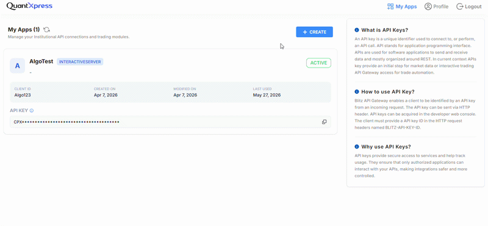
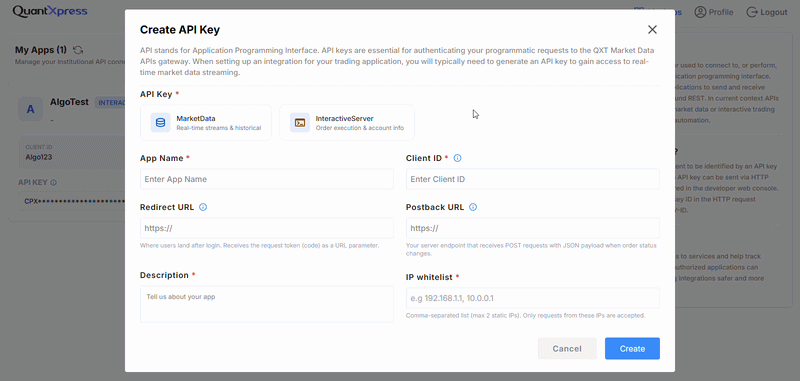
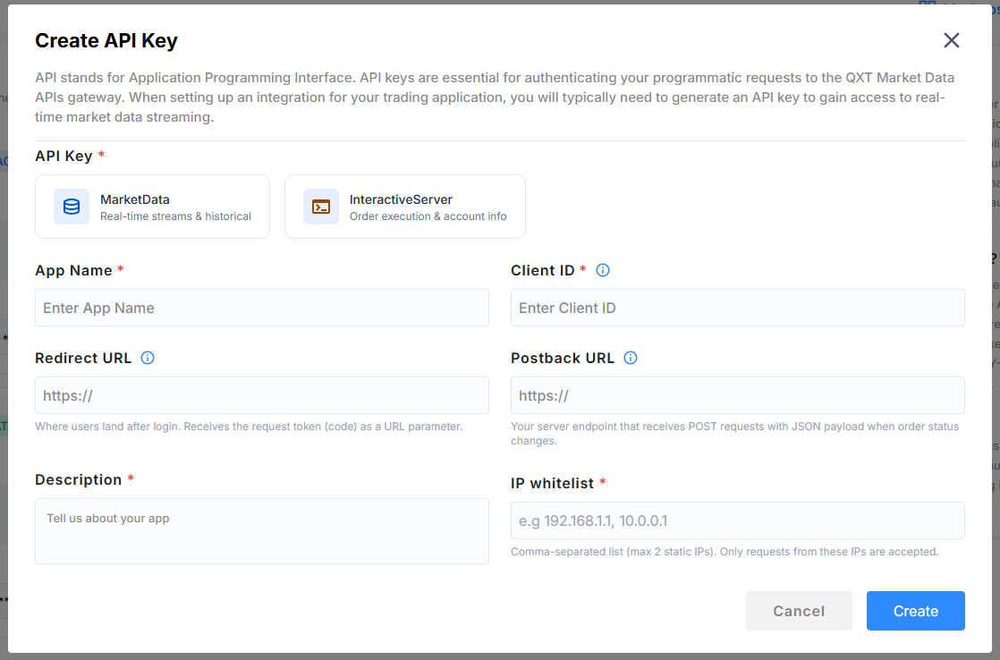
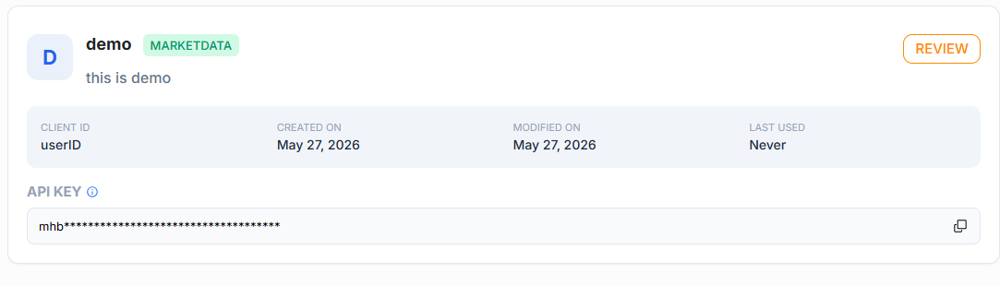
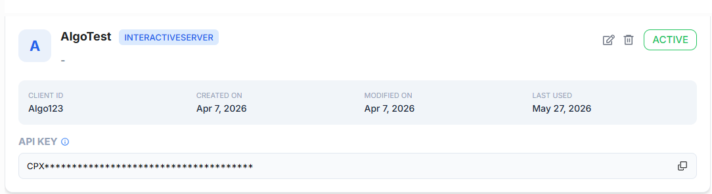

# Generating an API Key

API Keys are required for secure, programmatic access to the **BlitzTrader Gateway**. This guide explains every step in detail, from account prerequisites to generating your API Key and managing your applications.

!!! tip "**Good to Know**"
    You need to be logged into your account to view the "My Apps" section, generate new keys, or manage existing ones.

---

## Prerequisites Before You Start

Before creating an API key, ensure the following:

### Active BlitzTrader Account

You must already have verified BlitzTrader account.

---

## Step-by-Step Guide

### Step 1: Visit the API Management Portal

Once you've logged into the BlitzTrader Portal, navigate to the **API Management** or **My Apps** section in your account dashboard.

---

### Step 2: Create a New App

To generate an API key, you must create an "App". This App represents your software or platform connecting to BlitzTrader.

1. Click the **Create** button.
2. You will see an App Creation form. Fill in the required fields:

   

   - **API Key Type**: Choose the type of access your app requires:
     - `MarketData`: For fetching live and historical market data.
     - `InteractiveServer`: For placing orders, managing positions, and trading operations.

       

   - **App Name**: Any descriptive name for your application (e.g., `My Algo Trading App`). This name is only for identification.
   - **Client ID**: Provide a unique client identifier for your application.
   - **Redirect URL**: The web address the system redirects to after successful login. *(Example: `https://yourdomain.com/callback`)*
   - **Postback URL**: Specify this if your application requires automated notifications for order updates or trades.
   - **Description**: A short explanation of what your app does.
   - **IP whitelist**: Only requests from these IPs are accepted. Add the IP addresses that are allowed to call the API. See [IP Whitelisting](ipWhitelist.md) for full details.

3. Click **Create API Key**.

!!! Important "Key Status"
    After creating API Key contact the Admin to active it. You can see the status at the top right corner of the key

    

---

### Step 3: Secure Your API Key

Once the app is created and active, the system will generate and display your new API Key.

!!! warning "**Security Warning**"
    Your API Key will only be displayed once. **Copy and store it securely.** Treat this key like a password—never share it publicly or save it where others can access it.

---

## How to Use Your API Key

Once generated, you can use the API Key to generate the Access Token.

---

## Managing Your API Keys

You can view, edit, or delete API keys anytime through the **API Management** page:

- **Edit** – Modify settings like the app name, redirect URL, IP whitelist, or description.
- **Delete** – Permanently remove an API key when it is no longer needed. *(Note: Any active applications using a deleted key will immediately lose access.)*

To manage or update the IP addresses allowed to access your app, refer to the [IP Whitelisting](ipWhitelist.md) guide.

---

## Best Practices & Common Mistakes

### Best Practices

- **Store keys securely:** Keep your keys in a safe, private location.
- **Separate Keys:** Generate different keys for different applications to keep your connections organized and secure.

### Common Mistakes to Avoid

- Sharing your API key with unauthorized individuals.
- Providing an incorrect Redirect URL, which can cause connection failures.
