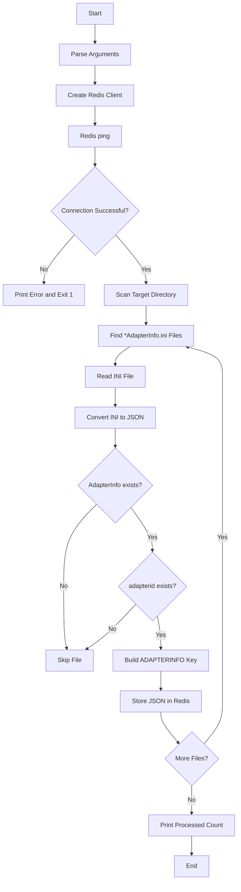

# Adapter INI to Redis Script

## 1. Purpose

This script scans a directory for files ending with:

```text
AdapterInfo.ini
```

For each matching file it:

1. Reads the INI content.
2. Converts the INI sections and values into a JSON object.
3. Reads `AdapterInfo.adapterid`.
4. Builds the Redis key:
   `ADAPTERINFO:<adapterid>`
5. Stores the JSON content in Redis.

---

## 2. Execution Flow



---

## 3. Redis Configuration

The script reads Redis configuration using:

```python
get("redis", ...)
```

Arguments:

```text
--redis_host
--redis_port
--redis_db
```

Defaults:

```text
redis_host = localhost
redis_port = 6379
redis_db   = 0
```

The Redis client is created with:

```python
redis.Redis(
    host=REDIS_HOST,
    port=REDIS_PORT,
    db=REDIS_DB,
    decode_responses=True
)
```

---

## 4. Redis Connection

The script tests the Redis connection using:

```python
r.ping()
```

Successful connection:

```text
Successfully connected to Redis
```

If the connection fails:

```text
Error: Could not connect to Redis...
```

The script exits with:

```text
exit code 1
```

---

## 5. Target Directory

The directory is controlled by:

```text
--directory
```

Default:

```text
adapter_configs
```

Example:

```bash
python script.py --directory /path/to/adapter_configs
```

The script checks:

```python
os.path.isdir(directory_path)
```

If the directory does not exist, processing stops.

---

## 6. File Selection

The script scans the directory using:

```python
os.listdir(directory_path)
```

Only files whose names end with:

```text
AdapterInfo.ini
```

are processed.

Example matching files:

```text
NSEAdapterInfo.ini
BSEAdapterInfo.ini
TestAdapterInfo.ini
```

Other files are ignored.

---

# INI to JSON Conversion

## 7. `convert_ini_to_json()`

```python
convert_ini_to_json(ini_filepath)
```

Creates a `ConfigParser`:

```python
configparser.ConfigParser()
```

and reads the INI file.

For every INI section:

```python
json_data[section] = {}
```

Every key/value pair in that section is added to the corresponding JSON object.

---

## 8. Conversion Example

Input:

```ini
[AdapterInfo]
adapterid = NSE
name = TestAdapter

[Connection]
host = 127.0.0.1
port = 5000
```

Converted JSON object:

```json
{
    "AdapterInfo": {
        "adapterid": "NSE",
        "name": "TestAdapter"
    },
    "Connection": {
        "host": "127.0.0.1",
        "port": "5000"
    }
}
```

The function returns the JSON data as a Python dictionary.

---

## 9. INI Conversion Errors

The function handles:

```python
configparser.Error
```

and unexpected exceptions.

On error it prints the error and returns:

```python
None
```

The corresponding INI file is then skipped.

---

# Redis Key Creation

## 10. `store_json_in_redis()`

```python
store_json_in_redis(
    redis_client,
    file_name,
    json_content
)
```

Before storing the JSON, the script checks for:

```text
AdapterInfo
```

and:

```text
AdapterInfo.adapterid
```

---

## 11. `AdapterInfo` Validation

The script checks:

```python
json_content.get('AdapterInfo')
```

If the section does not exist:

```text
AdapterInfo section not found
```

The file is not stored.

---

## 12. `adapterid` Validation

The script checks:

```python
json_content.get('AdapterInfo').get('adapterid')
```

If the field is missing:

```text
AdapterID field not found
```

The file is not stored.

---

## 13. Redis Key

The key is generated from `adapterid`:

```python
key = "ADAPTERINFO:" + key
```

The final Redis key is stored using:

```python
key.upper()
```

Example:

```text
adapterid = NSEFO
```

Redis key:

```text
ADAPTERINFO:NSEFO
```

---

## 14. JSON Storage

The Python dictionary is converted into a JSON string:

```python
json.dumps(json_content, indent=4)
```

Then stored using:

```python
redis_client.set(key.upper(), json_string)
```

Redis contains:

```text
Key:
ADAPTERINFO:NSEFO

Value:
JSON representation of the AdapterInfo INI file
```

---

## 15. Redis Storage Result

Successful storage prints:

```text
Successfully stored 'ADAPTERINFO:NSEFO' in Redis.
```

Redis errors are handled using:

```python
redis.RedisError
```

and the function returns:

```python
False
```

Successful storage returns:

```python
True
```

---

# Directory Processing

## 16. `process_adapter_ini_files()`

```python
process_adapter_ini_files(directory_path, redis_client)
```

This function performs the complete file processing loop.

For every matching `*AdapterInfo.ini` file:

```text
Find file
   ↓
Convert INI to JSON
   ↓
Validate AdapterInfo
   ↓
Validate adapterid
   ↓
Create Redis key
   ↓
Store JSON in Redis
```

---

## 17. Processed File Count

The script maintains:

```python
processed_count = 0
```

The count increases only when:

```python
store_json_in_redis(...)
```

returns:

```python
True
```

At the end it prints:

```text
Total files processed and stored in Redis: <count>
```

---

# Command-Line Arguments

## 18. Arguments

| Argument | Default | Function |
|---|---|---|
| `--redis_host` | `localhost` | Redis host |
| `--redis_port` | `6379` | Redis port |
| `--redis_db` | `0` | Redis database |
| `--directory` | `adapter_configs` | Directory containing `*AdapterInfo.ini` files |

---

## 19. Examples

### Default configuration

```bash
python script.py
```

Uses:

```text
Redis → localhost:6379/0
Directory → adapter_configs
```

### Custom directory

```bash
python script.py --directory /data/adapter_configs
```

### Custom Redis

```bash
python script.py     --redis_host 127.0.0.1     --redis_port 6379     --redis_db 1     --directory /data/adapter_configs
```

---

# Error Handling

## 20. Directory Errors

If the target directory does not exist:

```text
Error: Directory '<directory>' not found.
```

Processing stops.

---

## 21. File Errors

If an INI file cannot be converted, it is skipped.

The script prints:

```text
Skipping '<filename>' due to conversion error.
```

---

## 22. Redis Errors

Redis connection errors cause the program to exit with:

```text
exit code 1
```

Redis errors while storing individual files are logged and that file is not counted as successfully stored.

---

# Function Reference

## 23. Functions

| Function | Functionality |
|---|---|
| `convert_ini_to_json()` | Reads an INI file and converts it to a Python dictionary representing JSON |
| `store_json_in_redis()` | Validates `AdapterInfo.adapterid`, builds the Redis key, and stores JSON |
| `process_adapter_ini_files()` | Finds matching INI files and processes each one |
| Main block | Parses arguments, connects to Redis, and starts directory processing |

---

# Functional Summary

## 24. Complete Flow

```text
Start
  ↓
Read Redis configuration
  ↓
Connect to Redis
  ↓
PING Redis
  ↓
Check adapter_configs directory
  ↓
Find files ending with AdapterInfo.ini
  ↓
For each file:
    ↓
Read INI
    ↓
Convert to JSON dictionary
    ↓
Check AdapterInfo section
    ↓
Check adapterid
    ↓
Create ADAPTERINFO:<adapterid>
    ↓
Store JSON in Redis
    ↓
Continue with next file
  ↓
Print processed count
  ↓
End
```

## 25. Redis Data

For an INI file containing:

```ini
[AdapterInfo]
adapterid = NSEFO
```

the script stores:

```text
Redis Key:
ADAPTERINFO:NSEFO
```

and the value is the complete JSON representation of the INI file.
