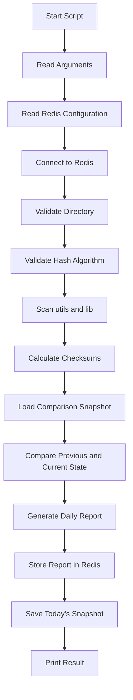

# Checksum Tracker

## 1. Purpose

`checksum_tracker.py` is used to track file integrity by calculating checksums for files, comparing the current state with a previous checksum snapshot, and identifying file changes.

The script:

* Scans the `utils` and `lib` directories under the supplied root directory.
* Calculates a checksum for each included file.
* Detects `NEW`, `CHANGED`, `UNCHANGED`, and `REMOVED` files.
* Maintains one checksum snapshot per date.
* Uses today's snapshot for repeated runs on the same day.
* Uses the latest previous snapshot when today's snapshot does not exist.
* Creates a daily JSON change report.
* Includes only `NEW`, `CHANGED`, and `REMOVED` files in the report's `changes` list.
* Stores the complete report in Redis.
* Saves the complete current checksum state as the daily snapshot.

The default checksum algorithm is SHA-256. The script also allows another algorithm to be supplied through the command line.

---

## 2. Functional Flow



The script executes the process in four main operational stages:

1. Scan the current files.
2. Load the appropriate previous checksum state.
3. Compare the current state and generate the report.
4. Save the current state as today's snapshot.

---

## 3. Directory and File Handling

### 3.1 Default Directories

The script uses the following default directories:

```text
checksums/
checksum_reports/
```

`checksums/` contains daily checksum snapshots.

`checksum_reports/` contains daily change reports.

These locations can be changed using command-line arguments.

### 3.2 Directories Excluded From Scanning

The script defines the following excluded directories:

```text
logs
downloads
backups
checksum_reports
checksums
__pycache__
```

These directories are removed from the directory traversal and are not included in checksum calculation.

### 3.3 Files Excluded From Scanning

The following file is explicitly excluded:

```text
changes.json
```

The scanner also excludes all files whose extension is `.log`, regardless of letter case.

For example:

```text
application.log
APPLICATION.LOG
server.Log
```

are all skipped.

### 3.4 Scanned Directories

The scanner does **not** scan every directory under the supplied root.

Only these directories are allowed:

```text
utils
lib
```

Therefore, if the supplied directory is:

```text
/home/Devops/Blitz
```

the scanner processes:

```text
/home/Devops/Blitz/utils
/home/Devops/Blitz/lib
```

Other top-level directories are not scanned.

---

## 4. Checksum Calculation

The script calculates checksums using Python's `hashlib` module.

The default algorithm is:

```text
sha256
```

The checksum calculation reads files in chunks rather than loading the entire file into memory.

The default chunk size is:

```text
65536 bytes
```

The process is:

1. Create the hash object using the selected algorithm.
2. Open the file in binary mode.
3. Read the file in chunks.
4. Update the hash for each chunk.
5. Return the hexadecimal checksum.

This allows the script to process files without requiring the entire file to be loaded into memory.

### 4.1 Changing the Algorithm

The checksum algorithm can be supplied using:

```bash
--algo
```

Example:

```bash
python checksum_tracker.py \
  --directory /home/Devops/Blitz \
  --algo sha256
```

The script validates the supplied algorithm before starting the scan.

If the algorithm is unsupported, execution stops with an error.

---

## 5. Directory Scanning

The directory scanning process uses `os.walk()`.

For every included file, the script creates a mapping containing:

```text
relative file path -> checksum
```

For example:

```json
{
  "utils/helper.py": "8f1c...",
  "lib/database.py": "92ab..."
}
```

The paths stored in the checksum state are relative to the supplied root directory.

Files that cannot be read because of an operating-system or permission error are skipped and a message is printed.

---

## 6. Current Checksum State

After scanning, the script creates a `current_state` dictionary.

Example:

```python
current_state = {
    "utils/file1.py": "checksum1",
    "lib/file2.py": "checksum2"
}
```

The dictionary represents the checksum state of all files included in the current scan.

This state is later:

* Compared against the previous state.
* Used to generate the daily report.
* Saved as today's checksum snapshot.

---

## 7. Snapshot Management

Checksum snapshots are stored as JSON files.

The default location is:

```text
checksums/
```

The filename uses the current date:

```text
checksums/YYYY-MM-DD.json
```

Example:

```text
checksums/2026-09-17.json
```

A snapshot contains the complete checksum state for the files scanned during that run.

Example:

```json
{
  "lib/database.py": "abc123...",
  "lib/helper.py": "def456...",
  "utils/service.py": "789abc..."
}
```

---

## 8. Snapshot Loading

The script determines which snapshot should be used for comparison.

The selection process is:

```text
Is today's snapshot available?
        |
       Yes
        |
Compare against today's snapshot

        No
        |
Find latest snapshot before today
        |
     Found?
      /   \
    Yes    No
     |      |
 Compare   First run
 with it   Empty state
```

### 8.1 Today's Snapshot

The script first checks whether a snapshot for today's date already exists.

If it exists, that snapshot is loaded.

Example:

```text
checksums/2026-09-17.json
```

This means repeated executions on the same day compare the current scan against the existing snapshot for that day.

### 8.2 Latest Previous Snapshot

If today's snapshot does not exist, the script searches the checksum directory for valid date-based JSON snapshots.

Only snapshots dated **before today** are considered.

For example, if today is:

```text
2026-09-17
```

and the directory contains:

```text
2026-09-10.json
2026-09-15.json
2026-09-16.json
```

the script uses:

```text
2026-09-16.json
```

as the comparison snapshot.

The `YYYY-MM-DD` filename format allows normal filename sorting to provide chronological ordering.

### 8.3 First Run

If no previous snapshot exists, the script uses:

```python
{}
```

as the previous state.

Therefore, all files found during the first scan are treated as `NEW`.

---

## 9. JSON Snapshot Validation

When loading a snapshot, the script validates the JSON content.

If:

* The file does not exist.
* The file cannot be read.
* The JSON is invalid.
* The JSON structure is not a dictionary.

the script returns an empty dictionary.

A warning is printed when an existing snapshot cannot be loaded correctly.

---

## 10. Change Detection

The script compares the previous checksum state with the current checksum state.

Each file receives one of four statuses:

```text
NEW
CHANGED
UNCHANGED
REMOVED
```

The status is determined using the file's relative path and checksum.

---

## 11. NEW Files

A file is classified as `NEW` when it does not exist in the previous state but exists in the current state.

Example:

```text
Previous: NOT FOUND
Current : checksum exists
Result  : NEW
```

Example report entry:

```json
{
  "status": "NEW",
  "previous_checksum": "NOT_FOUND",
  "current_checksum": "abc123..."
}
```

---

## 12. REMOVED Files

A file is classified as `REMOVED` when it existed in the previous state but is missing from the current scan.

Example:

```text
Previous: checksum exists
Current : NOT FOUND
Result  : REMOVED
```

Example report entry:

```json
{
  "status": "REMOVED",
  "previous_checksum": "abc123...",
  "current_checksum": "NOT_FOUND"
}
```

---

## 13. CHANGED Files

A file is classified as `CHANGED` when it exists in both states but its checksum is different.

Example:

```text
Previous: checksum A
Current : checksum B
Result  : CHANGED
```

Example report entry:

```json
{
  "status": "CHANGED",
  "previous_checksum": "abc123...",
  "current_checksum": "def456..."
}
```

A checksum change indicates that the file content has changed between the two compared states.

---

## 14. UNCHANGED Files

A file is classified as `UNCHANGED` when:

* It exists in the previous state.
* It exists in the current state.
* Both checksums are identical.

Example:

```text
Previous: checksum A
Current : checksum A
Result  : UNCHANGED
```

`UNCHANGED` files are included in the summary count but are **not added** to the report's `changes` list.

---

## 15. Comparison Logic

The script creates a union of file paths from both states:

```python
all_files = set(previous_state) | set(current_state)
```

This ensures that the comparison includes:

* Files that existed previously.
* Files that exist currently.
* Files that are present in both states.

Each path is then assigned a status.

The script counts all four statuses:

```text
NEW
CHANGED
UNCHANGED
REMOVED
```

However, only the following statuses are written into the report's `changes` list:

```text
NEW
CHANGED
REMOVED
```

`UNCHANGED` files are counted but omitted from the detailed change entries.

---

## 16. Daily Report

The daily report is stored under:

```text
checksum_reports/YYYY-MM-DD.json
```

Example:

```text
checksum_reports/2026-09-17.json
```

The report is overwritten on every execution for the current date.

Therefore, the report represents the result of the **latest run for that day**.

---

## 17. Report Structure

The report contains three main sections:

```text
date
generated_at
summary
changes
```

Example:

```json
{
  "date": "2026-09-17",
  "generated_at": "09/17/2026 11:20:30",
  "summary": {
    "NEW": 1,
    "CHANGED": 2,
    "UNCHANGED": 50,
    "REMOVED": 1
  },
  "changes": []
}
```

The summary counts all detected statuses.

The `changes` array contains only detailed entries for:

```text
NEW
CHANGED
REMOVED
```

The report is generated using the current execution timestamp.

---

## 18. Report Change Entry

Each changed file contains the following information:

```json
{
  "datetime": "09/17/2026 11:20:30",
  "file": "lib/example.py",
  "status": "CHANGED",
  "previous_checksum": "abc123...",
  "current_checksum": "def456..."
}
```

The fields are:

| Field               | Description                                 |
| ------------------- | ------------------------------------------- |
| `datetime`          | Date and time when the report was generated |
| `file`              | Relative file path                          |
| `status`            | `NEW`, `CHANGED`, or `REMOVED`              |
| `previous_checksum` | Checksum from the comparison snapshot       |
| `current_checksum`  | Checksum from the current scan              |

When a checksum is unavailable, the script uses:

```text
NOT_FOUND
```

This occurs for `NEW` and `REMOVED` files.

---

## 19. Redis Integration

The script connects to Redis using configuration values from the global configuration:

```python
get("redis", "host", "localhost")
get("redis", "port", 6379)
get("redis", "db", 0)
```

The Redis client uses:

```text
decode_responses=True
```

The connection is tested using:

```python
redis_client.ping()
```

If Redis cannot be reached, the script prints an error and exits with status `1`.

---

## 20. Redis Report Storage

After generating the daily report, the complete report object is converted into a JSON string.

The Redis key used is:

```text
BOD_PROCESS_CHECKSUM
```

The report is stored using a Redis `SET` operation.

Conceptually:

```text
Redis
└── BOD_PROCESS_CHECKSUM
      └── Complete latest checksum report
```

Therefore, the Redis key contains the latest report generated by the script.

The Redis value is replaced whenever a new report is generated.

---

## 21. Redis Error Handling

Redis connection errors are handled during startup.

If Redis is unavailable:

```text
Error: Could not connect to Redis.
```

is displayed and the script exits.

Errors that occur while storing the report in Redis are handled separately by `register_report_in_redis()`.

The function returns:

```text
True
```

when the report is stored successfully and:

```text
False
```

when a Redis or unexpected error occurs.

---

## 22. Command-Line Arguments

The script supports the following arguments:

| Argument         | Required | Default            | Description                      |
| ---------------- | -------- | ------------------ | -------------------------------- |
| `--directory`    | Yes      | —                  | Root directory to scan           |
| `--checksum-dir` | No       | `checksums`        | Directory for checksum snapshots |
| `--report-dir`   | No       | `checksum_reports` | Directory for daily reports      |
| `--algo`         | No       | `sha256`           | Checksum algorithm               |

The argument parser defines `--directory` as required.

---

## 23. `--directory`

This argument specifies the root directory to scan.

Example:

```bash
python checksum_tracker.py \
  --directory /home/Devops/Blitz
```

The directory must exist and must be a valid directory.

If the supplied path is invalid, the script prints an error and stops.

---

## 24. `--checksum-dir`

This argument specifies where daily checksum snapshots are stored.

Default:

```text
checksums
```

Example:

```bash
python checksum_tracker.py \
  --directory /home/Devops/Blitz \
  --checksum-dir /home/Devops/checksums
```

The directory is created automatically if it does not exist.

---

## 25. `--report-dir`

This argument specifies where daily checksum reports are stored.

Default:

```text
checksum_reports
```

Example:

```bash
python checksum_tracker.py \
  --directory /home/Devops/Blitz \
  --report-dir /home/Devops/checksum_reports
```

The report directory is created automatically when required.

---

## 26. `--algo`

This argument specifies the checksum algorithm.

Default:

```text
sha256
```

Example:

```bash
python checksum_tracker.py \
  --directory /home/Devops/Blitz \
  --algo sha256
```

The algorithm is validated using Python's `hashlib`.

If the algorithm is unsupported, the script prints:

```text
ERROR: Unsupported hash algorithm
```

and stops.

---

## 27. Example Execution

A basic execution is:

```bash
python checksum_tracker.py \
  --directory /home/Devops/Blitz
```

Using custom output directories:

```bash
python checksum_tracker.py \
  --directory /home/Devops/Blitz \
  --checksum-dir /home/Devops/checksums \
  --report-dir /home/Devops/checksum_reports
```

Using a specific checksum algorithm:

```bash
python checksum_tracker.py \
  --directory /home/Devops/Blitz \
  --algo sha256
```

---

## 28. Main Execution Process

The `main()` function controls the complete workflow.

### Step 1 — Read Arguments

The script reads:

```text
--directory
--checksum-dir
--report-dir
--algo
```

`--directory` is mandatory.

The default values are:

```text
--checksum-dir checksums
--report-dir checksum_reports
--algo sha256
```

---

### Step 2 — Read Redis Configuration

Redis configuration is read from the global configuration:

```text
Redis Host
Redis Port
Redis DB
```

Defaults are:

```text
Host: localhost
Port: 6379
DB:   0
```

---

### Step 3 — Connect to Redis

The Redis client is created and the connection is tested using:

```python
redis_client.ping()
```

If the connection fails, the script exits.

---

### Step 4 — Validate Target Directory

The script checks whether the supplied directory exists and is a directory.

If it is invalid, execution stops.

---

### Step 5 — Validate Checksum Algorithm

The requested algorithm is validated using:

```python
hashlib.new(args.algo)
```

If the algorithm is unsupported, execution stops.

---

### Step 6 — Scan Current Files

The script scans only:

```text
utils/
lib/
```

It skips:

```text
logs/
downloads/
backups/
checksum_reports/
checksums/
__pycache__/
```

It also skips:

```text
changes.json
*.log
```

A checksum is calculated for each remaining file.

The result becomes:

```text
current_state
```

---

### Step 7 — Load Comparison Snapshot

The script first checks for today's snapshot.

If today's snapshot exists:

```text
Use today's snapshot
```

Otherwise:

```text
Find latest snapshot before today
```

If no previous snapshot exists:

```text
Use empty previous state
```

---

### Step 8 — Compare States

The script compares:

```text
previous_state
```

against:

```text
current_state
```

Each file is classified as:

```text
NEW
CHANGED
UNCHANGED
REMOVED
```

---

### Step 9 — Generate Daily Report

The report is written to:

```text
checksum_reports/YYYY-MM-DD.json
```

Only:

```text
NEW
CHANGED
REMOVED
```

are included in the detailed `changes` array.

The complete report is then stored in Redis.

---

### Step 10 — Save Today's Snapshot

The current checksum state is saved to:

```text
checksums/YYYY-MM-DD.json
```

If today's snapshot already exists, it is overwritten with the latest current state.

---

### Step 11 — Print Result

The script prints the final counts:

```text
NEW
CHANGED
UNCHANGED
REMOVED
```

It also prints the locations of:

```text
JSON Report
Snapshot
```

If there are no new, changed, or removed files, the script reports:

```text
No file changes detected.
```

Otherwise:

```text
File changes detected. Please check the JSON report.
```

---

## 29. Complete Execution Sequence

```text
main()
   |
   +-- Read command-line arguments
   |
   +-- Read Redis configuration
   |
   +-- Connect to Redis
   |
   +-- Validate target directory
   |
   +-- Validate checksum algorithm
   |
   +-- Scan utils and lib
   |      |
   |      +-- Walk directories
   |      +-- Skip excluded directories
   |      +-- Skip changes.json
   |      +-- Skip .log files
   |      +-- Calculate checksum for each file
   |      +-- Build current_state
   |
   +-- Load today's snapshot
   |       OR
   +-- Find latest previous snapshot
   |       OR
   +-- Use empty previous state
   |
   +-- Compare previous and current state
   |
   +-- Determine file status
   |      |
   |      +-- NEW
   |      +-- CHANGED
   |      +-- UNCHANGED
   |      +-- REMOVED
   |
   +-- Generate daily report
   |
   +-- Store report in Redis
   |
   +-- Save today's checksum snapshot
   |
   +-- Print final result
```

---

## 30. Output Files

After execution, the script produces or updates:

```text
checksums/
└── YYYY-MM-DD.json

checksum_reports/
└── YYYY-MM-DD.json
```

### Checksum Snapshot

The snapshot contains the complete checksum state:

```text
checksums/YYYY-MM-DD.json
```

### Daily Report

The report contains:

```text
Summary
+
NEW/CHANGED/REMOVED details
```

Location:

```text
checksum_reports/YYYY-MM-DD.json
```

### Redis

The latest complete report is stored under:

```text
BOD_PROCESS_CHECKSUM
```

---

## 31. Example Directory Structure

A typical working structure may look like:

```text
Project/
│
├── utils/
│   ├── helper.py
│   └── service.py
│
├── lib/
│   ├── database.py
│   └── config.py
│
├── logs/
├── downloads/
├── backups/
├── checksums/
│   ├── 2026-09-15.json
│   ├── 2026-09-16.json
│   └── 2026-09-17.json
│
└── checksum_reports/
    ├── 2026-09-15.json
    ├── 2026-09-16.json
    └── 2026-09-17.json
```

Only files under:

```text
utils/
lib/
```

are scanned.

---

## 32. Same-Day Execution Behavior

Suppose the script runs on:

```text
2026-09-17
```

The first run creates:

```text
checksums/2026-09-17.json
```

If the script is executed again on the same day:

```text
checksums/2026-09-17.json
```

is detected and used as the comparison state.

The daily report:

```text
checksum_reports/2026-09-17.json
```

is also overwritten by the latest execution.

The current checksum state is then saved again to:

```text
checksums/2026-09-17.json
```

This allows the same-day snapshot and report to represent the latest state from the latest run.

---

## 33. First-Run Behavior

If no previous snapshot exists:

```text
previous_state = {}
```

All files found during the scan are therefore classified as:

```text
NEW
```

Example:

```text
Previous state:
{}

Current state:
{
    "lib/a.py": "...",
    "utils/b.py": "..."
}
```

Result:

```text
NEW: 2
CHANGED: 0
UNCHANGED: 0
REMOVED: 0
```

---

## 34. File Change Example

Suppose the previous snapshot contains:

```json
{
  "lib/app.py": "AAA",
  "lib/config.py": "BBB",
  "utils/helper.py": "CCC"
}
```

The current scan contains:

```json
{
  "lib/app.py": "DDD",
  "lib/config.py": "BBB",
  "utils/new.py": "EEE"
}
```

The detected changes are:

| File              | Previous    | Current     | Status      |
| ----------------- | ----------- | ----------- | ----------- |
| `lib/app.py`      | `AAA`       | `DDD`       | `CHANGED`   |
| `lib/config.py`   | `BBB`       | `BBB`       | `UNCHANGED` |
| `utils/helper.py` | `CCC`       | `NOT_FOUND` | `REMOVED`   |
| `utils/new.py`    | `NOT_FOUND` | `EEE`       | `NEW`       |

The report's detailed `changes` section contains:

```text
lib/app.py
utils/helper.py
utils/new.py
```

The unchanged file is counted in the summary but is not included in the detailed changes list.

---

## 35. Error Handling

The script handles several operational errors.

### Redis Connection Error

If Redis cannot be reached:

```text
Script exits with status 1
```

### Invalid Directory

If the target directory does not exist or is not a directory:

```text
ERROR: '<directory>' is not a valid directory.
```

### Invalid Checksum Algorithm

If the selected algorithm is not supported:

```text
ERROR: Unsupported hash algorithm: <algorithm>
```

### File Access Error

If a file cannot be read because of an operating-system or permission error, that file is skipped.

### Invalid Snapshot

If a snapshot cannot be loaded or contains an invalid JSON structure, an empty state is returned and a warning is printed.

### Report Permission Error

If the daily report cannot be written because of a permission error, the script prints an error message containing the report path and instructs the user to check whether the file is open or inaccessible.

---

## 36. Function Reference

| Function                     | Purpose                                                             |
| ---------------------------- | ------------------------------------------------------------------- |
| `register_report_in_redis()` | Stores the generated report in Redis                                |
| `calculate_checksum()`       | Calculates the checksum of a file                                   |
| `scan_directory()`           | Scans the allowed directories and builds the current checksum state |
| `load_json()`                | Loads and validates JSON snapshot data                              |
| `get_today_snapshot()`       | Checks whether today's snapshot exists                              |
| `find_latest_snapshot()`     | Finds the latest valid snapshot before today                        |
| `save_daily_snapshot()`      | Saves the current checksum state as today's snapshot                |
| `determine_status()`         | Determines the status of a file                                     |
| `write_daily_report()`       | Generates and writes the daily report                               |
| `main()`                     | Controls the complete execution workflow                            |

---

## 37. Data Flow

The checksum tracker maintains three representations of the file state:

```text
Current Files
     |
     v
Current Checksum State
     |
     +--------------------+
     |                    |
     v                    v
Comparison          Today's Snapshot
     |
     v
Change Detection
     |
     v
Daily Report
     |
     +------------+
     |            |
     v            v
JSON File       Redis
```

The current state is therefore used both for comparison/report generation and as the next stored snapshot.

---

## 38. Stored Data

### Snapshot

The snapshot stores:

```text
Relative File Path
        +
Checksum
```

Example:

```json
{
  "lib/app.py": "4d7f...",
  "utils/helper.py": "a92b..."
}
```

### Report

The report stores:

```text
Date
Generated Time
Summary
Changes
```

Example:

```json
{
  "date": "2026-09-17",
  "generated_at": "09/17/2026 11:20:30",
  "summary": {
    "NEW": 1,
    "CHANGED": 1,
    "UNCHANGED": 10,
    "REMOVED": 1
  },
  "changes": [
    {
      "datetime": "09/17/2026 11:20:30",
      "file": "lib/app.py",
      "status": "CHANGED",
      "previous_checksum": "abc...",
      "current_checksum": "def..."
    }
  ]
}
```

---

## 39. Operational Notes

### Scanning Scope

The supplied directory is the root directory, but only:

```text
utils/
lib/
```

are scanned.

### Log Files

All `.log` files are excluded.

### Generated Data

The following directories are excluded:

```text
checksums/
checksum_reports/
```

This prevents the checksum tracker from calculating checksums for its own generated output.

### Same-Day Reports

The report for the current date is overwritten on each execution.

### Same-Day Snapshot

The current day's snapshot is also overwritten when the script saves the latest state.

### Redis

The latest report is stored under:

```text
BOD_PROCESS_CHECKSUM
```

---

## 40. Final Functional Summary

The checksum tracker performs the following operations:

```text
Start
  ↓
Read command-line arguments
  ↓
Connect to Redis
  ↓
Validate target directory
  ↓
Validate checksum algorithm
  ↓
Scan utils and lib
  ↓
Skip excluded directories/files
  ↓
Calculate file checksums
  ↓
Build current checksum state
  ↓
Load today's snapshot
       OR
Load latest previous snapshot
       OR
Use empty state
  ↓
Compare previous and current states
  ↓
Detect:
  ├── NEW
  ├── CHANGED
  ├── UNCHANGED
  └── REMOVED
  ↓
Generate daily JSON report
  ↓
Store complete report in Redis
  ↓
Save current checksum snapshot
  ↓
Print result
  ↓
Finish
```

The resulting files are:

```text
checksums/YYYY-MM-DD.json
checksum_reports/YYYY-MM-DD.json
```

and the latest report is also available in Redis using:

```text
BOD_PROCESS_CHECKSUM
```

The script therefore provides a daily file-integrity tracking mechanism based on checksum comparison, while keeping generated checksum and report data outside the scanned file set.
