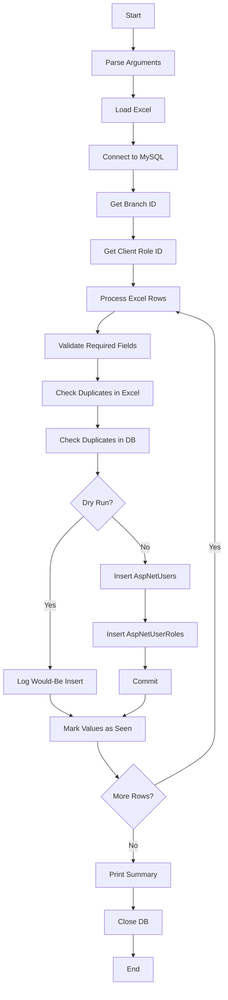

# User Import Script

## 1. Purpose

This script reads client data from an Excel file and inserts users into:

```text
AspNetUsers
AspNetUserRoles
```

It validates duplicate values before insertion and supports:

```text
Live mode
Dry-run mode
```

---

## 2. Execution Flow



---

# Input File

## 3. Excel File

The script requires:

```text
--excel
```

Example:

```bash
python import_users.py --excel Client_mapping.xlsx
```

The Excel workbook is opened using:

```python
openpyxl.load_workbook(
    path,
    read_only=True,
    data_only=True
)
```

The active worksheet is used.

---

## 4. Excel Headers

The script expects these column names:

| Excel Column | Used As |
|---|---|
| `Account id` | ClientId / UserName |
| `Account Name` | FirstName / LastName |
| `E-mail Id` | Email |
| `Residence address` | Address |
| `Residence Phone No.` | PhoneNumber |
| `Pan Number` | PanNumber |
| `DOB` | DateOfBirth |

Header whitespace is removed before processing.

---

## 5. Row Conversion

Each Excel row is converted into a dictionary:

```python
row_to_dict(headers, row)
```

This allows the script to access values by the Excel column names.

---

# Database Configuration

## 6. Database Arguments

The script accepts:

```text
--host
--port
--user
--password
--database
```

Defaults are loaded using:

```python
get("db", ...)
```

Default values:

```text
host     = 127.0.0.1
port     = 3306
user     = root
password = root
database = Blitz
```

---

## 7. Database Connection

```python
get_connection(
    host,
    port,
    user,
    password,
    database
)
```

connects using:

```python
mysql.connector.connect(...)
```

with:

```text
auth_plugin = mysql_native_password
```

---

# Branch and Role

## 8. Branch ID

The script searches the `Branches` table for:

```text
Main Branch
```

Query:

```sql
SELECT Id
FROM Branches
WHERE Name = %s
LIMIT 1
```

The returned ID is stored as:

```text
BranchId
```

If the branch is not found, processing stops with an error.

---

## 9. Role ID

The script searches `AspNetRoles` for:

```text
Client
```

Query:

```sql
SELECT Id
FROM AspNetRoles
WHERE Name = %s
LIMIT 1
```

The returned ID is used in:

```text
AspNetUserRoles
```

If the role is not found, processing stops with an error.

---

# Excel Data Processing

## 10. Required Field Validation

For every row, the script reads:

```text
Account id
Account Name
E-mail Id
Residence address
Residence Phone No.
Pan Number
DOB
```

The following are required:

```text
Account id
Email
```

If `Account id` is empty:

```text
Row is skipped
```

If email is empty:

```text
Row is skipped
```

Skipped rows increase:

```python
stats["skipped"]
```

---

## 11. Name Processing

The account name is split into:

```text
FirstName
LastName
```

using:

```python
split_name()
```

Example:

```text
ABHIJIT CHAUDHURY
        ↓
FirstName = ABHIJIT
LastName  = CHAUDHURY
```

If only one name is present, the last name remains empty.

---

## 12. Phone Processing

The phone value is converted to a string:

```python
str(int(phone_raw))
```

The result is used as:

```text
PhoneNumber
```

---

## 13. DOB Processing

`DOB` supports:

```text
datetime object
%d-%m-%Y
%Y-%m-%d
%d/%m/%Y
%m/%d/%Y
```

The function:

```python
parse_dob()
```

returns a `datetime` value.

An unsupported date format raises an error for that row.

---

# User Identity

## 14. User ID

A new UUID is generated for every valid user:

```python
user_id = str(uuid.uuid4())
```

This becomes:

```text
AspNetUsers.Id
```

---

## 15. Username

The account ID is used directly as:

```text
UserName
```

The normalized username is:

```python
username.upper()
```

and stored as:

```text
NormalizedUserName
```

---

## 16. Email

The Excel email becomes:

```text
Email
```

The uppercase version becomes:

```text
NormalizedEmail
```

---

# Duplicate Checks

## 17. Duplicate Check Inside Excel

The script tracks values already seen in the current Excel file:

```text
PhoneNumber
UserName
NormalizedUserName
Email
NormalizedEmail
```

Dictionaries used:

```python
seen_phones
seen_usernames
seen_norm_usernames
seen_emails
seen_norm_emails
```

If a duplicate is detected, the row is skipped.

---

## 18. Duplicate Check Against Database

```python
check_db_uniqueness()
```

checks the database for:

```text
Id
PhoneNumber
UserName
NormalizedUserName
Email
NormalizedEmail
```

Queries are executed against:

```text
AspNetUsers
```

If any matching value already exists, the row is skipped.

---

## 19. Duplicate Flow

```text
Excel row
   ↓
Check duplicates within Excel
   |
   +-- Duplicate → Skip
   |
   +-- No duplicate
          ↓
     Check database
          |
          +-- Duplicate → Skip
          |
          +-- No duplicate
                 ↓
             Build user
```

---

# User Record

## 20. User Fields

The script builds a complete user dictionary for `AspNetUsers`.

Important values are:

```text
Id
FirstName
LastName
PhoneNumber
Address
Country
DateOfBirth
UserType
ClientType
BranchId
PanNumber
ClientId
UserName
NormalizedUserName
Email
NormalizedEmail
PasswordHash
CountryCode
```

---

## 21. Fixed Values

The script sets fixed values including:

```text
Country             = India
CountryCode         = +91
UserType            = Client
Branch              = Main Branch
Role                = Client
UpdatedBy           = script
IsTemporaryPassword = 1
IsActivated         = 1
IsSuspended         = 0
IsDeleted           = 0
IsKYC               = 0
EmailConfirmed      = 0
PhoneNumberConfirmed = 0
TwoFactorEnabled    = 0
```

Several other status/configuration fields are also initialized to `0` or `None` according to the user dictionary in the script.

---

# Database Insert

## 22. Insert into `AspNetUsers`

```python
insert_user(cursor, user)
```

inserts the generated user record into:

```text
AspNetUsers
```

The insert includes the complete user field set created by the script.

---

## 23. Insert into `AspNetUserRoles`

After the user insert, the script executes:

```python
insert_user_role(
    cursor,
    user_id,
    role_id
)
```

which inserts:

```sql
INSERT INTO AspNetUserRoles
(UserId, RoleId)
VALUES (%s, %s)
```

This assigns the `Client` role to the newly created user.

---

## 24. Transaction

In live mode, both inserts are followed by:

```python
conn.commit()
```

So the user and corresponding role assignment are committed together for that row.

If a row-level error occurs:

```python
conn.rollback()
```

is executed.

---

# Dry-Run Mode

## 25. `--dry-run`

Example:

```bash
python import_users.py     --excel Client_mapping.xlsx     --dry-run
```

In dry-run mode:

```text
No database inserts are performed.
```

Instead, the script logs:

```text
Would insert user
Would insert AspNetUserRoles
```

The generated user values are printed to the log.

---

## 26. Live Mode

Without:

```text
--dry-run
```

the script runs in live mode.

It displays a warning and waits:

```text
5 seconds
```

before writing to the database.

---

# Logging

## 27. Log File

Logs are written to:

```text
import_users.log
```

and also to standard output.

Log format contains:

```text
timestamp
log level
message
```

---

## 28. Processing Statistics

The script tracks:

```python
stats = {
    "inserted": 0,
    "skipped": 0,
    "errors": 0
}
```

At the end it prints:

```text
Inserted: <count>
Skipped: <count>
Errors: <count>
```

---

# Command-Line Arguments

## 29. Arguments

| Argument | Required | Function |
|---|---|---|
| `--excel` | Yes | Excel input file |
| `--host` | No | MySQL host |
| `--port` | No | MySQL port |
| `--user` | No | MySQL username |
| `--password` | No | MySQL password |
| `--database` | No | Database name |
| `--dry-run` | No | Prevent database writes |

---

## 30. Examples

### Dry run

```bash
python import_users.py     --excel Client_mapping.xlsx     --host 127.0.0.1     --port 3306     --user root     --password root     --database Blitz     --dry-run
```

### Live import

```bash
python import_users.py     --excel Client_mapping.xlsx     --host 127.0.0.1     --port 3306     --user root     --password root     --database Blitz
```

---

# Function Reference

## 31. Functions

| Function | Functionality |
|---|---|
| `get_connection()` | Connects to MySQL |
| `fetch_branch_id()` | Gets `Main Branch` ID |
| `fetch_role_id()` | Gets `Client` role ID |
| `check_db_uniqueness()` | Checks user fields against existing DB records |
| `load_excel()` | Loads the Excel workbook |
| `row_to_dict()` | Converts an Excel row into a dictionary |
| `split_name()` | Splits account name into first and last name |
| `parse_dob()` | Converts DOB to datetime |
| `insert_user()` | Inserts a record into `AspNetUsers` |
| `insert_user_role()` | Assigns the Client role |
| `main()` | Controls the complete import process |

---

# Functional Summary

## 32. Complete Flow

```text
Excel File
   ↓
Load Headers and Rows
   ↓
Connect to MySQL
   ↓
Get Main Branch ID
   ↓
Get Client Role ID
   ↓
Process Each Row
   ↓
Validate Account ID + Email
   ↓
Parse Name / Phone / DOB
   ↓
Check Excel Duplicates
   ↓
Check DB Duplicates
   ↓
Build User Object
   ↓
Dry Run?
   |
   +-- Yes → Log INSERT details
   |
   +-- No
         ↓
      Insert AspNetUsers
         ↓
      Insert AspNetUserRoles
         ↓
      Commit
   ↓
Next Row
   ↓
Print Inserted / Skipped / Errors
   ↓
Close Database
```

## 33. Database Result

For each valid, non-duplicate Excel row in live mode:

```text
AspNetUsers
    ↓
New user record

AspNetUserRoles
    ↓
Client role assigned to that user
```

Skipped rows are not inserted, and row-level errors are rolled back and counted.
