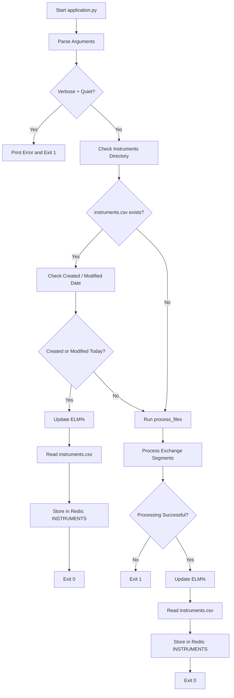

# NSE Instrument Parser — `application.py`

## 1. Purpose

`application.py` is the main application script for processing exchange instrument data.

It checks the existing instrument file, processes instrument data when required, updates ELM% information from AEL, and stores the final `instruments.csv` content in Redis.

The main activities are:

1. Check whether the `Instruments` directory exists.
2. Check whether `Instruments/instruments.csv` exists.
3. Check whether the file was created or modified today.
4. If the file is current, update ELM% and store the file in Redis.
5. If the file is not current or does not exist, process the requested exchange segments.
6. Update ELM% after successful instrument processing.
7. Read the generated `instruments.csv`.
8. Store the complete CSV content in Redis using the `INSTRUMENTS` key.
9. Return an appropriate process exit status.

---

## 2. Execution Flow



---

# 3. Application Location

The main script is:

```text
application.py
```

The script uses the following related components:

```text
application.py
instrument_parser.py
parsers/
└── update_span_margin.py
```

The detailed instrument-processing logic is handled by `process_files()` imported from `instrument_parser`.

ELM% updating is handled by `UpdateSpanMargin()` imported from `parsers.update_span_margin`.

---

# 4. Exchange Segments

Exchange segments are provided using the `--exchangeSegment` option.

Supported argument names are:

```text
--exchangeSegment
-e
--ExchangeSegment
--exchange_segment
```

The default exchange segments are:

```text
NSECM,NSEFO,NSECD,BSECM,BSEFO,BSECD
```

### Example

```bash
python application.py -e NSECM,NSEFO
```

Multiple segments can be supplied as comma-separated values:

```bash
python application.py -e NSECM,NSEFO,NSECD,BSECM,BSEFO,BSECD
```

---

# 5. Instrument File

The application expects the instrument file inside the `Instruments` directory relative to `application.py`.

Expected structure:

```text
<application directory>/
├── application.py
└── Instruments/
    └── instruments.csv
```

The primary instrument file is:

```text
Instruments/instruments.csv
```

This file is used as the source for Redis storage.

---

# 6. Existing Instrument File Check

Before running the instrument parser, `application.py` checks whether the `Instruments` directory exists.

If the directory exists, it checks for:

```text
Instruments/instruments.csv
```

If the file exists, the application checks both:

* Creation date
* Modification date

The dates are compared with the current date.

---

# 7. Daily File Validation

The existing `instruments.csv` is considered up-to-date when either:

* Its creation date is today, or
* Its modification date is today.

For example:

```text
Current Date:       17-09-2026
File Created:       17-09-2026
```

or:

```text
Current Date:       17-09-2026
File Modified:      17-09-2026
```

In either case, the existing file is used instead of running the instrument parser again.

---

# 8. When the Instrument File Is Up-to-Date

When `instruments.csv` was created or modified today, the application displays:

```text
Instruments file already exists and is up-to-date.
```

The application then:

1. Runs the ELM% update.
2. Reads the complete `instruments.csv`.
3. Connects to Redis.
4. Stores the CSV content using the `INSTRUMENTS` key.
5. Exits successfully.

The Redis data is stored as:

```text
Key: INSTRUMENTS
Value: Complete contents of instruments.csv
```

If these operations succeed, the application exits with:

```text
Exit Code: 0
```

---

# 9. When the Instrument File Is Not Current

If `instruments.csv` exists but was not created or modified today, the application proceeds with instrument processing.

The processing is performed through:

```text
process_files()
```

The requested exchange segments are passed to this processing step.

Example:

```bash
python application.py -e NSECM,NSEFO
```

The detailed instrument parsing logic is implemented in:

```text
instrument_parser.py
```

---

# 10. Instrument Processing

The application calls:

```text
process_files(exchangeSegment, verbose)
```

The `exchangeSegment` value contains the requested exchange segments.

For example:

```text
NSECM,NSEFO
```

The `verbose` setting is also passed to the parser.

The result returned by `process_files()` is used to determine whether the instrument-processing stage was successful.

---

# 11. Successful Instrument Processing

When `process_files()` returns a successful result, the application continues with:

```text
process_files()
     ↓
Update ELM%
     ↓
Read Instruments/instruments.csv
     ↓
Connect to Redis
     ↓
Store INSTRUMENTS
     ↓
Exit 0
```

The generated or updated instrument file is therefore made available both locally and through Redis.

---

# 12. ELM% Update

ELM% information is updated using:

```text
UpdateSpanMargin()
```

This is imported from:

```text
parsers.update_span_margin
```

The update is performed:

* When an existing `instruments.csv` is already current.
* After successful execution of `process_files()`.

The application attempts to continue with CSV and Redis processing even if the ELM% update raises an exception.

An error may be displayed such as:

```text
Error while updating ELM% from AEL: ...
```

or:

```text
Error while updating ELM% from AEL after process_files: ...
```

---

# 13. Redis Configuration

Redis configuration is obtained from the application's global configuration.

The following command-line options can override the Redis settings:

| Argument | Default     | Description          |
| -------- | ----------- | -------------------- |
| `--host` | `127.0.0.1` | Redis host           |
| `--port` | `6379`      | Redis port           |
| `--db`   | `0`         | Redis database index |

### Example

```bash
python application.py \
    --host 127.0.0.1 \
    --port 6379 \
    --db 0
```

---

# 14. Redis Storage

The application stores the complete contents of:

```text
Instruments/instruments.csv
```

in Redis using the key:

```text
INSTRUMENTS
```

The data flow is:

```text
Instruments/instruments.csv
        ↓
Read complete CSV
        ↓
Connect to Redis
        ↓
SET INSTRUMENTS <file_content>
```

The Redis value contains the complete CSV file content rather than only selected instrument records.

---

# 15. Redis Connection Handling

Redis is initialized using:

```text
Host
Port
Database
```

Default values are:

```text
Host: 127.0.0.1
Port: 6379
DB:   0
```

If a Redis connection error occurs while creating the client, the application prints the error and exits with:

```text
Exit Code: 1
```

---

# 16. Verbose Mode

Verbose mode is enabled using:

```bash
python application.py --verbose
```

or:

```bash
python application.py -v
```

Verbose mode provides additional information about the processing state.

For example, it can display information when:

* The `Instruments` directory does not exist.
* `instruments.csv` is not found.
* The existing file is not current.

---

# 17. Quiet Mode

Quiet mode is enabled using:

```bash
python application.py --quiet
```

or:

```bash
python application.py -q
```

Quiet mode suppresses normal informational output in the areas where the application checks the quiet setting.

Errors are still handled separately.

---

# 18. Verbose and Quiet Mode Conflict

`--verbose` and `--quiet` cannot be used together.

Invalid command:

```bash
python application.py -v -q
```

The application displays:

```text
Error: Cannot use both verbose and quiet modes
```

and exits with:

```text
Exit Code: 1
```

Use one of the following:

```bash
python application.py -v
```

or:

```bash
python application.py -q
```

---

# 19. Version

The application provides a version option:

```bash
python application.py --version
```

The configured version is:

```text
application.py 1.0.0
```

The exact displayed program name depends on how the script is invoked.

---

# 20. Command-Line Reference

| Argument                  | Default                               | Description                  |
| ------------------------- | ------------------------------------- | ---------------------------- |
| `--exchangeSegment`, `-e` | `NSECM,NSEFO,NSECD,BSECM,BSEFO,BSECD` | Exchange segments to process |
| `--host`                  | `127.0.0.1`                           | Redis host                   |
| `--port`                  | `6379`                                | Redis port                   |
| `--db`                    | `0`                                   | Redis database index         |
| `--verbose`, `-v`         | `False`                               | Enable verbose output        |
| `--quiet`, `-q`           | `False`                               | Suppress normal output       |
| `--version`               | `1.0.0`                               | Display application version  |

---

# 21. Error Handling

The application handles errors during several stages of execution.

### Instrument Directory / File

Errors can occur while checking:

```text
Instruments/
Instruments/instruments.csv
```

### File Timestamp

The application handles errors while reading the creation or modification timestamps.

### CSV Reading

If the instrument CSV cannot be opened or read, an error is reported.

### Redis

Errors can occur while:

* Creating the Redis client.
* Writing the instrument data to Redis.

### Instrument Processing

If `process_files()` fails, the application treats the instrument-processing stage as unsuccessful.

### ELM% Update

Errors during the ELM% update are reported, while the application attempts to continue with the remaining processing.

### Unexpected Errors

Unexpected exceptions are caught by the main application flow and result in a failed process status.

---

# 22. Success and Failure Status

The application uses a success status to determine the final exit code.

### Success

```text
Exit Code: 0
```

This indicates that the required instrument processing and final CSV/Redis storage completed successfully.

### Failure

```text
Exit Code: 1
```

This indicates that a required processing or final CSV/Redis operation failed.

---

# 23. Operational Verification

After running the application, verify that the instrument file exists:

```bash
ls -lh Instruments/instruments.csv
```

Check the file timestamp:

```bash
stat Instruments/instruments.csv
```

Verify Redis connectivity:

```bash
redis-cli ping
```

Expected response:

```text
PONG
```

Check whether the instrument data exists in Redis:

```bash
redis-cli EXISTS INSTRUMENTS
```

Expected response:

```text
1
```

To inspect the stored value:

```bash
redis-cli GET INSTRUMENTS
```

For a large instrument file, checking the key with `EXISTS` is preferable to printing the entire Redis value.

---

# 24. Typical Execution

### Default

```bash
python application.py
```

This uses:

```text
NSECM,NSEFO,NSECD,BSECM,BSEFO,BSECD
```

as the exchange segments.

### Specific Exchange Segments

```bash
python application.py -e NSECM,NSEFO
```

### Verbose Execution

```bash
python application.py -e NSECM,NSEFO -v
```

### Quiet Execution

```bash
python application.py -e NSECM,NSEFO -q
```

### Custom Redis Configuration

```bash
python application.py \
    -e NSECM,NSEFO,NSECD,BSECM,BSEFO,BSECD \
    --host 127.0.0.1 \
    --port 6379 \
    --db 0
```

---

# 25. Complete Functional Flow

```text
Start application.py
        ↓
Parse command-line arguments
        ↓
Validate verbose / quiet options
        ↓
Check Instruments directory
        ↓
Check instruments.csv
        ↓
Is file created or modified today?
        │
        ├── YES
        │    ↓
        │  Update ELM%
        │    ↓
        │  Read instruments.csv
        │    ↓
        │  Store in Redis → INSTRUMENTS
        │    ↓
        │  Exit 0
        │
        └── NO
             ↓
        Run process_files()
             ↓
        Processing successful?
             │
             ├── NO
             │    ↓
             │  Exit 1
             │
             └── YES
                  ↓
              Update ELM%
                  ↓
              Read instruments.csv
                  ↓
              Store in Redis → INSTRUMENTS
                  ↓
                Exit 0
```

---

# 26. Dependencies

The application depends on:

| Component                         | Purpose                                          |
| --------------------------------- | ------------------------------------------------ |
| `instrument_parser.process_files` | Processes the requested exchange instrument data |
| `parsers.update_span_margin`      | Updates ELM% information                         |
| Redis                             | Stores the generated instrument CSV              |
| `Instruments/instruments.csv`     | Local instrument data file                       |
| Global configuration              | Provides Redis configuration                     |

---

# 27. Output

The main local output is:

```text
Instruments/instruments.csv
```

The same file content is stored in Redis:

```text
Redis Key: INSTRUMENTS
```

Final data flow:

```text
Exchange Instrument Data
        ↓
application.py
        ↓
process_files()
        ↓
Instruments/instruments.csv
        ↓
Update ELM%
        ↓
Redis
        ↓
INSTRUMENTS
```

---

# 28. Key Takeaway

`application.py` is responsible for coordinating the instrument-data preparation flow.

It ensures that:

* Required exchange segments are processed.
* `Instruments/instruments.csv` is available.
* An existing file from the current day can be reused.
* ELM% information is updated.
* The final instrument CSV is stored in Redis.
* Redis uses the `INSTRUMENTS` key for the instrument data.
* The application returns an appropriate success or failure exit code.

The overall process is:

```text
application.py
    ↓
Check existing instruments.csv
    ↓
Process instrument data when required
    ↓
Update ELM%
    ↓
Read instruments.csv
    ↓
Store in Redis
    ↓
INSTRUMENTS
```
