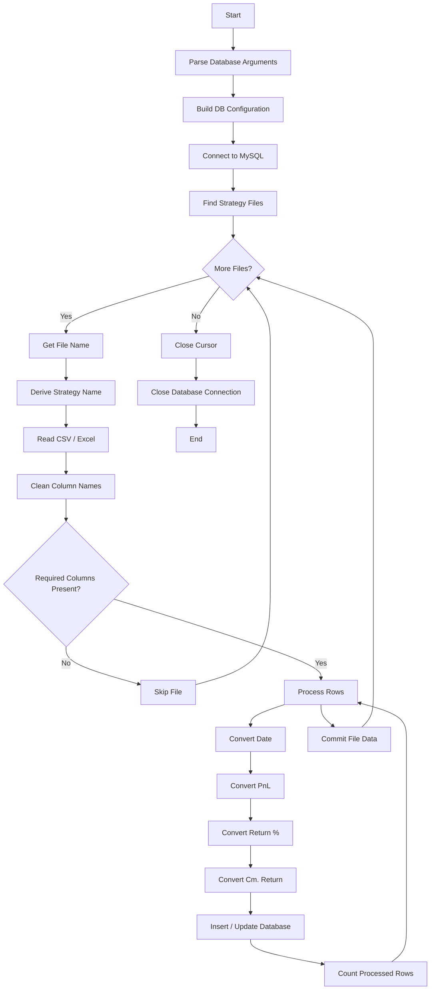

# Signal Strategy Dailies Upload Script

## 1. Purpose

The **Signal Strategy Dailies Upload Script** reads daily strategy performance files from the configured strategy directory and uploads the data into the MySQL table:

```text
SignalStrategyDailies
```

The script supports the following input file formats:

```text
.xlsx
.xls
.csv
```

The strategy name is automatically derived from the input filename.

For example:

```text
Calculus.xlsx
```

becomes:

```text
Calculus
```

and is stored in the database as:

```text
SignalStrategyName = Calculus
```

The script processes all supported files present in:

```text
/home/Blitz/BOD/QX.ProcessManager/downloads/signal_strategies_dailies
```

---

# 2. Processing Flow

The complete processing flow is:



---

# 3. Data Folder

The script reads strategy files from the fixed directory:

```text
/home/Blitz/BOD/QX.ProcessManager/downloads/signal_strategies_dailies
```

This path is defined by:

```python
DATA_FOLDER = r"/home/Blitz/BOD/QX.ProcessManager/downloads/signal_strategies_dailies"
```

The directory is scanned for all supported file types.

### Supported files

```text
*.xlsx
*.xls
*.csv
```

The script does not accept a data-folder path through a command-line argument. The folder is defined directly in the script.

---

# 4. Supported File Types

The script searches for:

```text
*.xlsx
*.xls
*.csv
```

These extensions are defined in:

```python
SUPPORTED_EXTENSIONS = ["*.xlsx", "*.xls", "*.csv"]
```

Each extension is searched separately using `glob.glob()`.

All matching files are collected into:

```python
all_files
```

The script then processes every file found in this list.

---

# 5. Database Configuration

The script connects to MySQL using the following configuration:

```text
Host
Port
Username
Password
Database
```

These values can be supplied through command-line arguments.

The configuration is created as:

```python
DB_CONFIG = {
    "host": args.host,
    "port": args.port,
    "user": args.user,
    "password": args.password,
    "database": args.database
}
```

---

# 6. Database Configuration Source

Default database values are retrieved using:

```python
get("db", ...)
```

from:

```text
lib.global_config
```

The defaults defined by the script are:

| Parameter | Default     |
| --------- | ----------- |
| Host      | `127.0.0.1` |
| Port      | `3306`      |
| User      | `root`      |
| Password  | `root`      |
| Database  | `Blitz`     |

If command-line arguments are provided, those values are used instead of the defaults.

---

# 7. Command-Line Arguments

The script supports the following arguments:

| Argument     | Default     | Description           |
| ------------ | ----------- | --------------------- |
| `--host`     | `127.0.0.1` | MySQL server host     |
| `--port`     | `3306`      | MySQL server port     |
| `--user`     | `root`      | MySQL username        |
| `--password` | `root`      | MySQL password        |
| `--database` | `Blitz`     | Target MySQL database |

Example:

```bash
python upload_signal_strategy_dailies.py \
    --host 127.0.0.1 \
    --port 3306 \
    --user root \
    --password root \
    --database Blitz
```

The actual Python filename should be replaced with the deployed filename if it differs.

---

# 8. Target Database Table

The target table is:

```text
SignalStrategyDailies
```

The table name is defined in the script as:

```python
TABLE_NAME = "SignalStrategyDailies"
```

The script expects this table to already exist.

The script does **not** create or alter the table.

---

# 9. Required Database Columns

The script inserts the following columns:

```text
SignalStrategyName
Date
Price
Percentage
CumulativePercentage
```

The insert operation uses:

```sql
INSERT INTO SignalStrategyDailies
(
    SignalStrategyName,
    Date,
    Price,
    Percentage,
    CumulativePercentage
)
```

The database table therefore needs to support these columns and an appropriate unique/primary key for duplicate handling.

---

# 10. Database Connection

The script connects to MySQL using:

```python
mysql.connector.connect(**DB_CONFIG)
```

After a successful connection, it creates a cursor:

```python
cursor = connection.cursor()
```

The same database connection and cursor are used while processing all strategy files.

Successful connection output:

```text
Connected To Database
```

---

# 11. Database Connection Failure

If the MySQL connection fails, the error is handled by:

```python
except Error as db_error:
```

The script prints:

```text
Database Error: <error message>
```

Database errors are different from individual row and file processing errors because they are handled by the outer database exception block.

---

# 12. Finding Strategy Files

The script creates an empty list:

```python
all_files = []
```

It then searches the configured directory for each supported extension.

Conceptually:

```text
signal_strategies_dailies/
│
├── Calculus.xlsx
├── Momentum.xlsx
├── Breakout.csv
├── Trend.xls
└── ...
```

All matching files are added to:

```python
all_files
```

The script prints the number of files found:

```text
Found <number> files
```

---

# 13. File Processing Order

Each file in `all_files` is processed individually.

The script does not combine all strategy files into one DataFrame.

Instead, the flow is:

```text
File 1
  ↓
Read
  ↓
Validate
  ↓
Insert
  ↓
Commit

File 2
  ↓
Read
  ↓
Validate
  ↓
Insert
  ↓
Commit

File 3
  ↓
...
```

This means each strategy file is handled independently.

---

# 14. Strategy Name

The strategy name is derived from the filename.

The extension is removed using:

```python
strategy_name = os.path.splitext(file_name)[0]
```

Examples:

```text
Calculus.xlsx
        ↓
Calculus
```

```text
Momentum.csv
        ↓
Momentum
```

```text
Breakout.xls
        ↓
Breakout
```

The resulting value is stored in:

```text
SignalStrategyName
```

---

# 15. Strategy Name and File Name Relationship

The script does not read the strategy name from a column inside the file.

Instead:

```text
Filename
   ↓
Remove extension
   ↓
Strategy Name
   ↓
SignalStrategyName
```

For example:

```text
MeanReversion.xlsx
```

produces:

```text
SignalStrategyName = MeanReversion
```

---

# 16. Reading CSV Files

If the file extension is `.csv`, the script uses:

```python
pd.read_csv(file_path)
```

Example:

```text
Strategy.csv
```

is loaded into a pandas DataFrame.

---

# 17. Reading Excel Files

For `.xlsx` and `.xls` files, the script uses:

```python
pd.read_excel(file_path)
```

The resulting data is stored in a pandas DataFrame.

---

# 18. Column Name Cleaning

After the file is loaded, column names are cleaned using:

```python
df.columns = [str(col).strip() for col in df.columns]
```

This removes leading and trailing spaces from column names.

For example:

```text
" Date "
```

becomes:

```text
"Date"
```

Similarly:

```text
"PnL "
```

becomes:

```text
"PnL"
```

This allows the required-column validation to work with column names containing accidental surrounding spaces.

---

# 19. Required Input Columns

Every strategy file must contain these four columns:

```text
Date
PnL
Return %
Cm. Return
```

The script checks for these exact column names after trimming whitespace.

Required columns:

| Column       | Purpose                      |
| ------------ | ---------------------------- |
| `Date`       | Daily strategy date          |
| `PnL`        | Strategy profit/loss value   |
| `Return %`   | Daily return percentage      |
| `Cm. Return` | Cumulative return percentage |

---

# 20. Required Column Validation

The script builds the required-column list:

```python
required_columns = [
    "Date",
    "PnL",
    "Return %",
    "Cm. Return"
]
```

It then checks which columns are missing.

Conceptually:

```text
Read file
   ↓
Clean column names
   ↓
Check Date
   ↓
Check PnL
   ↓
Check Return %
   ↓
Check Cm. Return
```

If all four are present, row processing begins.

---

# 21. Missing Required Columns

If one or more required columns are missing, the file is skipped.

Example:

```text
Skipping Calculus -> Missing Columns: ['Cm. Return']
```

No rows from that file are processed or inserted.

The script then continues with the next file.

---

# 22. Input-to-Database Mapping

The input fields are mapped to database fields as follows:

| Input File                  | Database Column        |
| --------------------------- | ---------------------- |
| File name without extension | `SignalStrategyName`   |
| `Date`                      | `Date`                 |
| `PnL`                       | `Price`                |
| `Return %`                  | `Percentage`           |
| `Cm. Return`                | `CumulativePercentage` |

The mapping is important because the source file uses `PnL`, while the database column receiving that value is named `Price`.

---

# 23. Date Processing

The source:

```text
Date
```

is converted using:

```python
pd.to_datetime(row["Date"])
```

The resulting datetime value is supplied to the database insert.

Example:

```text
2026-09-09
```

becomes a pandas datetime value before insertion.

---

# 24. PnL Processing

The source:

```text
PnL
```

is converted to a floating-point value.

The conversion is:

```python
float(row["PnL"])
```

If the PnL value is missing:

```text
0
```

is used.

The resulting value is inserted into:

```text
Price
```

Therefore:

```text
PnL → Price
```

---

# 25. Return Percentage Processing

The source column:

```text
Return %
```

is converted to a numeric value.

The script first converts the value to a string and removes `%`:

```python
str(row["Return %"]).replace("%", "")
```

It then converts the result to `float`.

Example:

```text
5.25%
```

becomes:

```text
5.25
```

The value is stored in:

```text
Percentage
```

Therefore:

```text
Return % → Percentage
```

---

# 26. Missing Return Percentage

If:

```text
Return %
```

is missing, the script uses:

```text
0
```

The database value therefore becomes:

```text
Percentage = 0
```

for that row.

---

# 27. Cumulative Return Processing

The source column:

```text
Cm. Return
```

is processed similarly to `Return %`.

The `%` character is removed:

```python
str(row["Cm. Return"]).replace("%", "")
```

The resulting value is converted to `float`.

Example:

```text
18.50%
```

becomes:

```text
18.50
```

The result is stored in:

```text
CumulativePercentage
```

Therefore:

```text
Cm. Return → CumulativePercentage
```

---

# 28. Missing Cumulative Return

If:

```text
Cm. Return
```

is missing for a row, the script uses:

```text
0
```

The resulting database value is:

```text
CumulativePercentage = 0
```

---

# 29. Complete Data Transformation

The transformation can be summarized as:

```text
Input File
   │
   ├── Filename
   │      ↓
   │   SignalStrategyName
   │
   ├── Date
   │      ↓
   │   Date
   │
   ├── PnL
   │      ↓
   │   Price
   │
   ├── Return %
   │      ↓
   │   Remove %
   │      ↓
   │   Percentage
   │
   └── Cm. Return
          ↓
       Remove %
          ↓
       CumulativePercentage
```

---

# 30. Database Insert

Each valid row is inserted into:

```text
SignalStrategyDailies
```

The values inserted are:

```text
SignalStrategyName
Date
Price
Percentage
CumulativePercentage
```

The SQL operation is:

```sql
INSERT INTO SignalStrategyDailies
(
    SignalStrategyName,
    Date,
    Price,
    Percentage,
    CumulativePercentage
)
VALUES
(
    %s,
    %s,
    %s,
    %s,
    %s
)
```

---

# 31. Duplicate Record Handling

The insert query uses:

```sql
ON DUPLICATE KEY UPDATE
```

This means that if the inserted record conflicts with an existing unique/primary key, the script updates the existing record instead of failing because of a duplicate key.

The following values are updated:

```text
Price
Percentage
CumulativePercentage
```

The strategy name and date are not changed by the duplicate-update clause.

---

# 32. Duplicate Update Flow

The database behavior is:

```text
Insert Row
    ↓
Does matching unique key exist?
    │
    ├── No
    │    ↓
    │  Insert new row
    │
    └── Yes
         ↓
      Update:
        Price
        Percentage
        CumulativePercentage
```

This allows the script to be run again with updated daily strategy files without causing duplicate-key failures for matching records.

---

# 33. Row Processing

Rows are processed individually using:

```python
for _, row in df.iterrows():
```

For every row, the script performs:

```text
Read Date
   ↓
Convert Date
   ↓
Read PnL
   ↓
Convert PnL
   ↓
Read Return %
   ↓
Remove %
   ↓
Convert to float
   ↓
Read Cm. Return
   ↓
Remove %
   ↓
Convert to float
   ↓
Build database values
   ↓
Execute INSERT / UPDATE
```

---

# 34. Processed Row Counter

For every successfully executed database operation, the script increments:

```python
processed_rows += 1
```

At the end of the file, the script prints:

```text
<strategy_name> -> <processed_rows> rows processed
```

Example:

```text
Calculus -> 252 rows processed
```

This count represents rows for which the `cursor.execute()` operation completed without raising an exception.

---

# 35. Row-Level Error Handling

Each row is processed inside its own `try/except` block.

If an error occurs while processing a row, the script prints:

```text
Row Error in <strategy_name>: <error>
```

The row is not counted as successfully processed.

Importantly, the error does not stop processing of the remaining rows in the same file.

The flow is:

```text
Row 1 → Success
Row 2 → Success
Row 3 → Error → Continue
Row 4 → Success
Row 5 → Success
```

---

# 36. File-Level Error Handling

Each file is also processed inside a separate `try/except` block.

If an error occurs during file processing, the script prints:

```text
File Processing Error (<file_name>): <error>
```

The script then continues with the next file.

For example:

```text
Calculus.xlsx → Processed
Momentum.xlsx → File Error
Breakout.csv → Processed
```

A failure in one file therefore does not automatically stop processing of subsequent files.

---

# 37. File Validation Failure vs File Processing Error

There are two different file-level outcomes.

### Missing required columns

The script prints:

```text
Skipping <strategy_name> -> Missing Columns: [...]
```

and moves to the next file.

### Other file-processing exception

The script prints:

```text
File Processing Error (<file_name>): ...
```

and moves to the next file.

---

# 38. Database Commit

After all rows in a file have been attempted, the script executes:

```python
connection.commit()
```

The commit occurs once for each successfully read and processed file.

Conceptually:

```text
Read File
   ↓
Process Rows
   ↓
Execute INSERT / UPDATE operations
   ↓
Commit
```

---

# 39. Per-File Commit Behavior

The script does not wait until every strategy file has been processed before committing.

Instead:

```text
Strategy A
   ↓
Process rows
   ↓
Commit

Strategy B
   ↓
Process rows
   ↓
Commit

Strategy C
   ↓
Process rows
   ↓
Commit
```

This means each file's database operations are committed separately.

---

# 40. Database Insert Errors During Row Processing

If a database-related error occurs during:

```python
cursor.execute(insert_query, values)
```

it is caught by the row-level exception:

```python
except Exception as row_error:
```

The script prints:

```text
Row Error in <strategy_name>: <error>
```

and continues processing the next row.

---

# 41. File Processing Error Behavior

If an exception occurs outside the individual row-processing block but inside the file-processing block, it is caught as:

```python
except Exception as file_error:
```

The script prints:

```text
File Processing Error (<file_name>): <error>
```

and continues to the next file.

---

# 42. Completion Message

After all files in `all_files` have been processed, the script prints:

```text
All Strategy Files Processed Successfully
```

This message indicates that the file-processing loop has completed.

It should not be interpreted as confirmation that every row in every file was inserted successfully, because individual row and file errors are handled and processing continues.

---

# 43. Connection Cleanup

The script closes the database cursor in the `finally` block:

```python
cursor.close()
```

It then checks whether the database connection is active:

```python
connection.is_connected()
```

If connected, it closes the connection:

```python
connection.close()
```

Finally, it prints:

```text
Database Connection Closed
```

This cleanup runs after the main processing logic and exception handling.

---

# 44. Complete Execution Sequence

The complete execution sequence is:

```text
Start
  ↓
Parse command-line arguments
  ↓
Read default DB configuration
  ↓
Build DB_CONFIG
  ↓
Connect to MySQL
  ↓
Create database cursor
  ↓
Search signal_strategies_dailies
  ↓
Find .xlsx / .xls / .csv files
  ↓
For each file
  ↓
Get filename
  ↓
Remove extension
  ↓
Create strategy name
  ↓
Read CSV / Excel
  ↓
Clean column names
  ↓
Validate required columns
  ↓
If columns missing → Skip file
  ↓
Process each row
  ↓
Convert Date
  ↓
Convert PnL
  ↓
Convert Return %
  ↓
Convert Cm. Return
  ↓
INSERT / UPDATE
  ↓
Count processed row
  ↓
Continue next row
  ↓
Commit file
  ↓
Continue next file
  ↓
Print completion message
  ↓
Close cursor
  ↓
Close database connection
  ↓
End
```

---

# 45. Example Input File

Consider:

```text
Calculus.xlsx
```

containing:

| Date       |  PnL | Return % | Cm. Return |
| ---------- | ---: | -------: | ---------: |
| 2026-09-09 | 1000 |    2.50% |     15.20% |
| 2026-09-10 |  750 |    1.80% |     17.27% |

The filename produces:

```text
SignalStrategyName = Calculus
```

---

# 46. Example Database Values

The first row:

```text
Date        = 2026-09-09
PnL         = 1000
Return %    = 2.50%
Cm. Return  = 15.20%
```

is transformed into:

```text
SignalStrategyName     = Calculus
Date                   = 2026-09-09
Price                  = 1000
Percentage             = 2.50
CumulativePercentage   = 15.20
```

The second row is transformed similarly.

---

# 47. Example Database Mapping

For the example above:

```text
Calculus.xlsx
      ↓
Calculus
      ↓
SignalStrategyName
```

and:

```text
PnL
 ↓
Price
```

```text
Return %
 ↓
Remove %
 ↓
Percentage
```

```text
Cm. Return
 ↓
Remove %
 ↓
CumulativePercentage
```

---

# 48. Expected Console Output

A successful execution can produce output similar to:

```text
Starting Strategy Daily Upload Process...
Connected To Database
Found 3 files

Processing Strategy: Calculus
Calculus -> 250 rows processed

Processing Strategy: Momentum
Momentum -> 250 rows processed

Processing Strategy: Breakout
Breakout -> 248 rows processed

All Strategy Files Processed Successfully
Database Connection Closed
```

The exact row counts depend on the contents of the input files.

---

# 49. Missing Column Example

If a file contains:

```text
Date
PnL
Return %
```

but does not contain:

```text
Cm. Return
```

the output will be similar to:

```text
Skipping Calculus -> Missing Columns: ['Cm. Return']
```

The file is skipped and the next file is processed.

---

# 50. Row Error Example

If an individual row contains a value that cannot be converted or inserted, the output can contain:

```text
Row Error in Calculus: <error message>
```

The script then continues with the next row.

---

# 51. File Error Example

If an error occurs while reading or processing a file:

```text
File Processing Error (Calculus.xlsx): <error message>
```

The script then continues with the next file.

---

# 52. Database Error Example

If the MySQL connection itself fails, the script reports:

```text
Database Error: <error message>
```

The database connection cleanup is then performed in the `finally` block where applicable.

---

# 53. Daily Strategy File Structure

A valid strategy daily file should contain at least:

```text
Date
PnL
Return %
Cm. Return
```

Additional columns may exist because the script only checks for the required columns and reads the required fields during row processing.

Example:

```text
Date | PnL | Return % | Cm. Return | Other Column
```

is acceptable as long as the required columns are present.

---

# 54. File Naming Convention

The script uses the filename as the strategy name.

Therefore, strategy files should be named consistently.

Example:

```text
Calculus.xlsx
Momentum.xlsx
Breakout.csv
TrendFollowing.xls
```

will produce:

```text
Calculus
Momentum
Breakout
TrendFollowing
```

as their respective `SignalStrategyName` values.

---

# 55. Important File Naming Consideration

Because the filename becomes the strategy name, changing the filename changes the value inserted into:

```text
SignalStrategyName
```

For example:

```text
Calculus.xlsx
```

produces:

```text
Calculus
```

while:

```text
Calculus_v2.xlsx
```

produces:

```text
Calculus_v2
```

These are treated as different strategy names.

---

# 56. Existing Record Updates

When a matching duplicate key is detected, the script updates:

```text
Price
Percentage
CumulativePercentage
```

using the latest values supplied by the input file.

This allows the script to be rerun for existing strategy/date records.

Example:

```text
Existing:
Calculus | 2026-09-09 | 950 | 2.10 | 14.50

New File:
Calculus | 2026-09-09 | 1000 | 2.50 | 15.20
```

After the duplicate update, the existing record's values become:

```text
Calculus | 2026-09-09 | 1000 | 2.50 | 15.20
```

provided the database unique key identifies the record as a duplicate.

---

# 57. What the Script Does Not Do

The current script does **not**:

* Create the `SignalStrategyDailies` table.
* Create the MySQL database.
* Download strategy files from an external source.
* Delete processed files.
* Move files after processing.
* Archive files.
* Validate the business correctness of PnL values.
* Validate that percentage values are mathematically correct.
* Validate that dates are trading dates.
* Recalculate cumulative returns.
* Recalculate PnL.
* Create a separate database transaction covering all files.

The script reads the files already present in the configured directory and uploads their values.

---

# 58. Dependencies

The script requires Python packages used by the implementation:

```text
pandas
mysql-connector-python
```

It also uses Python standard-library modules:

```text
os
sys
argparse
glob
```

The script additionally imports:

```python
lib.global_config.get
```

Therefore, the project environment must provide:

```text
lib/global_config.py
```

with the required configuration access.

---

# 59. Runtime Requirements

Before running the script, verify:

1. Python is available.
2. Required Python packages are installed.
3. `lib.global_config` is available.
4. The strategy data directory exists.
5. Strategy files are present in the directory.
6. MySQL is reachable.
7. The configured database exists.
8. `SignalStrategyDailies` exists.
9. The MySQL user has permission to insert and update the target table.

---

# 60. Pre-Execution Checklist

Before execution:

```text
[ ] MySQL is running
[ ] Database is reachable
[ ] Database name is correct
[ ] SignalStrategyDailies table exists
[ ] Strategy folder exists
[ ] Strategy files are present
[ ] Files use .xlsx, .xls or .csv
[ ] Required columns exist
[ ] Python dependencies are installed
[ ] Database credentials are correct
```

---

# 61. Verification After Execution

After execution, first check the console output.

Look for:

```text
Connected To Database
```

Then:

```text
Found <number> files
```

For each successfully processed file:

```text
<strategy_name> -> <rows> rows processed
```

Finally:

```text
All Strategy Files Processed Successfully
Database Connection Closed
```

---

# 62. Database Verification

After execution, verify the target table:

```sql
SELECT *
FROM SignalStrategyDailies;
```

To check records for a particular strategy:

```sql
SELECT *
FROM SignalStrategyDailies
WHERE SignalStrategyName = 'Calculus';
```

To check a particular date:

```sql
SELECT *
FROM SignalStrategyDailies
WHERE Date = '2026-09-09';
```

---

# 63. Verify Strategy Names

Check that filenames were converted correctly:

```sql
SELECT DISTINCT SignalStrategyName
FROM SignalStrategyDailies
ORDER BY SignalStrategyName;
```

Expected values should correspond to the strategy filenames without their extensions.

For example:

```text
Calculus
Momentum
Breakout
```

---

# 64. Verify Latest Values

For a specific strategy:

```sql
SELECT
    SignalStrategyName,
    Date,
    Price,
    Percentage,
    CumulativePercentage
FROM SignalStrategyDailies
WHERE SignalStrategyName = 'Calculus'
ORDER BY Date DESC;
```

This can be used to verify that the latest daily strategy values were uploaded.

---

# 65. Verify Record Count

To check the number of records for a strategy:

```sql
SELECT
    SignalStrategyName,
    COUNT(*) AS RecordCount
FROM SignalStrategyDailies
GROUP BY SignalStrategyName;
```

This provides a basic comparison between the number of uploaded database records and the source strategy files.

---

# 66. Troubleshooting — No Files Found

If the output shows:

```text
Found 0 files
```

check:

```text
/home/Blitz/BOD/QX.ProcessManager/downloads/signal_strategies_dailies
```

Verify that the directory contains:

```text
.xlsx
.xls
.csv
```

files.

Also verify that the directory name is exactly:

```text
signal_strategies_dailies
```

---

# 67. Troubleshooting — Missing Columns

If the output shows:

```text
Skipping <strategy> -> Missing Columns: [...]
```

open the corresponding file and verify these column names:

```text
Date
PnL
Return %
Cm. Return
```

The script strips leading/trailing spaces but does not rename arbitrary column names.

For example:

```text
Return
```

is not treated as:

```text
Return %
```

---

# 68. Troubleshooting — Database Connection

If the output shows:

```text
Database Error: ...
```

check:

```text
MySQL service
MySQL host
MySQL port
Username
Password
Database name
Network connectivity
```

You can also verify the supplied arguments.

Example:

```bash
python upload_signal_strategy_dailies.py \
    --host 127.0.0.1 \
    --port 3306 \
    --user root \
    --password root \
    --database Blitz
```

---

# 69. Troubleshooting — Table Missing

If the database reports that:

```text
SignalStrategyDailies
```

does not exist, create/configure the table before running the upload script.

The current script does not create the table automatically.

---

# 70. Troubleshooting — Row Errors

If output contains:

```text
Row Error in <strategy>: ...
```

identify the affected strategy and inspect the corresponding source file.

Common areas to check are:

```text
Date
PnL
Return %
Cm. Return
```

The script continues to the next row after a row-level error.

---

# 71. Troubleshooting — Excel Reading

If an Excel file cannot be read, verify:

```text
File is not corrupted
File extension matches its actual format
Required Excel-reading dependencies are installed
File is accessible by the user running the script
```

---

# 72. Troubleshooting — Duplicate Records

If records are unexpectedly updated instead of inserted, inspect the table's primary/unique key.

The script relies on:

```sql
ON DUPLICATE KEY UPDATE
```

Therefore, duplicate behavior is determined by the unique/primary key defined in the database.

---

# 73. Data Integrity Considerations

The script performs basic input validation by checking for required columns and converting values to expected types.

It does not independently verify the business correctness of the supplied strategy data.

For example, it does not calculate whether:

```text
PnL
Return %
Cm. Return
```

are mathematically consistent.

The values are uploaded based on the contents of the source file.

---

# 74. Multiple Strategy Files

The directory can contain multiple strategy files:

```text
signal_strategies_dailies/
│
├── Calculus.xlsx
├── Momentum.xlsx
├── Breakout.csv
├── MeanReversion.xls
└── Trend.xlsx
```

The script scans the directory and processes each matching file individually.

Each filename becomes its strategy identifier.

---

# 75. Re-Running the Script

The script can be executed again against the same files.

For records that match an existing database unique key:

```text
ON DUPLICATE KEY UPDATE
```

updates:

```text
Price
Percentage
CumulativePercentage
```

This allows existing strategy/date data to be refreshed from the source files.

---

# 76. Operational Behavior

The script is designed as a file-to-database upload process:

```text
Strategy Daily Files
        ↓
signal_strategies_dailies
        ↓
Read Files
        ↓
Validate Required Columns
        ↓
Convert Data
        ↓
SignalStrategyDailies
```

It does not perform file generation or strategy calculation.

---

# 77. Important Operational Points

For correct operation:

* Strategy files must be placed in the configured folder.
* Only `.xlsx`, `.xls`, and `.csv` files are scanned.
* Strategy name comes from the filename.
* Required columns must be present.
* PnL is stored in the database column `Price`.
* Percentage symbols are removed before numeric conversion.
* Missing numeric values are converted to `0`.
* Each file is committed separately.
* Row errors do not stop the remaining rows.
* File errors do not stop the remaining files.
* The target table must already exist.

---

# 78. Functional Summary

The script performs the following operations:

```text
Start
  ↓
Load database configuration
  ↓
Parse command-line arguments
  ↓
Connect to MySQL
  ↓
Scan strategy directory
  ↓
Find .xlsx / .xls / .csv
  ↓
Process each file
  ↓
Derive strategy name from filename
  ↓
Read file
  ↓
Clean column names
  ↓
Validate required columns
  ↓
Read each row
  ↓
Convert Date
  ↓
Convert PnL
  ↓
Convert Return %
  ↓
Convert Cm. Return
  ↓
Insert / Update SignalStrategyDailies
  ↓
Commit current file
  ↓
Process next file
  ↓
Close database cursor
  ↓
Close database connection
  ↓
End
```

---

# 79. Database Result

The final strategy daily data is stored in:

```text
SignalStrategyDailies
```

using the following fields:

```text
SignalStrategyName
Date
Price
Percentage
CumulativePercentage
```

The source-to-database relationship is:

```text
Filename       → SignalStrategyName
Date           → Date
PnL            → Price
Return %       → Percentage
Cm. Return     → CumulativePercentage
```

---

# 80. Key Takeaway

The **Signal Strategy Dailies Upload Script** is responsible for taking existing daily strategy files from:

```text
/home/Blitz/BOD/QX.ProcessManager/downloads/signal_strategies_dailies
```

and loading their daily performance data into:

```text
SignalStrategyDailies
```

The process automatically derives the strategy name from each filename, validates the required input columns, converts the daily values into database-compatible values, and performs insert/update operations.

The important mapping is:

```text
Strategy Filename
       ↓
SignalStrategyName

Date
       ↓
Date

PnL
       ↓
Price

Return %
       ↓
Percentage

Cm. Return
       ↓
CumulativePercentage
```

Existing duplicate records are updated for:

```text
Price
Percentage
CumulativePercentage
```

Each strategy file is committed separately, while individual row or file errors are reported and processing continues wherever possible.
