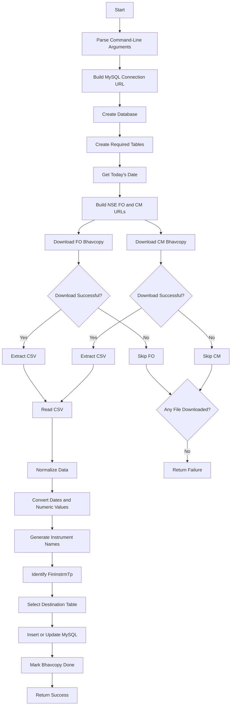

# NSE Bhavcopy Downloader and Processor
## Script: `download_and_process_bhavcopy.py`
## 1. Purpose

The `download_and_process_bhavcopy.py` script is responsible for downloading and processing daily market data.

The **currently active workflow** processes NSE Bhavcopy files for:

```text
NSE Futures & Options (FO)

NSE Capital Market (CM)
```

The script downloads the daily NSE Bhavcopy ZIP files, extracts the CSV files, normalizes the market-data fields, generates standardized instrument names, routes the records according to their financial instrument type, and stores the processed data in MySQL.

The script also contains a **Yahoo Finance historical OHLC data workflow**. This Yahoo Finance functionality is currently commented out and is not executed by the active `main()` flow.

The active NSE workflow performs the following operations:

1. Creates the configured MySQL database if it does not exist.
2. Creates the required market-data tables.
3. Gets the current system date.
4. Builds the NSE FO and CM Bhavcopy URLs.
5. Downloads the NSE Bhavcopy files.
6. Extracts the CSV files from the downloaded ZIP archives.
7. Reads the CSV files using Pandas.
8. Normalizes the NSE field names.
9. Converts date and numeric fields.
10. Generates standardized instrument names.
11. Identifies the financial instrument type using `FinInstrmTp`.
12. Routes records to the appropriate MySQL table.
13. Inserts new records or updates existing records.
14. Returns a success or failure result to the calling process.

The source also contains a commented Yahoo Finance implementation for fetching daily OHLC data for configured market indices.

---

# 2. Execution Flow

The **active NSE Bhavcopy execution flow** is:



The active `main()` function creates the database and tables, generates the current day's NSE URLs, downloads available Bhavcopy files, processes them, and inserts or updates the resulting records in MySQL.

---

# Configuration

# 3. Process Path

The script determines the project process path from the location of `download_and_process_bhavcopy.py`.

The process path is calculated as:

```python
PROCESS_PATH = os.path.abspath(
    os.path.join(os.path.dirname(__file__), '..')
)
```

The default download directory is:

```text
<PROCESS_PATH>/downloads
```

The source defines:

```python
DOWNLOAD_FOLDER = os.path.join(PROCESS_PATH, "downloads")
```

This directory is used as the default location for downloaded and extracted NSE Bhavcopy files.

The download directory can be overridden from the command line using:

```text
--download_dir
```

The configured value is assigned to `DOWNLOAD_FOLDER` when the command-line arguments are parsed.

---

# 4. Database Configuration

Database configuration is read using:

```python
get("market_data_db", ...)
```

The script supports the following database parameters:

```text
host
port
user
password
database
```

These values can be supplied through command-line arguments:

```text
--host
--port
--user
--password
--database
```

The default fallback values defined by the script are:

```text
Host     = 127.0.0.1
Port     = 3306
User     = root
Password = root
Database = qx_market_histdb
```

If values are available through `lib.global_config`, those configured values are used instead of the fallback values.

---

# 5. MySQL Connection

The script uses:

```text
PyMySQL
SQLAlchemy
```

for MySQL connectivity and database operations.

The base database URL is constructed dynamically:

```text
mysql+pymysql://<user>:<password>@<host>:<port>
```

The complete database URL is:

```text
mysql+pymysql://<user>:<password>@<host>:<port>/<database>
```

The script creates:

```text
DATABASE_URL
FULL_DB_URL
```

from the parsed database configuration.

---

# NSE Bhavcopy Workflow

# 6. Database Creation

Before downloading and processing market data, the script checks whether the configured MySQL database exists.

If the database does not exist, it creates it using:

```sql
CREATE DATABASE IF NOT EXISTS <database>
```

After the operation, the script prints:

```text
Database '<database>' ready.
```

This operation is handled by the `create_database()` function.

---

# 7. Required Tables

The script creates three market-data tables:

```text
tbl_nsecm_futures_daily

tbl_nsecm_options_daily

tbl_nsecm_equity_daily
```

The tables are created using:

```sql
CREATE TABLE IF NOT EXISTS
```

Therefore, existing tables are not recreated when the script runs.

---

# 8. Table Structure

All three tables use the same base columns.

| Column            | Type           | Description                  |
| ----------------- | -------------- | ---------------------------- |
| `InstrumentName`  | `VARCHAR(100)` | Standardized instrument name |
| `Timestamp`       | `DATETIME`     | Market-data date/time        |
| `Open`            | `FLOAT`        | Opening price                |
| `High`            | `FLOAT`        | Highest price                |
| `Low`             | `FLOAT`        | Lowest price                 |
| `Close`           | `FLOAT`        | Closing price                |
| `LTP`             | `FLOAT`        | Last traded price            |
| `Volume`          | `BIGINT`       | Trading volume               |
| `OpenInterest`    | `BIGINT`       | Open interest                |
| `PrevSettle`      | `FLOAT`        | Previous settlement price    |
| `FinalSettle`     | `FLOAT`        | Final settlement price       |
| `ContractsTraded` | `BIGINT`       | Number of contracts traded   |
| `TradeValue`      | `FLOAT`        | Total trade value            |

The primary key is:

```text
InstrumentName + Timestamp
```

This combination uniquely identifies a market-data record for an instrument and timestamp.

---

# 9. NSE Bhavcopy Download

The active download function is:

```python
download_bhavcopy_file()
```

The function performs the following operations:

1. Creates the destination directory if required.
2. Extracts the filename from the NSE URL.
3. Builds the local file path.
4. Sends the HTTP request.
5. Downloads the response to the local file.
6. Checks whether the downloaded file is a valid ZIP archive.
7. Extracts the first member of the ZIP archive.
8. Deletes the original ZIP file.
9. Returns the extracted file path.

If an error occurs, the function prints a download error and returns `None`.

---

# 10. NSE Request

The downloader sends the following HTTP headers:

```text
User-Agent: Mozilla/5.0
Referer: https://www.nseindia.com/
```

The request uses streaming download mode.

The configured timeout is:

```text
Connection timeout = 10 seconds
Read timeout       = 30 seconds
```

The downloaded response is written to the destination file in chunks.

---

# 11. NSE Bhavcopy URLs

The script obtains the current system date using:

```python
datetime.datetime.today()
```

The date is formatted as:

```text
YYYYMMDD
```

For example:

```text
20260917
```

The date is inserted into the NSE Bhavcopy URLs.

## NSE FO

```text
https://nsearchives.nseindia.com/content/fo/BhavCopy_NSE_FO_0_0_0_<YYYYMMDD>_F_0000.csv.zip
```

## NSE CM

```text
https://nsearchives.nseindia.com/content/cm/BhavCopy_NSE_CM_0_0_0_<YYYYMMDD>_F_0000.csv.zip
```

The URLs are created inside `main()`.

---

# 12. ZIP Extraction

The downloaded NSE files are ZIP archives.

The extraction process is:

```text
ZIP File
   ↓
Validate ZIP
   ↓
Open ZIP
   ↓
Read ZIP Members
   ↓
Select First Member
   ↓
Extract File
   ↓
Delete ZIP
   ↓
Return Extracted File Path
```

The function checks the downloaded file using:

```python
zipfile.is_zipfile()
```

After successful extraction, the original ZIP file is removed.

---

# Data Processing

# 13. CSV Processing

The extracted Bhavcopy file is processed using:

```python
process_file()
```

The function reads the CSV using Pandas:

```python
pd.read_csv()
```

The initial read uses the Python parsing engine.

If the resulting DataFrame contains only one column, another comma-separated read is attempted.

If the CSV cannot be read, the script prints:

```text
Read error <file>: <error>
```

and returns an empty DataFrame.

The successfully loaded DataFrame is passed to:

```python
normalize_df()
```

for further processing.

---

# 14. Data Normalization

The `normalize_df()` function converts NSE source fields into the standard fields used by the application.

The important field mappings are:

| NSE Field         | Standard Field    |
| ----------------- | ----------------- |
| `TckrSymb`        | `Symbol`          |
| `OpnPric`         | `Open`            |
| `HghPric`         | `High`            |
| `LwPric`          | `Low`             |
| `ClsPric`         | `Close`           |
| `LastPric`        | `LTP`             |
| `PrvsClsgPric`    | `PrevSettle`      |
| `SttlmPric`       | `FinalSettle`     |
| `TtlTradgVol`     | `Volume`          |
| `OpnIntrst`       | `OpenInterest`    |
| `TtlNbOfTxsExctd` | `ContractsTraded` |
| `TtlTrfVal`       | `TradeValue`      |
| `TradDt`          | `Timestamp`       |
| `TIMESTAMP`       | `Timestamp`       |
| `XpryDt`          | `ExpiryDate`      |
| `StrkPric`        | `StrikePrice`     |
| `OptnTp`          | `OptionType`      |
| `FinInstrmTp`     | `FinInstrmTp`     |

The normalized DataFrame is restricted to the fields required by the processing workflow.

---

# 15. Date Conversion

The following fields are converted to datetime values:

```text
Timestamp
ExpiryDate
```

`Timestamp` is converted using:

```python
pd.to_datetime()
```

The `ExpiryDate` field is also converted into a datetime value.

Invalid date values can therefore become missing datetime values and are subsequently subject to the final row validation.

---

# 16. Numeric Conversion

The script converts the following fields to numeric values:

```text
Open
High
Low
Close
LTP
Volume
OpenInterest
PrevSettle
FinalSettle
ContractsTraded
TradeValue
StrikePrice
```

The conversion uses:

```python
pd.to_numeric(..., errors="coerce")
```

Invalid numeric values are converted to `NaN` and then replaced with:

```text
0
```

This ensures that the normalized market-data DataFrame contains numeric values for these fields.

---

# Instrument Name Generation

# 17. Equity Instrument

For financial instrument type:

```text
STK
```

the instrument name is generated from the symbol.

Format:

```text
SYMBOL
```

Example:

```text
RELIANCE
```

The code assigns:

```python
row['InstrumentName'] = row['Symbol']
```

for `STK` instruments.

---

# 18. Futures Instrument

For:

```text
FinInstrmTp = STF
```

the script generates the instrument name using:

```text
Symbol + Expiry Date + FUT
```

The expiry date is formatted as:

```text
DDMMMYY
```

Format:

```text
SYMBOLDDMMMYYFUT
```

Example:

```text
NIFTY25SEP26FUT
```

This provides a standardized futures instrument name based on the underlying symbol and expiry date.

---

# 19. Options Instrument

For:

```text
FinInstrmTp = STO
```

and option type:

```text
CE
```

or:

```text
PE
```

the script generates the instrument name using:

```text
Symbol + Expiry Date + Strike Price + Option Type
```

The format is:

```text
SYMBOLDDMMMYYSTRIKECE
```

or:

```text
SYMBOLDDMMMYYSTRIKEPE
```

Example:

```text
NIFTY25SEP2625000CE
```

The strike price is formatted using the numeric value from `StrikePrice`.

---

# 20. Data Validation

After normalization and instrument-name generation, the script retains rows only when the following values are available:

```text
InstrumentName
Timestamp
```

Rows that do not contain an instrument name or timestamp are excluded from the final DataFrame.

The normalized DataFrame is therefore filtered before being passed to the database-routing function.

---

# Table Routing

# 21. Financial Instrument Type Mapping

The destination database table is selected according to `FinInstrmTp`.

| `FinInstrmTp` | Destination Table         |
| ------------- | ------------------------- |
| `STK`         | `tbl_nsecm_equity_daily`  |
| `STO`         | `tbl_nsecm_options_daily` |
| `STF`         | `tbl_nsecm_futures_daily` |
| `IDO`         | `tbl_nsecm_options_daily` |
| `IDF`         | `tbl_nsecm_futures_daily` |

The mapping is implemented by:

```python
get_table_name()
```

---

# 22. Insert and Update Processing

The normalized DataFrame is passed to:

```python
insert_df_by_type()
```

The function:

1. Checks whether the DataFrame is empty.
2. Verifies that `FinInstrmTp` is available.
3. Converts missing Pandas values to `None`.
4. Reads the financial instrument type.
5. Determines the destination table.
6. Loads the table metadata using SQLAlchemy.
7. Removes routing-only fields.
8. Keeps only columns that exist in the destination table.
9. Creates a MySQL insert statement.
10. Adds duplicate-key update handling.
11. Executes the statement.

---

# 23. Unknown Instrument Type

If `FinInstrmTp` does not match a configured mapping, the record is skipped.

The supported routing types are:

```text
STK
STO
STF
IDO
IDF
```

For an unsupported value, the script prints:

```text
Skipping row with unknown FinInstrmTp: <type>
```

and continues processing the remaining records.

---

# 24. Duplicate Handling

All three market-data tables use:

```text
InstrumentName + Timestamp
```

as their primary key.

When an incoming record has the same primary-key combination as an existing record, the script uses:

```sql
ON DUPLICATE KEY UPDATE
```

The non-primary-key values from the incoming record are used to update the existing record.

Therefore, processing the same Bhavcopy data again does not create another record with the same `InstrumentName` and `Timestamp`.

---

# Yahoo Finance API

# 25. Yahoo Finance Workflow

The source code also contains a Yahoo Finance historical OHLC workflow.

**Important:** the Yahoo Finance implementation is currently **commented out**.

Therefore, it is **not executed by the current active `main()` workflow**.

The Yahoo workflow is structured as:

```text
Yahoo Symbol Configuration
          ↓
Yahoo Chart API
          ↓
Historical Daily Data
          ↓
Read OHLCV
          ↓
Create Normalized Rows
          ↓
Save to MySQL
```

The implementation is retained in the source as an additional/optional historical market-data mechanism.

---

# 26. Supported Yahoo Indices

The commented Yahoo symbol configuration contains:

| Index      | Yahoo Symbol  |
| ---------- | ------------- |
| NIFTY 50   | `^NSEI`       |
| NIFTY BANK | `^NSEBANK`    |
| SENSEX     | `^BSESN`      |
| BANKEX     | `BSE-BANK.BO` |

These mappings are defined in the commented `YAHOO_SYMBOLS` configuration.

---

# 27. Yahoo Finance Chart API

The commented Yahoo implementation uses the Yahoo Finance Chart API:

```text
https://query1.finance.yahoo.com/v8/finance/chart/<YAHOO_SYMBOL>
```

The Yahoo symbol is dynamically inserted into the URL.

For example:

```text
https://query1.finance.yahoo.com/v8/finance/chart/^NSEI
```

The actual request URL is constructed by the commented `fetch_yahoo_data()` function.

---

# 28. Yahoo API Parameters

The Yahoo request uses:

```text
interval=1d
period1=<start timestamp>
period2=<end timestamp>
```

The configured interval is:

```text
1d
```

which represents daily market data.

The `period1` and `period2` values are generated from the requested start and end dates.

---

# 29. Yahoo API Request

The commented function performs an HTTP GET request using:

```python
requests.get()
```

The request includes:

```text
User-Agent: Mozilla/5.0
```

The response is converted to JSON.

If an exception occurs while requesting or parsing the response, the script prints:

```text
Yahoo error <symbol>: <error>
```

and returns an empty list.

---

# 30. Yahoo API Response

The function reads the Yahoo response from:

```text
chart
   ↓
result
   ↓
timestamp
indicators
   ↓
quote
```

The quote data is used to obtain:

```text
Open
High
Low
Close
Volume
```

If the Yahoo API does not return a valid chart result, the script prints:

```text
No Yahoo data for <symbol>
```

and returns an empty list.

---

# 31. Yahoo OHLCV Processing

For every returned Yahoo record, the implementation checks whether the Open value exists.

Records with a missing Open value are skipped.

For valid records, the following values are read:

```text
Open
High
Low
Close
Volume
```

The timestamp supplied by Yahoo is converted into a date at midnight.

The resulting values are then passed to the row-generation logic.

---

# 32. Yahoo Timestamp Processing

Yahoo provides timestamps as Unix timestamps.

The commented implementation converts the timestamp into a Python datetime and resets the time to:

```text
00:00:00
```

The resulting datetime is stored as the database `Timestamp`.

This makes the Yahoo daily records consistent with the daily market-data table structure.

---

# 33. Yahoo Database Row

The Yahoo implementation creates rows containing:

```text
InstrumentName
Timestamp
Open
High
Low
Close
LTP
Volume
OpenInterest
PrevSettle
FinalSettle
ContractsTraded
TradeValue
```

Yahoo provides OHLC and Volume information.

Fields that are not provided by the Yahoo implementation are initialized to:

```text
0
```

The implementation sets:

```text
LTP = Close
```

The generated rows are then intended for database insertion.

---

# 34. Yahoo Database Table

The commented Yahoo workflow saves its OHLC records into:

```text
tbl_nsecm_equity_daily
```

The Yahoo save function uses the same market-data table structure as the equity market-data table.

---

# 35. Yahoo Duplicate Handling

The commented Yahoo database implementation uses:

```sql
ON DUPLICATE KEY UPDATE
```

For duplicate records, the existing values are updated for:

```text
Open
High
Low
Close
LTP
Volume
```

This allows the same Yahoo daily data to be processed again without creating a duplicate primary-key record.

---

# 36. Yahoo Data Failure

When the Yahoo API request fails, the function returns:

```text
[]
```

When no Yahoo result is available, it also returns:

```text
[]
```

The calling workflow can therefore treat an empty result as a failed or unavailable data fetch.

The corresponding messages are:

```text
Yahoo error <symbol>: <error>

No Yahoo data for <symbol>
```

---

# 37. Current Yahoo Status

The current status of the Yahoo functionality is:

```text
Implemented in source        : Yes
Yahoo API endpoint           : Yes
Yahoo symbol mappings        : Yes
Daily OHLC processing        : Yes
Database save implementation : Yes
Called by active main()      : No
Currently active             : No
```

The Yahoo functions are present as commented code and therefore do not participate in the current daily execution.

---

# Main Execution

# 38. Daily NSE Processing

The active `main()` function starts the NSE Bhavcopy process by printing:

```text
[BHAVCOPY] Processing NSE Bhavcopy...
```

It then performs:

```text
Create Database
      ↓
Create Tables
      ↓
Create SQLAlchemy Engine
      ↓
Get Today's Date
      ↓
Build NSE URLs
      ↓
Download FO
      ↓
Download CM
      ↓
Process Successful Files
      ↓
Insert / Update Database
      ↓
Set Bhavcopy Completion State
      ↓
Return Result
```

---

# 39. Daily Date

The active process gets the current system date:

```python
datetime.datetime.today()
```

and formats it as:

```text
YYYYMMDD
```

This value is used to construct the NSE FO and CM Bhavcopy URLs.

Therefore, the file requested by the script is based on the system date of the machine on which the process is running.

---

# 40. FO Bhavcopy Processing

The script generates the NSE FO URL:

```text
https://nsearchives.nseindia.com/content/fo/BhavCopy_NSE_FO_0_0_0_<YYYYMMDD>_F_0000.csv.zip
```

It then passes the URL to:

```python
download_bhavcopy_file()
```

If the download succeeds, the extracted file path is added to the list of files to process.

The file is then passed through:

```text
process_file()
        ↓
normalize_df()
        ↓
insert_df_by_type()
```

---

# 41. CM Bhavcopy Processing

The script generates the NSE CM URL:

```text
https://nsearchives.nseindia.com/content/cm/BhavCopy_NSE_CM_0_0_0_<YYYYMMDD>_F_0000.csv.zip
```

The file follows the same processing path:

```text
Download
   ↓
Extract
   ↓
Read CSV
   ↓
Normalize
   ↓
Generate Instrument Name
   ↓
Route by FinInstrmTp
   ↓
Insert / Update MySQL
```

---

# 42. Multiple File Processing

The script maintains a list:

```python
all_files = []
```

Every successful download is added to this list.

The script then loops through all successful files:

```text
FO File
   ↓
Process
   ↓
Insert/Update

CM File
   ↓
Process
   ↓
Insert/Update
```

This allows the script to process whichever NSE Bhavcopy files were successfully downloaded.

---

# 43. Bhavcopy Completion State

The script maintains the global variable:

```python
bhavcopy_done = False
```

Initially:

```text
False
```

After the download/processing section receives one or more successfully downloaded files, it sets:

```python
bhavcopy_done = True
```

The main function then returns:

```text
True
```

This state can be used by an external Process Manager or retry mechanism to determine whether the process should be considered completed.

---

# 44. No Successful Download

If none of the requested Bhavcopy files can be downloaded:

```text
all_files
```

remains empty.

The completion flag remains:

```text
False
```

and the function returns:

```text
False
```

This indicates that the process did not complete its download stage successfully.

---

# Command-Line Arguments

# 45. Supported Arguments

The current script supports the following command-line arguments:

| Argument         | Default / Source            | Purpose                                       |
| ---------------- | --------------------------- | --------------------------------------------- |
| `--download_dir` | `<PROCESS_PATH>/downloads`  | Directory used for downloaded/extracted files |
| `--host`         | Config / `127.0.0.1`        | MySQL host                                    |
| `--port`         | Config / `3306`             | MySQL port                                    |
| `--user`         | Config / `root`             | MySQL username                                |
| `--password`     | Config / `root`             | MySQL password                                |
| `--database`     | Config / `qx_market_histdb` | MySQL database                                |

The database-related defaults are first read from `market_data_db` configuration and fall back to the values defined in the argument parser.

---

# 46. Default Execution

The script can be executed using:

```bash
python download_and_process_bhavcopy.py
```

With no additional arguments, it uses:

```text
Configured MySQL values
```

and:

```text
<PROCESS_PATH>/downloads
```

as the download directory.

---

# 47. Custom Download Directory

A different download directory can be specified using:

```bash
python download_and_process_bhavcopy.py \
    --download_dir /path/to/downloads
```

The supplied directory is used instead of the default `downloads` directory.

---

# 48. Custom Database Configuration

Database values can be supplied directly:

```bash
python download_and_process_bhavcopy.py \
    --host 127.0.0.1 \
    --port 3306 \
    --user root \
    --password root \
    --database qx_market_histdb
```

These values are used to construct the SQLAlchemy/MySQL connection URLs.

---

# Error Handling

# 49. Download Error

If the NSE download operation fails, the script catches the exception and prints:

```text
Download error: <error>
```

The downloader returns:

```text
None
```

The failed file is not added to the processing list.

This allows the script to continue handling any other successfully downloaded file.

---

# 50. CSV Read Error

If the downloaded CSV cannot be read, the script prints:

```text
Read error <file>: <error>
```

and returns:

```text
Empty DataFrame
```

The empty DataFrame is subsequently ignored by the database insert function.

---

# 51. Empty DataFrame

If there is no data to insert, `insert_df_by_type()` prints:

```text
No data to insert
```

and exits the insert operation without attempting a database insert.

---

# 52. Missing Instrument Type

If the normalized DataFrame does not contain:

```text
FinInstrmTp
```

the script prints:

```text
FinInstrmTp column not found; cannot route rows. Skipping insert.
```

The database insertion is skipped because the script cannot determine the destination table.

---

# 53. Unknown Instrument Type

If a record contains an unsupported `FinInstrmTp`, the script prints:

```text
Skipping row with unknown FinInstrmTp: <type>
```

That individual row is skipped while the remaining rows continue to be processed.

---

# 54. Main Execution Error

The complete `main()` execution is wrapped in exception handling.

If an unexpected exception occurs, the script prints:

```text
Main failed: <error>
```

and returns:

```text
False
```

This allows the calling process to identify that the script did not complete successfully.

---

# Output

# 55. Download Output

The NSE Bhavcopy files are downloaded to:

```text
<PROCESS_PATH>/downloads
```

by default.

If `--download_dir` is supplied, that directory is used instead.

After successful ZIP extraction, the original ZIP file is deleted and the extracted file remains available in the destination directory.

---

# 56. Database Output

The processed NSE data is stored in one of the following tables:

```text
tbl_nsecm_equity_daily

tbl_nsecm_futures_daily

tbl_nsecm_options_daily
```

The destination table is selected using the financial instrument type.

---

# 57. Equity Data Output

Records with:

```text
FinInstrmTp = STK
```

are stored in:

```text
tbl_nsecm_equity_daily
```

---

# 58. Futures Data Output

Records with:

```text
FinInstrmTp = STF
```

or:

```text
FinInstrmTp = IDF
```

are stored in:

```text
tbl_nsecm_futures_daily
```

---

# 59. Options Data Output

Records with:

```text
FinInstrmTp = STO
```

or:

```text
FinInstrmTp = IDO
```

are stored in:

```text
tbl_nsecm_options_daily
```

---

# 60. Yahoo Output

The commented Yahoo workflow is designed to save its daily OHLC records into:

```text
tbl_nsecm_equity_daily
```

The Yahoo workflow is currently commented out and therefore does not generate database records during the active execution.

---

# Verification

# 61. Verify Script Execution

Run:

```bash
python download_and_process_bhavcopy.py
```

The first active process message should be:

```text
[BHAVCOPY] Processing NSE Bhavcopy...
```

The script should then display database, download and processing messages.

---

# 62. Verify Download Directory

Check the download directory:

```bash
ls -lh downloads/
```

The extracted NSE Bhavcopy files should be available after successful download and extraction.

Remember that the original ZIP files are deleted after successful extraction.

---

# 63. Verify Database

Connect to MySQL:

```bash
mysql -u root -p
```

Select the configured database:

```sql
USE qx_market_histdb;
```

Check the available tables:

```sql
SHOW TABLES;
```

Expected tables:

```text
tbl_nsecm_equity_daily
tbl_nsecm_futures_daily
tbl_nsecm_options_daily
```

---

# 64. Verify Equity Data

Run:

```sql
SELECT *
FROM tbl_nsecm_equity_daily
ORDER BY Timestamp DESC
LIMIT 10;
```

This displays the latest equity market-data records.

---

# 65. Verify Futures Data

Run:

```sql
SELECT *
FROM tbl_nsecm_futures_daily
ORDER BY Timestamp DESC
LIMIT 10;
```

This displays the latest futures records.

---

# 66. Verify Options Data

Run:

```sql
SELECT *
FROM tbl_nsecm_options_daily
ORDER BY Timestamp DESC
LIMIT 10;
```

This displays the latest options records.

---

# 67. Verify Instrument Names

For futures:

```sql
SELECT InstrumentName, Timestamp
FROM tbl_nsecm_futures_daily
ORDER BY Timestamp DESC
LIMIT 10;
```

Expected instrument names follow the format:

```text
SYMBOLDDMMMYYFUT
```

For example:

```text
NIFTY25SEP26FUT
```

For options:

```sql
SELECT InstrumentName, Timestamp
FROM tbl_nsecm_options_daily
ORDER BY Timestamp DESC
LIMIT 10;
```

Expected format:

```text
SYMBOLDDMMMYYSTRIKECE
```

or:

```text
SYMBOLDDMMMYYSTRIKEPE
```

---

# Troubleshooting

# 68. Bhavcopy Download Failed

If the download fails, check:

```text
Internet connectivity
NSE availability
System date
NSE Bhavcopy availability
NSE URL accessibility
```

The URLs are generated dynamically using the current system date.

Also check the console output for:

```text
Download error: <error>
```

---

# 69. Incorrect System Date

Because the Bhavcopy URL is generated from the machine's current date, an incorrect system date can result in an incorrect NSE file URL.

Verify:

```bash
date
```

on Linux.

For Windows, verify the system date/time settings.

---

# 70. MySQL Connection Failed

If the database connection fails, verify:

```text
MySQL service
MySQL host
MySQL port
MySQL username
MySQL password
Database name
market_data_db configuration
```

You can also provide the values explicitly:

```bash
python download_and_process_bhavcopy.py \
    --host <host> \
    --port <port> \
    --user <user> \
    --password <password> \
    --database <database>
```

---

# 71. Database Does Not Exist

The script normally creates the configured database automatically.

If database creation fails, check that the configured MySQL user has permission to execute:

```sql
CREATE DATABASE
```

---

# 72. No Records Inserted

Check the application output for:

```text
No data to insert
```

This indicates that the processed DataFrame contains no records.

Also check for:

```text
FinInstrmTp column not found; cannot route rows. Skipping insert.
```

This indicates that the financial instrument type field required for table routing was not available.

---

# 73. Unknown Instrument Type

If the logs contain:

```text
Skipping row with unknown FinInstrmTp: <type>
```

check the `FinInstrmTp` values in the NSE source file.

The current routing configuration supports:

```text
STK
STO
STF
IDO
IDF
```

---

# 74. Yahoo API Troubleshooting

The Yahoo workflow is currently disabled.

If it is enabled later and no data is returned, check:

```text
Yahoo symbol mapping
Yahoo API response
Requested start/end date
Network connectivity
Yahoo API availability
```

Possible messages include:

```text
Yahoo error <symbol>: <error>
```

or:

```text
No Yahoo data for <symbol>
```

The current Yahoo implementation returns an empty list when the request fails or no data is available.

---

# 75. Duplicate Records

Duplicate records are not inserted as separate primary-key records.

The primary key is:

```text
InstrumentName + Timestamp
```

and the database insert uses:

```sql
ON DUPLICATE KEY UPDATE
```

Therefore, if the same instrument and timestamp already exist, the existing record is updated.

---

# Important Operational Notes

# 76. Active vs Commented Functionality

The current source contains two market-data workflows.

## Active NSE Bhavcopy Workflow

```text
NSE Bhavcopy
      ↓
FO / CM
      ↓
Download
      ↓
Extract CSV
      ↓
Read CSV
      ↓
Normalize
      ↓
Generate Instrument Name
      ↓
Identify FinInstrmTp
      ↓
Route to Table
      ↓
Insert / Update MySQL
```

This workflow is executed by the active `main()` function.

---

## Commented Yahoo Finance Workflow

```text
Index
  ↓
Yahoo Symbol
  ↓
Yahoo Chart API
  ↓
Daily OHLCV
  ↓
Normalize Row
  ↓
Set LTP = Close
  ↓
Save to tbl_nsecm_equity_daily
```

This workflow exists in the source but is currently commented out and does not participate in the active execution.

---

# 77. Yahoo Finance Supported Indices

The Yahoo implementation contains mappings for:

```text
NIFTY 50
NIFTY BANK
SENSEX
BANKEX
```

with Yahoo symbols:

```text
NIFTY 50   → ^NSEI
NIFTY BANK → ^NSEBANK
SENSEX     → ^BSESN
BANKEX     → BSE-BANK.BO
```

---

# 78. Yahoo Finance API Details

The Yahoo implementation uses:

```text
https://query1.finance.yahoo.com/v8/finance/chart/<symbol>
```

with:

```text
interval=1d
period1=<start timestamp>
period2=<end timestamp>
```

The response is processed as JSON and the daily OHLCV values are converted into the application's market-data row format.

---

# 79. Yahoo vs NSE Data Workflow

| Feature           | NSE Bhavcopy                                                   | Yahoo Finance          |
| ----------------- | -------------------------------------------------------------- | ---------------------- |
| Current status    | **Active**                                                     | **Commented/Disabled** |
| Data type         | NSE Bhavcopy                                                   | Historical OHLCV       |
| FO data           | Yes                                                            | No                     |
| CM data           | Yes                                                            | No                     |
| NIFTY 50          | Available through NSE data where applicable                    | Configured             |
| NIFTY BANK        | Available through NSE data where applicable                    | Configured             |
| SENSEX            | Not part of active Bhavcopy workflow as a separate index fetch | Configured             |
| BANKEX            | Not part of active Bhavcopy workflow as a separate index fetch | Configured             |
| API               | NSE Archives                                                   | Yahoo Chart API        |
| Database          | Equity/Futures/Options tables                                  | Equity table           |
| Current execution | Yes                                                            | No                     |

---

# 80. Process Manager Integration

The script returns a Boolean result from `main()`.

Successful completion returns:

```text
True
```

Failure returns:

```text
False
```

This makes the script suitable for execution from an external Process Manager that checks the returned result to determine whether the process completed successfully or requires another attempt.

The source explicitly returns `True` when `bhavcopy_done` is set and `False` otherwise.

---

# Functional Summary

# 81. Complete Active NSE Flow

```text
Start
  ↓
Parse Arguments
  ↓
Build MySQL Configuration
  ↓
Create Database
  ↓
Create Required Tables
  ↓
Get Today's Date
  ↓
Build NSE FO / CM URLs
  ↓
Download FO Bhavcopy
  ↓
Download CM Bhavcopy
  ↓
Extract CSV Files
  ↓
Read CSV
  ↓
Normalize NSE Fields
  ↓
Convert Dates
  ↓
Convert Numeric Fields
  ↓
Generate Instrument Names
  ↓
Identify FinInstrmTp
  ↓
Select Destination Table
  ↓
Insert / Update MySQL
  ↓
Set Bhavcopy Completion State
  ↓
Return Result
  ↓
End
```

---

# 82. Optional Yahoo Finance Flow

The Yahoo implementation present in the source follows:

```text
Index
  ↓
Yahoo Symbol
  ↓
Yahoo Chart API
  ↓
Historical Daily Data
  ↓
Read Timestamp
  ↓
Read OHLCV
  ↓
Convert Timestamp
  ↓
Create Database Row
  ↓
Set LTP = Close
  ↓
Save to tbl_nsecm_equity_daily
```

This workflow is currently commented out.

---

# 83. Database Architecture

The active market-data database structure is:

```text
qx_market_histdb
│
├── tbl_nsecm_equity_daily
│     └── STK
│
├── tbl_nsecm_futures_daily
│     ├── STF
│     └── IDF
│
└── tbl_nsecm_options_daily
      ├── STO
      └── IDO
```

The routing is controlled by `get_table_name()`.

---

# 84. Complete Data Pipeline

The overall active data pipeline is:

```text
NSE Archives
     │
     ├── FO Bhavcopy
     │
     └── CM Bhavcopy
            │
            ▼
       ZIP Download
            │
            ▼
       ZIP Extraction
            │
            ▼
          CSV File
            │
            ▼
       Pandas DataFrame
            │
            ▼
      Data Normalization
            │
            ▼
   Date/Numeric Conversion
            │
            ▼
   Instrument Name Creation
            │
            ▼
      FinInstrmTp Routing
            │
      ┌─────┼─────┐
      ▼     ▼     ▼
   Equity Futures Options
      │     │     │
      └─────┼─────┘
            ▼
           MySQL
```

---

# 85. Data Storage Result

The final NSE market data is stored in:

```text
tbl_nsecm_equity_daily
tbl_nsecm_futures_daily
tbl_nsecm_options_daily
```

The records contain:

```text
InstrumentName
Timestamp
Open
High
Low
Close
LTP
Volume
OpenInterest
PrevSettle
FinalSettle
ContractsTraded
TradeValue
```

The primary key is:

```text
InstrumentName + Timestamp
```

and duplicate records are handled through MySQL duplicate-key updates.

---

# 86. Key Takeaway

`download_and_process_bhavcopy.py` is the **NSE Bhavcopy ingestion and market-data processing script**.

Its primary responsibility is to take daily NSE Bhavcopy files and convert them into structured historical market data in MySQL.

The active process is:

```text
NSE Bhavcopy
      ↓
Download
      ↓
Extract
      ↓
Read CSV
      ↓
Normalize
      ↓
Convert Data
      ↓
Generate Standard Instrument Names
      ↓
Route by Financial Instrument Type
      ↓
Insert / Update MySQL
```

The script also contains a **Yahoo Finance historical OHLC implementation** for:

```text
NIFTY 50
NIFTY BANK
SENSEX
BANKEX
```

using the Yahoo Finance Chart API.