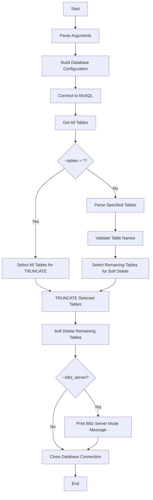

# Database Table Cleanup Script

## 1. Purpose

`db_clean.py` is a MySQL database maintenance utility used to clean database tables.

The script supports two cleanup operations:

* **TRUNCATE** — permanently removes all rows from selected tables.
* **SOFT DELETE cleanup** — removes rows where `IsDeleted = TRUE` from tables that were not selected for truncation.

The cleanup behavior is controlled through the `--tables` command-line argument.

> ⚠️ **Warning:** `TRUNCATE` and `DELETE` are destructive database operations. Verify the database, table names, and cleanup mode before execution.

---

## 2. Execution Flow



---

## 3. Database Configuration

The script obtains default database configuration using:

```python
get("db", ...)
```

The following database settings are supported:

```text
user
password
host
database
port
```

Default fallback values are:

| Setting  | Default     |
| -------- | ----------- |
| User     | `root`      |
| Password | `root`      |
| Host     | `localhost` |
| Database | `Blitz`     |
| Port     | `3306`      |

Command-line arguments override the values obtained from the global configuration.

---

## 4. Database Connection

### `get_db_connection()`

```python
get_db_connection(config)
```

This function establishes a connection to MySQL using `mysql.connector`.

The connection uses:

* Database username
* Database password
* Host
* Database name
* Port

Successful connection:

```text
Successfully connected to the database.
```

If the connection fails, the error is displayed and the function returns:

```python
None
```

The main process then stops because there is no valid database connection.

---

## 5. Fetching Database Tables

### `get_all_tables()`

```python
get_all_tables(cursor)
```

The function retrieves table names from the currently selected database using:

```sql
SHOW TABLES
```

The returned table names are converted into a set for table validation and lookup.

```text
Database
   ↓
SHOW TABLES
   ↓
All table names
   ↓
Set of database tables
```

---

## 6. `--tables` Argument

The `--tables` argument determines which tables are permanently truncated.

Syntax:

```bash
--tables <table1,table2,...>
```

Example:

```bash
python db_clean.py --tables users,orders
```

The supplied table names are separated by commas and whitespace around each name is removed.

---

## 7. Specific Table Cleanup

When specific table names are supplied:

```bash
python db_clean.py --tables users,orders
```

the script separates the database tables into two groups:

```text
Specified valid tables
        ↓
TRUNCATE

Remaining database tables
        ↓
SOFT DELETE
```

For example, if the database contains:

```text
users
orders
products
logs
sessions
```

and the command is:

```bash
python db_clean.py --tables users,orders
```

the processing becomes:

| Table      | Operation   |
| ---------- | ----------- |
| `users`    | TRUNCATE    |
| `orders`   | TRUNCATE    |
| `products` | SOFT DELETE |
| `logs`     | SOFT DELETE |
| `sessions` | SOFT DELETE |

---

## 8. Truncate All Tables

To select every table for truncation, use:

```bash
python db_clean.py --tables "*"
```

When `*` is supplied:

* All tables in the selected database are selected for truncation.
* No tables remain for soft-delete processing.

The script reports:

```text
Detected '*' for --tables. All tables will be truncated.
```

> ⚠️ **Extreme caution:** Using `--tables "*"` permanently removes all rows from every table in the selected database.

---

## 9. No Tables Specified

If `--tables` is not supplied:

```bash
python db_clean.py
```

the default value is an empty string.

No tables are selected for truncation.

As a result:

```text
All database tables
        ↓
Check for IsDeleted
        ↓
Delete rows where IsDeleted = TRUE
```

Therefore, omitting `--tables` does **not** mean that no cleanup occurs.

It causes all database tables to be considered for soft-delete cleanup.

---

## 10. Invalid Table Names

When specific tables are supplied, the script checks whether each table exists in the selected database.

Example:

```bash
python db_clean.py --tables users,orders,test_table
```

If `test_table` does not exist, the script prints a warning:

```text
Warning: The following tables specified for truncation do not exist in the database: test_table
```

Invalid table names are excluded from the truncation list.

The remaining valid table names continue through the cleanup process.

---

## 11. Processing Modes

The `process_tables()` function supports two modes:

```text
truncate
soft_delete
```

The selected mode determines the operation performed on each table.

---

## 12. Truncate Mode

When the processing mode is:

```text
truncate
```

the script executes:

```sql
TRUNCATE TABLE `table_name`
```

for each selected table.

### Example

```text
users
  ↓
TRUNCATE TABLE `users`
  ↓
All rows removed
```

After a successful operation on each table, the transaction is committed.

---

## 13. Truncate Failure Handling

If `TRUNCATE TABLE` fails for a table, the script:

1. Prints the error.
2. Performs a rollback.
3. Attempts a fallback `DELETE` operation.

Fallback query:

```sql
DELETE FROM `table_name`
```

If the fallback succeeds, the number of affected rows is reported and the operation is committed.

Example:

```text
TRUNCATE fails
      ↓
ROLLBACK
      ↓
Try DELETE
      ↓
DELETE succeeds
      ↓
COMMIT
```

This fallback is handled independently for each table.

---

## 14. Soft Delete Mode

When the processing mode is:

```text
soft_delete
```

the script first checks whether the table contains an `IsDeleted` column.

Only tables containing that column are processed for soft-delete cleanup.

---

## 15. `IsDeleted` Column Check

### `column_exists()`

```python
column_exists(cursor, table_name, column_name)
```

The function checks whether a specified column exists using:

```sql
SHOW COLUMNS FROM `table_name` LIKE 'column_name'
```

For soft-delete processing, the column checked is:

```text
IsDeleted
```

The flow is:

```text
Table
  ↓
Check IsDeleted column
  ↓
 ┌───────────────┐
 │               │
Exists         Missing
 │               │
 ↓               ↓
Delete          Skip
marked rows     table
```

---

## 16. Soft Delete Query

If the `IsDeleted` column exists, the script executes:

```sql
DELETE FROM `table_name`
WHERE `IsDeleted` = TRUE
```

This permanently removes rows that have already been marked as deleted.

Example:

```text
Before cleanup:

ID    IsDeleted
1     FALSE
2     TRUE
3     FALSE
4     TRUE

        ↓

DELETE WHERE IsDeleted = TRUE

        ↓

Remaining rows:

ID    IsDeleted
1     FALSE
3     FALSE
```

The number of deleted rows is obtained using:

```python
cursor.rowcount
```

---

## 17. Tables Without `IsDeleted`

If a table does not contain an `IsDeleted` column, it is skipped during soft-delete processing.

Example output:

```text
Skipping table `logs` for soft deletion: 'IsDeleted' column not found.
```

The script does not attempt to delete rows from that table.

---

## 18. Processing Order

The cleanup occurs in two main stages.

### Step 1 — Truncate Selected Tables

The valid tables specified through `--tables` are processed using:

```text
TRUNCATE
```

### Step 2 — Soft Delete Remaining Tables

All database tables not included in the truncation input are processed using:

```text
SOFT DELETE
```

The overall flow is:

```text
Database Tables
      ↓
Read --tables
      ↓
Validate specified tables
      ↓
 ┌───────────────┐
 │               │
Specified      Remaining
tables         tables
 │               │
 ↓               ↓
TRUNCATE       Check IsDeleted
                 ↓
              DELETE
              IsDeleted=TRUE
```

---

## 19. Transaction Handling

Database changes are committed on a per-table basis.

### Successful Operation

```python
conn.commit()
```

### Failed Operation

```python
conn.rollback()
```

This means a failure affecting one table does not cause all previously completed table operations to be rolled back.

For example:

```text
Table A → Success → COMMIT
Table B → Success → COMMIT
Table C → Failure → ROLLBACK
Table D → Continue processing
```

The exact continuation depends on the cleanup mode and error handling within the table-processing loop.

---

## 20. Truncate Fallback Transaction

For truncate mode, if `TRUNCATE` fails:

```text
TRUNCATE
   ↓
Failure
   ↓
ROLLBACK
   ↓
DELETE FROM table
   ↓
Success?
 ┌──────┴──────┐
Yes            No
 ↓              ↓
COMMIT       ROLLBACK
```

The fallback `DELETE` attempts to remove all rows from the affected table.

---

## 21. `--blitz_server`

The script supports:

```bash
--blitz_server
```

The argument is a Boolean command-line option.

When enabled, the script prints:

```text
Blitz server mode enabled. Additional cleanup tasks can be added here if needed.
```

Currently, this block does not perform any additional database cleanup.

Therefore, enabling `--blitz_server` currently changes the displayed runtime message but does not add another cleanup operation.

---

## 22. Command-Line Arguments

| Argument         | Default                            | Description                        |
| ---------------- | ---------------------------------- | ---------------------------------- |
| `--user`         | `root` / global configuration      | MySQL username                     |
| `--password`     | `root` / global configuration      | MySQL password                     |
| `--host`         | `localhost` / global configuration | MySQL server host                  |
| `--database`     | `Blitz` / global configuration     | Database name                      |
| `--port`         | `3306` / global configuration      | MySQL port                         |
| `--tables`       | `""`                               | Comma-separated tables to truncate |
| `--blitz_server` | `False`                            | Enables Blitz server mode message  |

---

## 23. Command-Line Examples

### 23.1 Truncate Selected Tables

```bash
python db_clean.py --tables users,orders
```

Processing:

```text
users   → TRUNCATE
orders  → TRUNCATE

All other tables
        ↓
SOFT DELETE where IsDeleted = TRUE
```

---

### 23.2 Truncate All Tables

```bash
python db_clean.py --tables "*"
```

Processing:

```text
All database tables
        ↓
TRUNCATE
        ↓
No soft-delete processing
```

---

### 23.3 Soft Delete Cleanup Only

```bash
python db_clean.py
```

Processing:

```text
All database tables
        ↓
Check IsDeleted
        ↓
If IsDeleted exists
        ↓
DELETE WHERE IsDeleted = TRUE
```

Tables without `IsDeleted` are skipped.

---

### 23.4 Specify Database Connection

```bash
python db_clean.py \
  --user root \
  --password "<password>" \
  --host localhost \
  --database Blitz \
  --port 3306 \
  --tables users,orders
```

---

### 23.5 Use Blitz Server Mode

```bash
python db_clean.py \
  --tables users,orders \
  --blitz_server
```

This enables the current Blitz Server mode message. No additional cleanup task is currently executed by that option.

---

## 24. Error Handling

The script handles database errors during:

* Database connection
* Table discovery
* Column existence checks
* Table truncation
* Fallback deletion
* Soft-delete operations

Unexpected exceptions during table processing are also caught.

For cleanup failures, the script attempts:

```python
conn.rollback()
```

The process then continues according to the surrounding table-processing logic.

---

## 25. Database Connection Failure

If the MySQL connection cannot be established:

```text
Error connecting to the database: <error>
```

The connection function returns `None`.

The main process then reports:

```text
Exiting due to database connection error.
```

No table cleanup is performed.

---

## 26. Table Discovery Failure

If `SHOW TABLES` fails, the table-discovery function returns an empty list.

This means the main process has no discovered tables available for cleanup.

The database connection is still closed in the final cleanup block.

---

## 27. Column Check Failure

If checking for the `IsDeleted` column fails, the column-check function returns `False`.

The table is therefore treated as not having the required column and is skipped for soft-delete processing.

---

## 28. Connection Closing

The database connection is closed in the `finally` block after the main processing logic.

```text
Cleanup processing
       ↓
Blitz server handling
       ↓
Close database connection
       ↓
Exit
```

The script prints:

```text
Database connection closed.
```

when the connection is closed.

---

## 29. Function Reference

| Function              | Responsibility                              |
| --------------------- | ------------------------------------------- |
| `get_db_connection()` | Establishes the MySQL connection            |
| `get_all_tables()`    | Retrieves all table names                   |
| `column_exists()`     | Checks whether a column exists              |
| `process_tables()`    | Performs truncate or soft-delete operations |
| `main()`              | Controls the complete cleanup workflow      |

---

## 30. Operational Safety Checklist

Before executing the cleanup script:

* [ ] Verify the MySQL host.
* [ ] Verify the database name.
* [ ] Verify the database credentials.
* [ ] Verify the selected tables.
* [ ] Understand whether the operation will truncate or soft-delete rows.
* [ ] Be especially careful when using `--tables "*"` .
* [ ] Confirm that the selected database is the intended environment.
* [ ] Ensure required database permissions are available.
* [ ] Review the command before executing it in production.

> ⚠️ `TRUNCATE` permanently removes all rows from the selected table. Use it only when complete table cleanup is intended.

---

## 31. Cleanup Behavior Matrix

| `--tables` value   | Truncate                   | Soft Delete                                                                                     |
| ------------------ | -------------------------- | ----------------------------------------------------------------------------------------------- |
| `users,orders`     | Valid `users` and `orders` | All other database tables                                                                       |
| `*`                | All database tables        | None                                                                                            |
| Not supplied       | None                       | All database tables                                                                             |
| Invalid table name | No                         | Not part of the truncation list; remaining database tables are still considered for soft-delete |

---

## 32. Complete Functional Flow

```text
Start
  ↓
Parse command-line arguments
  ↓
Load database configuration
  ↓
Connect to MySQL
  ↓
Get all database tables
  ↓
Read --tables
  ↓
Validate specified table names
  ↓
Determine truncation tables
  ↓
Determine remaining tables
  ↓
TRUNCATE selected tables
  ↓
Soft-delete rows from remaining tables
  ↓
Check --blitz_server
  ↓
Close database connection
  ↓
End
```

---

## 33. Functional Summary

`db_clean.py` provides controlled database cleanup through two cleanup modes:

```text
TRUNCATE
    ↓
Remove all rows from selected tables
```

and:

```text
SOFT DELETE CLEANUP
    ↓
Find tables containing IsDeleted
    ↓
DELETE rows where IsDeleted = TRUE
```

The `--tables` argument controls which tables are permanently truncated.

The important behaviors are:

* Specific tables can be selected for `TRUNCATE`.
* `--tables "*"` selects all database tables for `TRUNCATE`.
* When no tables are specified, all database tables are considered for soft-delete cleanup.
* Tables without `IsDeleted` are skipped during soft-delete processing.
* Failed `TRUNCATE` operations have a `DELETE` fallback.
* Each table operation is committed separately.
* Database errors are handled with rollback where applicable.
* The optional `--blitz_server` flag currently only prints a status message.
* The database connection is closed after processing.

> ⚠️ This script performs destructive database operations. Always verify the target database and cleanup parameters before execution.
