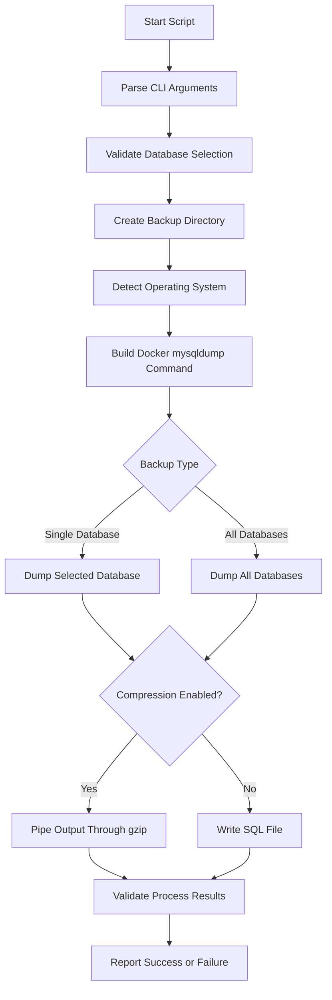

# MySQL Database Backup Script

## 1. Purpose

`db_backup.py` is a database backup utility used to create MySQL backups using `mysqldump`.

The script supports:

* Single-database backups
* Full-server backups using `--all_databases`
* Compressed `.sql.gz` backups
* Uncompressed `.sql` backups
* Docker-based MySQL execution
* Windows and Linux environments
* Automatic creation of the backup directory
* Timestamped backup filenames
* Failure handling and partial-file cleanup
* Manual execution through the command line

The script executes `mysqldump` inside a Docker container and saves the generated backup on the host system.

---

## 2. High-Level Execution Flow



---

## 3. Backup Function

### `backup_mysql_database()`

The `backup_mysql_database()` function is the main backup engine.

It is responsible for:

* Validating the backup directory
* Selecting the platform-specific `mysqldump` path
* Building the Docker command
* Selecting a database or all databases
* Generating the backup filename
* Compressing the backup when enabled
* Handling backup errors
* Removing incomplete backup files
* Returning the backup status

### Function Parameters

| Parameter              | Description                      | Default                   |
| ---------------------- | -------------------------------- | ------------------------- |
| `host`                 | MySQL server host                | From global configuration |
| `port`                 | MySQL server port                | `3306`                    |
| `mysqlbin_path`        | MySQL binary directory path      | Windows MySQL 8.0 path    |
| `db_user`              | MySQL username                   | From global configuration |
| `db_password`          | MySQL password                   | From global configuration |
| `db_name`              | Database to back up              | `None`                    |
| `backup_dir`           | Backup destination directory     | `.`                       |
| `all_databases`        | Whether to back up all databases | `False`                   |
| `compress`             | Whether to compress the backup   | `True`                    |
| `mysql_container_name` | MySQL Docker container name      | `blitz_mysql`             |

---

## 4. Backup Directory

Before starting the backup, the script checks whether the specified output directory exists.

If the directory does not exist, it attempts to create it automatically.

Example:

```text
backups/
```

If the directory cannot be created, the backup process stops and returns failure.

### Directory Creation Behavior

```text
Backup directory exists
        ↓
Continue backup

Backup directory does not exist
        ↓
Create directory
        ↓
Continue backup

Directory creation fails
        ↓
Report error
        ↓
Backup fails
```

---

## 5. Operating System Support

The script checks the operating system using `sys.platform`.

### Windows

On Windows, the script builds a `mysqldump.exe` path using the supplied `mysqlbin_path`.

The default path is:

```text
C:\Program Files\MySQL\MySQL Server 8.0\bin
```

### Linux

On Linux, the script uses:

```text
mysqldump
```

### Important Runtime Behavior

Although the script prepares a platform-specific `MYSQLDUMP_FULL_PATH`, the actual backup command is built using Docker:

```text
docker exec -i <container> mysqldump ...
```

Therefore, the actual database dump is executed **inside the MySQL Docker container**.

The `mysqlbin_path` argument does not form the command that is ultimately executed.

---

## 6. Docker-Based MySQL Backup

The actual backup command follows this structure:

```bash
docker exec -i <mysql_container_name> mysqldump \
  -u<username> \
  -p<password> \
  --host=<host> \
  --port=<port> \
  <database>
```

For example:

```bash
docker exec -i blitz_mysql mysqldump \
  -uroot \
  -p<password> \
  --host=localhost \
  --port=3306 \
  Blitz
```

The default Docker container name is:

```text
blitz_mysql
```

It can be changed using:

```bash
--mysql_container_name
```

### Docker Execution Flow

```text
Host Machine
     |
     | docker exec
     ↓
MySQL Docker Container
     |
     | mysqldump
     ↓
SQL Dump Output
     |
     ↓
Host Backup File
```

---

## 7. Database Selection

The script supports two backup modes.

### 7.1 Single Database

By default, the script backs up the database specified using:

```bash
--database
```

Example:

```bash
--database Blitz
```

The resulting dump contains the selected database backup.

If `--database` is not supplied and `--all_databases` is not enabled, the script reports an error.

---

### 7.2 All Databases

The `--all_databases` option creates a backup of all databases available through the configured MySQL connection.

Example:

```bash
--all_databases
```

When this option is used:

* `--database` is ignored for the dump selection.
* The filename prefix becomes `all_databases`.

Example:

```text
all_databases_backup_20260917_110530.sql.gz
```

---

## 8. Backup Filename

Every backup receives a timestamp.

The timestamp format is:

```text
YYYYMMDD_HHMMSS
```

For a single database, the filename format is:

```text
<database>_backup_<timestamp>.sql.gz
```

Example:

```text
Blitz_backup_20260917_110530.sql.gz
```

For an all-database backup:

```text
all_databases_backup_20260917_110530.sql.gz
```

### Filename Structure

```text
Database Name
      +
_backup_
      +
YYYYMMDD_HHMMSS
      +
.sql / .sql.gz
```

Timestamped filenames allow multiple backups to be stored without overwriting previous files.

---

## 9. Compression

Compression is enabled by default.

When compression is enabled, the `mysqldump` output is piped directly into `gzip`.

### Compressed Backup Flow

```text
mysqldump
    ↓
SQL Output
    ↓
gzip
    ↓
.sql.gz
```

Example:

```text
Blitz_backup_20260917_110530.sql.gz
```

Compression can reduce the amount of disk space required for backup storage.

---

## 10. Uncompressed Backup

Compression can be disabled using:

```bash
--no_compress
```

or:

```bash
-nc
```

In this mode, the backup is written directly as an SQL file.

Example:

```text
Blitz_backup_20260917_110530.sql
```

### Backup Formats

| Mode            | Extension | Behavior                                 |
| --------------- | --------- | ---------------------------------------- |
| Default         | `.sql.gz` | SQL dump compressed using gzip           |
| `--no_compress` | `.sql`    | SQL dump stored without gzip compression |

---

## 11. Backup Output Location

The backup destination is specified using:

```bash
--output_dir
```

or:

```bash
-o
```

The directory is created automatically if it does not already exist.

Example:

```bash
--output_dir backups
```

Result:

```text
backups/
└── Blitz_backup_20260917_110530.sql.gz
```

### Important

Although the argument definition contains a default value of `backups`, `--output_dir` is also marked as **required** by the command-line parser.

Therefore, the operator should always provide:

```bash
--output_dir <directory>
```

---

## 12. Command-Line Interface

The script can be executed directly from the command line.

### Basic Syntax

```bash
python db_backup.py \
  --user <mysql_user> \
  --password <mysql_password> \
  --database <database_name> \
  --output_dir <backup_directory>
```

---

## 13. Command-Line Arguments

### Connection Arguments

| Argument           | Description       | Default                               |
| ------------------ | ----------------- | ------------------------------------- |
| `--host`           | MySQL server host | Global DB configuration / `localhost` |
| `--port`           | MySQL server port | Global DB configuration / `3306`      |
| `-u`, `--user`     | MySQL username    | Global DB configuration / `root`      |
| `-p`, `--password` | MySQL password    | Global DB configuration / `root`      |

---

### Backup Arguments

| Argument                | Description                         | Default                             |
| ----------------------- | ----------------------------------- | ----------------------------------- |
| `-d`, `--database`      | Database to back up                 | Global DB configuration / `Blitz`   |
| `-a`, `--all_databases` | Back up all databases               | Disabled                            |
| `-o`, `--output_dir`    | Directory where the backup is saved | `backups`, but argument is required |
| `-nc`, `--no_compress`  | Disable gzip compression            | Compression enabled                 |

---

### Docker and MySQL Path Arguments

| Argument                 | Description                 | Default                                       |
| ------------------------ | --------------------------- | --------------------------------------------- |
| `-m`, `--mysqlbin_path`  | MySQL binary directory path | `C:\Program Files\MySQL\MySQL Server 8.0\bin` |
| `--mysql_container_name` | MySQL Docker container name | `blitz_mysql`                                 |

---

## 14. Global Database Configuration

Several database connection arguments use values from:

```python
lib.global_config.get()
```

The script attempts to obtain:

```text
db.host
db.port
db.user
db.password
db.database
```

If a value is not available from the global configuration, the script has fallback defaults.

| Configuration | Fallback    |
| ------------- | ----------- |
| Host          | `localhost` |
| Port          | `3306`      |
| User          | `root`      |
| Password      | `root`      |
| Database      | `Blitz`     |

Command-line arguments can override these defaults.

---

## 15. Single Database Backup Example

Example:

```bash
python db_backup.py \
  --host localhost \
  --port 3306 \
  --user root \
  --password "<password>" \
  --database Blitz \
  --output_dir backups
```

With default compression enabled, the expected output is similar to:

```text
backups/
└── Blitz_backup_20260917_110530.sql.gz
```

The exact timestamp depends on the execution time.

---

## 16. All Database Backup Example

To back up all databases:

```bash
python db_backup.py \
  --host localhost \
  --port 3306 \
  --user root \
  --password "<password>" \
  --all_databases \
  --output_dir backups
```

Expected output:

```text
backups/
└── all_databases_backup_20260917_110530.sql.gz
```

When `--all_databases` is specified, the database supplied through `--database` is ignored for backup selection.

---

## 17. Uncompressed Backup Example

To generate an uncompressed SQL dump:

```bash
python db_backup.py \
  --user root \
  --password "<password>" \
  --database Blitz \
  --output_dir backups \
  --no_compress
```

Expected output:

```text
backups/
└── Blitz_backup_20260917_110530.sql
```

---

## 18. Custom Docker Container Example

If the MySQL container has a different name:

```bash
python db_backup.py \
  --user root \
  --password "<password>" \
  --database Blitz \
  --output_dir backups \
  --mysql_container_name my_mysql
```

The script then executes `mysqldump` inside:

```text
my_mysql
```

instead of the default:

```text
blitz_mysql
```

---

## 19. Backup Process Messages

During execution, the script prints status messages to the console.

Typical successful execution includes messages similar to:

```text
--- MySQL Backup Application ---
Ensure 'mysqldump' command is available in your system's PATH.
If you get 'command not found' errors, install MySQL client tools.

Starting backup for 'Blitz' with compression...
Backup successful: 'backups/Blitz_backup_20260917_110530.sql.gz'

MySQL backup process completed successfully!

--- Exiting MySQL Backup Application ---
```

The exact filename depends on the execution timestamp.

---

## 20. Error Handling

The script handles several failure conditions and returns `False` when the backup cannot be completed.

### 20.1 Backup Directory Creation Failure

If the backup directory cannot be created:

```text
Error: Could not create backup directory
```

The backup process stops.

---

### 20.2 Database Name Missing

If neither a database name nor `--all_databases` is supplied, the script reports an argument error.

The backup function also validates that `db_name` exists when `all_databases` is disabled.

---

### 20.3 MySQL Backup Failure

If `mysqldump` returns a non-zero exit code, the script reports the error.

For uncompressed backups, the partially created SQL file is removed.

For compressed backups, the generated compressed file is also removed when `mysqldump` fails.

---

### 20.4 gzip Failure

For compressed backups, the script checks the gzip process return code.

If gzip fails, the backup process returns failure.

---

### 20.5 Required Command Not Found

If the required command cannot be started, the script reports that `mysqldump` or `gzip` could not be found.

The script recommends ensuring the required tools are available in the system environment.

Because the actual `mysqldump` command is executed through Docker, Docker must also be available and the configured MySQL container must be accessible.

---

### 20.6 Unexpected Errors

Unexpected exceptions are caught and reported with an error message.

The function returns:

```text
False
```

when the backup cannot be completed successfully.

---

## 21. Partial Backup Cleanup

The script attempts to remove partially created backup files when `mysqldump` fails.

This prevents an incomplete dump from being left in the backup directory and being mistaken for a valid backup.

```text
Backup starts
     ↓
Backup file created
     ↓
mysqldump fails
     ↓
Delete partial file
     ↓
Report failure
```

---

## 22. Return Status

The backup function returns a Boolean status.

| Return Value | Meaning                       |
| ------------ | ----------------------------- |
| `True`       | Backup completed successfully |
| `False`      | Backup failed                 |

The main execution block uses this status to display the final result.

Successful execution:

```text
MySQL backup process completed successfully!
```

Failed execution:

```text
MySQL backup process failed.
```

---

## 23. Runtime Dependencies

### Required Runtime Components

The backup process requires the following components:

* Python
* Docker
* Running MySQL Docker container
* `mysqldump` available inside the MySQL container
* `gzip` when compression is enabled

### Python Standard Library

The script uses Python standard-library modules:

```text
os
subprocess
datetime
sys
argparse
```

It also imports:

```text
lib.global_config
```

from the project.

No third-party Python package is required by the script itself for the backup operation.

---

## 24. Operational Prerequisites

Before running the backup, verify:

### Docker

Docker should be running.

Check:

```bash
docker --version
```

---

### MySQL Container

Verify that the configured container exists and is running:

```bash
docker ps
```

For the default configuration:

```text
blitz_mysql
```

---

### MySQL Access

The supplied MySQL credentials must have sufficient permissions for the requested dump.

---

### Backup Directory

The specified output directory must be writable by the process.

The script creates the directory when it does not exist.

---

### gzip

For compressed backups, `gzip` must be available on the host system.

Check:

```bash
gzip --version
```

---

## 25. Security Considerations

The script accepts the MySQL password through:

```bash
--password
```

For example:

```bash
--password "<password>"
```

Passing passwords directly through command-line arguments can expose credentials through mechanisms such as shell history or process inspection, depending on the operating environment.

### Operational Recommendation

For production environments, consider using a more secure credential-management mechanism rather than exposing database passwords directly in command-line arguments.

The current script itself does not implement environment-variable or secret-manager based password handling.

---

## 26. Backup Storage Structure

A typical backup directory can contain multiple timestamped backups:

```text
backups/
├── Blitz_backup_20260917_080000.sql.gz
├── Blitz_backup_20260917_100000.sql.gz
├── Blitz_backup_20260917_120000.sql.gz
└── Blitz_backup_20260917_140000.sql.gz
```

Each execution generates a new timestamped filename.

The script does not automatically delete older backups.

---

## 27. Compressed Backup Structure

When compression is enabled:

```text
mysqldump
    ↓
SQL data
    ↓
gzip
    ↓
Blitz_backup_YYYYMMDD_HHMMSS.sql.gz
```

When compression is disabled:

```text
mysqldump
    ↓
SQL data
    ↓
Blitz_backup_YYYYMMDD_HHMMSS.sql
```

---

## 28. Operational Usage

The script can be used as a standalone backup utility or incorporated into a larger operational workflow.

A typical workflow may be:

```text
Start Operational Process
        ↓
Run Database Backup
        ↓
Verify Backup Result
        ↓
Continue Subsequent Operations
```

The script itself does not automatically trigger database cleanup, ingestion, schema changes, or restore operations.

Those actions must be handled by the surrounding workflow or operator.

---

## 29. Important Operational Notes

### Database Selection

Use:

```bash
--database <name>
```

for a specific database.

Use:

```bash
--all_databases
```

for all databases.

---

### Output Directory

Always provide:

```bash
--output_dir <directory>
```

because the argument is marked as required by the CLI parser.

---

### Compression

Compression is enabled by default.

Use:

```bash
--no_compress
```

only when an uncompressed `.sql` file is required.

---

### Docker Container

The default container is:

```text
blitz_mysql
```

If the environment uses another container name, specify:

```bash
--mysql_container_name <container>
```

---

### Backup Verification

A successful script execution indicates that the backup command completed successfully.

For operational recovery planning, backups should also be periodically tested through an actual restore process.

The current script does **not** perform restore validation automatically.

---

## 30. Function and Responsibility Reference

| Component                 | Responsibility                                  |
| ------------------------- | ----------------------------------------------- |
| `backup_mysql_database()` | Performs the database backup                    |
| `os`                      | Handles directories and file paths              |
| `subprocess`              | Executes Docker, mysqldump, and gzip processes  |
| `datetime`                | Generates timestamped filenames                 |
| `argparse`                | Processes command-line arguments                |
| `global_config.get()`     | Provides default database configuration         |
| `docker exec`             | Executes `mysqldump` inside the MySQL container |
| `mysqldump`               | Generates the SQL database dump                 |
| `gzip`                    | Compresses the SQL dump when enabled            |

---

## 31. Complete Backup Flow

```text
Operator / Process Manager
            ↓
      Execute db_backup.py
            ↓
       Parse arguments
            ↓
   Validate database selection
            ↓
    Validate/create output dir
            ↓
     Build Docker command
            ↓
      Execute mysqldump
            ↓
      ┌─────┴─────┐
      ↓           ↓
  Compress     No Compression
      ↓           ↓
    gzip       .sql file
      ↓           ↓
      └─────┬─────┘
            ↓
     Validate result
            ↓
   ┌────────┴────────┐
   ↓                 ↓
Success             Failure
   ↓                 ↓
Save backup       Cleanup partial
   ↓                 ↓
Report success    Report failure
```

---

## 32. Example Backup Results

### Compressed Single Database

Command:

```bash
python db_backup.py \
  --user root \
  --password "<password>" \
  --database Blitz \
  --output_dir backups
```

Result:

```text
backups/
└── Blitz_backup_20260917_110530.sql.gz
```

---

### Uncompressed Single Database

Command:

```bash
python db_backup.py \
  --user root \
  --password "<password>" \
  --database Blitz \
  --output_dir backups \
  --no_compress
```

Result:

```text
backups/
└── Blitz_backup_20260917_110530.sql
```

---

### All Databases

Command:

```bash
python db_backup.py \
  --user root \
  --password "<password>" \
  --all_databases \
  --output_dir backups
```

Result:

```text
backups/
└── all_databases_backup_20260917_110530.sql.gz
```

---

## 33. Summary

`db_backup.py` provides a command-line mechanism for creating MySQL database backups.

The main characteristics are:

* Supports individual database backups
* Supports all-database backups
* Executes `mysqldump` inside a Docker container
* Generates timestamped backup filenames
* Compresses backups by default
* Supports uncompressed SQL output
* Automatically creates the backup directory
* Handles backup and compression failures
* Removes partial backup files when `mysqldump` fails
* Supports configurable MySQL connection parameters
* Supports configurable Docker container names
* Can be executed manually or as part of an automated operational workflow
* Does not perform automatic backup deletion or restore validation

The resulting backup files provide a recoverable SQL dump that can be retained and used by a separate database restore process when required.
