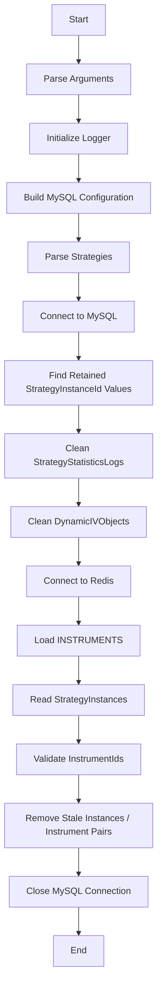

# Strategy Statistics and Dynamic IV Cleanup Script

## 1. Purpose

The `rt_ivobj_and_sstat.py` script performs two database cleanup operations in a single execution:

1. Retains `StrategyStatisticsLogs` and `DynamicIVObjects` data for selected strategies and strategy instances.
2. Removes stale strategy instances and instrument-related records by comparing database data with the Redis instrument master.

The script works with:

* MySQL
* Redis
* JSON-formatted `IVObjects` data

The cleanup is performed in two phases:

```text
MySQL Strategy Retention
        ↓
Clean StrategyStatisticsLogs
        ↓
Clean DynamicIVObjects
        ↓
Redis Instrument Validation
        ↓
Clean Stale StrategyInstances
        ↓
Clean Missing Instrument Records
```

> ⚠️ **Warning:** This script performs destructive database operations. Always verify the selected strategies, instances, database, and Redis instrument master before execution.

---

## 2. Main Functional Flow



---

# 3. Logging

## 3.1 Logger Initialization

The script initializes a logger named:

```text
rt_ivobj_and_sstat
```

The logger can be reinitialized using:

```python
init_logger(log_file)
```

The logger records:

* Information messages
* Warning messages
* Error messages

These messages provide visibility into database cleanup, Redis processing, skipped records, and failures.

---

## 3.2 Log File

The default log file is:

```text
rt_ivobj_and_sstat.log
```

The file is created next to the script.

The log file is opened in append mode, so messages from subsequent executions are added to the existing log file.

A custom log file can be supplied using:

```bash
--log-file <path>
```

---

# 4. MySQL Connection

## 4.1 Database Configuration

The script obtains default MySQL configuration values from:

```python
get("db", ...)
```

The supported configuration values are:

```text
user
password
host
database
port
```

The command-line arguments can override these values.

### Default Values

| Parameter | Default                                 |
| --------- | --------------------------------------- |
| User      | From global configuration / `root`      |
| Password  | From global configuration / `root`      |
| Host      | From global configuration / `127.0.0.1` |
| Database  | From global configuration / `Blitz`     |
| Port      | From global configuration / `3306`      |

---

## 4.2 `get_db_connection()`

```python
get_db_connection(config)
```

This function creates a MySQL connection using `mysql.connector`.

The connection uses:

* Username
* Password
* Host
* Database
* Port

If the connection succeeds, the connection object is returned.

If a MySQL connection error occurs:

```text
Error connecting to the database: <error>
```

is logged and `None` is returned.

The main process stops when a database connection cannot be established.

---

# 5. Redis Connection

## 5.1 `get_redis_connection()`

```python
get_redis_connection(args)
```

The Redis connection uses:

| Parameter | Source         |
| --------- | -------------- |
| Host      | `--redis-host` |
| Port      | `--redis-port` |
| Database  | `--redis-db`   |

The connection uses:

```text
decode_responses=True
```

After creating the Redis client, the script executes:

```python
redis_conn.ping()
```

to validate connectivity.

If Redis connection fails, the error is logged and `None` is returned.

---

# 6. Strategy Retention

## 6.1 Strategy Input

The script accepts the strategy selection through:

```bash
--strategies
```

The default value is:

```text
Copy Trade:Matrix
```

The expected format is:

```text
StrategyName:InstanceName1|InstanceName2,StrategyName2
```

Example:

```bash
python script.py --strategies "ABX1:Instance1|Instance2,XYZ"
```

This represents:

```text
ABX1
 ├── Instance1
 └── Instance2

XYZ
 └── All instances
```

---

## 6.2 Strategy Parsing

The script separates multiple strategy definitions using:

```text
,
```

For example:

```text
ABX1:Instance1|Instance2,XYZ
```

becomes two entries:

```text
ABX1:Instance1|Instance2
XYZ
```

When `:` is present, the value is split into:

```text
Strategy Name
Instance Names
```

Instance names are then separated using:

```text
|
```

---

## 6.3 Strategy Without Instance Name

A strategy can also be supplied without `:`.

Example:

```text
XYZ
```

If the strategy value is alphanumeric, the script stores it as:

```python
{
    "XYZ": ["*"]
}
```

The `*` value represents all instances for that strategy.

---

## 6.4 Invalid Strategy Input

Invalid strategy definitions are logged.

Examples include:

```text
Invalid strategy format
```

or strategy names that do not satisfy the expected parsing rules.

Invalid entries are not added to the retention dictionary.

---

# 7. Finding Retained Strategy Instances

The script uses `StrategyStatisticsLogs` to find the `StrategyInstanceId` values that should be retained.

The resulting IDs are stored in:

```text
instance_ids
```

There are two lookup modes.

---

## 7.1 Retain All Instances for a Strategy

When a strategy is represented as:

```text
StrategyName:*
```

or parsed into:

```python
["*"]
```

the script queries:

```sql
SELECT StrategyInstanceId
FROM StrategyStatisticsLogs
WHERE StrategyName = %s
```

All matching `StrategyInstanceId` values are added to the retention list.

---

## 7.2 Retain Specific Instances

For input such as:

```text
ABX1:Instance1|Instance2
```

the script searches using:

```sql
SELECT StrategyInstanceId
FROM StrategyStatisticsLogs
WHERE StrategyName = %s
AND StrategyInstanceName IN (...)
```

Only matching strategy instances are retained.

---

# 8. No Retained Instances

If no `StrategyInstanceId` values are found, the script performs a full cleanup of the two retention-related tables.

It deletes all rows from:

```text
StrategyStatisticsLogs
DynamicIVObjects
```

Queries:

```sql
DELETE FROM StrategyStatisticsLogs
```

and:

```sql
DELETE FROM DynamicIVObjects
```

The changes are then committed.

> ⚠️ If the supplied strategy selection does not match any strategy instances, this branch removes all rows from both tables.

---

# 9. Cleanup for Retained Instances

When retained `StrategyInstanceId` values exist, the script performs a more selective cleanup.

The cleanup consists of:

1. Capture zero-position statistics.
2. Delete statistics for non-retained instances.
3. Delete zero-position statistics from retained instances.
4. Delete dynamic IV objects for non-retained instances.
5. Delete dynamic IV objects associated with zero-position legs.

---

# 10. Capture Zero-Position Legs

Before deleting zero-position statistics, the script captures:

```text
StrategyInstanceId
IVName
```

for retained instances where:

```text
NetPosition = 0
```

Query:

```sql
SELECT StrategyInstanceId, IVName
FROM StrategyStatisticsLogs
WHERE StrategyInstanceId IN (...)
AND NetPosition = 0
```

The resulting pairs are stored in:

```text
zero_position_keys
```

Format:

```text
(StrategyInstanceId, IVName)
```

These pairs are later used to identify corresponding `DynamicIVObjects`.

---

# 11. Delete Statistics for Non-Retained Instances

All `StrategyStatisticsLogs` rows belonging to strategy instances that are not in the retained list are deleted.

Query:

```sql
DELETE FROM StrategyStatisticsLogs
WHERE StrategyInstanceId NOT IN (...)
```

This removes statistics associated with strategy instances that were not selected for retention.

---

# 12. Delete Zero-Position Statistics

Even for retained strategy instances, statistics with:

```text
NetPosition = 0
```

are removed.

Query:

```sql
DELETE FROM StrategyStatisticsLogs
WHERE StrategyInstanceId IN (...)
AND NetPosition = 0
```

The number of deleted rows is added to the statistics deletion count.

---

# 13. Delete Dynamic IV Objects for Non-Retained Instances

For `DynamicIVObjects`, the script removes rows where:

```text
IsDynamic = 1
```

and the `StrategyInstanceId` is not retained.

Query:

```sql
DELETE FROM DynamicIVObjects
WHERE IsDynamic = 1
AND StrategyInstanceId NOT IN (...)
```

Only dynamic IV objects are targeted by this cleanup step.

---

# 14. Delete Dynamic IV Objects for Zero-Position Legs

The previously captured:

```text
(StrategyInstanceId, IVName)
```

pairs are matched against:

```text
(StrategyInstanceId, Name)
```

in `DynamicIVObjects`.

The cleanup targets:

```text
IsDynamic = 1
```

Query:

```sql
DELETE FROM DynamicIVObjects
WHERE IsDynamic = 1
AND (StrategyInstanceId, Name) IN (...)
```

This keeps the `DynamicIVObjects` cleanup aligned with the zero-position entries removed from `StrategyStatisticsLogs`.

---

# 15. Transaction Handling

The retention cleanup is committed after successful database operations.

```python
conn.commit()
```

If a MySQL error occurs during the retention step:

```python
conn.rollback()
```

is executed and the error is logged.

The script does not use one single transaction for the entire program. The retention phase and orphan cleanup operations perform commits as their respective operations complete.

---

# 16. Redis Instrument Master

## 16.1 `INSTRUMENTS` Redis Key

The orphan cleanup reads instrument master data from Redis.

The default Redis key is:

```text
INSTRUMENTS
```

This key is expected to contain a Redis STRING containing newline-separated CSV records.

Example:

```text
110010002000016,NSE,NIFTY MIDCAP 100,...
110010002000017,NSE,BANKNIFTY,...
```

---

## 16.2 Instrument ID Field

The script extracts the InstrumentId from a configurable CSV field.

The default field index is:

```text
0
```

The index is zero-based.

For example, with:

```text
110010002000016,NSE,NIFTY MIDCAP 100,...
```

field index `0` produces:

```text
110010002000016
```

---

## 16.3 Loading Instrument IDs

### `load_instrument_ids_from_redis()`

```python
load_instrument_ids_from_redis(
    redis_conn,
    instrument_key,
    field_index
)
```

The function:

1. Reads the Redis `INSTRUMENTS` key.
2. Splits the value into lines.
3. Splits each line into CSV fields.
4. Extracts the configured field.
5. Adds valid InstrumentIds to a set.

The result is a set of instrument ID strings.

Example:

```text
{
    "110010002000016",
    "110010002000017"
}
```

If the Redis key is missing, empty, unreadable, or produces zero IDs, the function returns `None`.

---

# 17. Redis Instrument Validation

## 17.1 `is_instrument_present()`

```python
is_instrument_present(
    instrument_ids,
    instrument_id
)
```

This function checks whether an InstrumentId exists in the Redis-derived instrument set.

The logic is:

```text
InstrumentId exists in Redis
        ↓
Present

InstrumentId does not exist
        ↓
Missing
```

If the instrument master could not be loaded, the orphan cleanup is aborted before processing `StrategyInstances`.

---

# 18. Orphaned Strategy Instance Cleanup

## 18.1 `cleanup_stale_strategy_instances()`

```python
cleanup_stale_strategy_instances(
    conn,
    redis_conn,
    redis_instrument_key,
    redis_instrument_field_index
)
```

This function compares database strategy-instance information against the Redis instrument master.

It reads:

```sql
SELECT StrategyInstanceId, IVObjects
FROM StrategyInstances
```

Each strategy instance is evaluated according to its `IVObjects` content.

---

# 19. `IVObjects` JSON Structure

The `IVObjects` field is expected to contain a JSON array.

Each object can contain:

```text
InstrumentId
```

Example:

```json
[
    {
        "InstrumentId": "110010002000016"
    },
    {
        "InstrumentId": "110010002000017"
    }
]
```

The script parses the value using JSON decoding.

---

# 20. Invalid `IVObjects` Data

If the `IVObjects` value contains invalid JSON:

```text
StrategyInstanceId
        ↓
JSON parsing fails
        ↓
Log error
        ↓
Skip StrategyInstance
```

If the parsed JSON value is not a list, the strategy instance is also skipped.

Examples of invalid data:

```text
Malformed JSON
```

or:

```json
{
    "InstrumentId": "123"
}
```

when an array is expected.

---

# 21. Strategy Instance with `IVObjects`

When:

```text
IVObjects
```

contains one or more objects, the script checks the InstrumentId values against Redis.

The script stops checking as soon as it finds the first missing InstrumentId.

Flow:

```text
StrategyInstance
       ↓
Read IVObjects
       ↓
Check InstrumentId
       ↓
Present?
   ┌───────┴───────┐
  Yes              No
   ↓                ↓
Check next       Delete complete
instrument       StrategyInstance
```

---

# 22. Missing Instrument in `IVObjects`

When a missing InstrumentId is found, the script deletes **all rows belonging to that `StrategyInstanceId`** from:

```text
StrategyStatisticsLogs
DynamicIVObjects
StrategyInstances
```

The deletes are:

```sql
DELETE FROM StrategyStatisticsLogs
WHERE StrategyInstanceId = %s
```

```sql
DELETE FROM DynamicIVObjects
WHERE StrategyInstanceId = %s
```

```sql
DELETE FROM StrategyInstances
WHERE StrategyInstanceId = %s
```

The transaction is then committed.

> ⚠️ The script does not delete only the missing instrument. It removes the complete strategy instance and all related rows identified by that `StrategyInstanceId`.

---

# 23. Strategy Instance with Empty `IVObjects`

When:

```text
IVObjects = []
```

the script does **not** delete the `StrategyInstances` row.

Instead, it queries:

```sql
SELECT InstrumentId
FROM DynamicIVObjects
WHERE StrategyInstanceId = %s
```

Each returned InstrumentId is compared against the Redis instrument set.

---

# 24. Missing Instruments for Empty `IVObjects`

When a `DynamicIVObjects` InstrumentId is not found in Redis, the script deletes the matching pair from both:

```text
DynamicIVObjects
StrategyStatisticsLogs
```

Queries:

```sql
DELETE FROM DynamicIVObjects
WHERE StrategyInstanceId = %s
AND InstrumentId = %s
```

and:

```sql
DELETE FROM StrategyStatisticsLogs
WHERE StrategyInstanceId = %s
AND InstrumentId = %s
```

The changes are committed.

The corresponding `StrategyInstances` row remains unchanged.

---

# 25. Orphan Cleanup Statistics

The orphan cleanup tracks two counters:

```text
total_deleted_instances
total_deleted_pairs
```

### `total_deleted_instances`

Counts `StrategyInstances` rows deleted because an InstrumentId referenced by a non-empty `IVObjects` array was missing from Redis.

### `total_deleted_pairs`

Counts instrument pairs cleaned up when `IVObjects` is empty and a missing InstrumentId is found in `DynamicIVObjects`.

At completion, the script logs both values.

Example:

```text
Orphaned-instance cleanup done:
5 StrategyInstances deleted,
12 instrument pairs cleaned up
```

---

# 26. Command-Line Arguments

## 26.1 Database Arguments

| Argument     | Default                     | Description    |
| ------------ | --------------------------- | -------------- |
| `--user`     | Global config / `root`      | MySQL username |
| `--password` | Global config / `root`      | MySQL password |
| `--host`     | Global config / `127.0.0.1` | MySQL host     |
| `--database` | Global config / `Blitz`     | Database name  |
| `--port`     | Global config / `3306`      | MySQL port     |

---

## 26.2 Strategy Argument

| Argument       | Default             | Description                                      |
| -------------- | ------------------- | ------------------------------------------------ |
| `--strategies` | `Copy Trade:Matrix` | Strategies and optional instance names to retain |

Example:

```bash
--strategies "ABX1:Instance1|Instance2,XYZ"
```

---

## 26.3 Redis Arguments

| Argument                         | Default                     | Description                                  |
| -------------------------------- | --------------------------- | -------------------------------------------- |
| `--redis-host`                   | Global config / `127.0.0.1` | Redis host                                   |
| `--redis-port`                   | Global config / `6379`      | Redis port                                   |
| `--redis-db`                     | Global config / `0`         | Redis database index                         |
| `--redis-instrument-key`         | `INSTRUMENTS`               | Redis key containing instrument master       |
| `--redis-instrument-field-index` | `0`                         | Zero-based CSV field containing InstrumentId |

---

## 26.4 Logging Argument

| Argument     | Default                                | Description   |
| ------------ | -------------------------------------- | ------------- |
| `--log-file` | `rt_ivobj_and_sstat.log` beside script | Log file path |

The log file is appended to on every run.

---

# 27. Command-Line Examples

## 27.1 Retain Specific Strategy Instances

```bash
python rt_ivobj_and_sstat.py \
  --strategies "ABX1:Instance1|Instance2"
```

This searches for:

```text
StrategyName = ABX1
InstanceName = Instance1
InstanceName = Instance2
```

The matching `StrategyInstanceId` values are retained during the retention phase.

---

## 27.2 Retain All Instances of a Strategy

```bash
python rt_ivobj_and_sstat.py \
  --strategies "ABX1"
```

The strategy is treated as:

```text
ABX1:*
```

All matching instances for `ABX1` are selected.

---

## 27.3 Multiple Strategies

```bash
python rt_ivobj_and_sstat.py \
  --strategies "ABX1:Instance1|Instance2,XYZ"
```

This means:

```text
ABX1
 ├── Instance1
 └── Instance2

XYZ
 └── All instances
```

---

## 27.4 Custom Redis Instrument Key

```bash
python rt_ivobj_and_sstat.py \
  --strategies "ABX1" \
  --redis-instrument-key INSTRUMENTS
```

---

## 27.5 Custom Redis Database

```bash
python rt_ivobj_and_sstat.py \
  --strategies "ABX1" \
  --redis-db 1
```

---

## 27.6 Custom Log File

```bash
python rt_ivobj_and_sstat.py \
  --strategies "ABX1" \
  --log-file /var/log/rt_ivobj_and_sstat.log
```

---

# 28. Complete Execution Sequence

```text
Start
  ↓
Parse command-line arguments
  ↓
Initialize logger
  ↓
Build MySQL configuration
  ↓
Parse --strategies
  ↓
Connect to MySQL
  ↓
Find retained StrategyInstanceId values
  ↓
┌─────────────────────────────┐
│ Retained IDs found?         │
└──────────────┬──────────────┘
               │
       ┌───────┴───────┐
       │               │
      No              Yes
       │               │
       ↓               ↓
Delete all        Capture zero-position
StrategyStats     statistics
and DynamicIV          ↓
Objects            Delete non-retained
       │            statistics
       │                ↓
       │            Delete zero-position
       │            statistics
       │                ↓
       │            Delete non-retained
       │            dynamic objects
       │                ↓
       │            Delete matching
       │            zero-position
       │            dynamic objects
       │
       └──────────┬──────────┘
                  ↓
             Commit DB work
                  ↓
             Connect to Redis
                  ↓
             Load INSTRUMENTS
                  ↓
          Instrument master available?
             ┌────┴────┐
            No         Yes
             │          │
             ↓          ↓
          Abort      Read StrategyInstances
          orphan          ↓
          cleanup      Parse IVObjects
                         ↓
                   Check InstrumentIds
                         ↓
                  Remove stale records
                         ↓
                 Close MySQL connection
                         ↓
                        End
```

---

# 29. Retention Phase Summary

The first phase is focused on retaining selected strategy instances.

```text
--strategies
      ↓
Find StrategyInstanceId
      ↓
Keep selected instances
      ↓
Remove non-retained statistics
      ↓
Remove zero-position statistics
      ↓
Remove non-retained dynamic IV objects
      ↓
Remove dynamic IV objects for
zero-position legs
```

---

# 30. Orphan Cleanup Phase Summary

The second phase compares database instrument references against Redis.

```text
Redis INSTRUMENTS
       ↓
Load InstrumentIds
       ↓
Read StrategyInstances
       ↓
Check IVObjects
       ↓
Instrument exists?
   ┌───────┴───────┐
  Yes              No
   ↓                ↓
Keep             Remove stale
instance         records
```

For empty `IVObjects`, the script checks `DynamicIVObjects` directly and removes only missing instrument pairs.

---

# 31. Important Operational Behavior

### Missing Redis Instrument Master

If the Redis `INSTRUMENTS` key cannot be loaded or parsed into InstrumentIds, orphan cleanup is aborted.

The script does not treat unavailable instrument-master data as an empty instrument set.

This prevents the cleanup from incorrectly treating every database instrument as missing.

---

### Missing Instrument in Non-Empty `IVObjects`

If one InstrumentId referenced by `IVObjects` is missing from Redis:

```text
Entire StrategyInstance
       ↓
Deleted
```

The associated:

```text
StrategyStatisticsLogs
DynamicIVObjects
```

rows for that StrategyInstanceId are also deleted.

---

### Empty `IVObjects`

If `IVObjects` is empty:

```text
StrategyInstances row
       ↓
Retained
```

Only missing instrument pairs in:

```text
DynamicIVObjects
StrategyStatisticsLogs
```

are removed.

---

### Invalid JSON

If `IVObjects` contains invalid JSON, the strategy instance is skipped and an error is logged.

---

### Unsupported JSON Structure

If `IVObjects` parses successfully but is not a list, the strategy instance is skipped.

---

# 32. Error Handling

The script handles MySQL errors during:

* Database connection
* Strategy retention queries
* Statistics deletion
* Dynamic IV cleanup
* Strategy instance cleanup

Redis errors are handled during:

* Redis connection
* Instrument master retrieval
* Redis instrument validation

Errors are written to the configured log file.

Database errors during cleanup trigger:

```python
conn.rollback()
```

---

# 33. Database Connection Closing

The MySQL connection is closed after:

1. Strategy retention cleanup
2. Redis orphan cleanup

The script closes the connection at the end of the main execution flow.

---

# 34. Function Reference

| Function                             | Responsibility                                                    |
| ------------------------------------ | ----------------------------------------------------------------- |
| `init_logger()`                      | Initializes the application logger                                |
| `get_db_connection()`                | Connects to MySQL                                                 |
| `get_redis_connection()`             | Connects to Redis and validates the connection                    |
| `load_instrument_ids_from_redis()`   | Loads InstrumentIds from the Redis `INSTRUMENTS` key              |
| `is_instrument_present()`            | Checks whether an InstrumentId exists in the Redis instrument set |
| `cleanup_stale_strategy_instances()` | Removes stale strategy instances and missing instrument pairs     |
| `main()`                             | Controls strategy retention and orphan cleanup                    |

---

# 35. Data Sources and Tables

## MySQL Tables

The script operates on:

```text
StrategyStatisticsLogs
DynamicIVObjects
StrategyInstances
```

### `StrategyStatisticsLogs`

Used to:

* Find retained `StrategyInstanceId` values.
* Remove non-retained strategy statistics.
* Remove zero-position statistics.
* Remove statistics associated with missing instruments.

### `DynamicIVObjects`

Used to:

* Remove dynamic objects for non-retained instances.
* Remove objects associated with zero-position legs.
* Remove missing instrument pairs during orphan cleanup.

### `StrategyInstances`

Used during orphan cleanup to:

* Read `StrategyInstanceId`
* Read `IVObjects`
* Validate referenced InstrumentIds
* Remove stale strategy instances

---

# 36. Redis Data

The script expects the Redis key:

```text
INSTRUMENTS
```

to contain newline-separated CSV records.

The configured field index determines which CSV field is interpreted as the InstrumentId.

Default:

```text
Field Index: 0
```

---

# 37. Operational Safety Checklist

Before running the script:

* [ ] Verify the MySQL host.
* [ ] Verify the MySQL database.
* [ ] Verify database credentials.
* [ ] Review the `--strategies` value.
* [ ] Confirm the strategy and instance names are correct.
* [ ] Verify Redis host and port.
* [ ] Verify the Redis database index.
* [ ] Confirm the `INSTRUMENTS` key contains valid instrument master data.
* [ ] Verify the InstrumentId field index.
* [ ] Confirm the log file location.
* [ ] Review the expected cleanup impact before production execution.

> ⚠️ **Important:** An incorrect `--strategies` value can cause the retention phase to delete more data than intended. In particular, if no matching `StrategyInstanceId` values are found, the script deletes all rows from `StrategyStatisticsLogs` and `DynamicIVObjects`.

---

# 38. Functional Summary

The script performs the following complete workflow:

```text
                    START
                      ↓
              Parse Arguments
                      ↓
              Initialize Logger
                      ↓
              Connect to MySQL
                      ↓
              Parse Strategies
                      ↓
        Find Retained StrategyInstanceIds
                      ↓
             ┌────────┴────────┐
             │                 │
       No retained IDs     IDs found
             │                 │
             ↓                 ↓
      Delete all Stats    Keep selected IDs
      Delete all IVObjs         ↓
                            Delete non-retained
                            statistics
                                 ↓
                            Delete zero-position
                            statistics
                                 ↓
                            Delete non-retained
                            DynamicIVObjects
                                 ↓
                            Delete zero-position
                            dynamic objects
             │                 │
             └────────┬────────┘
                      ↓
                 Connect Redis
                      ↓
              Load INSTRUMENTS
                      ↓
             Read StrategyInstances
                      ↓
                Parse IVObjects
                      ↓
              Validate InstrumentIds
                      ↓
          ┌───────────┴───────────┐
          │                       │
   Missing in IVObjects      IVObjects empty
          │                       │
          ↓                       ↓
 Delete complete instance    Check DynamicIVObjects
          │                       │
          ↓                       ↓
 Delete related Stats       Delete missing pairs
 and DynamicIVObjects             │
          │                       │
          └───────────┬───────────┘
                      ↓
             Close MySQL Connection
                      ↓
                     END
```

---

# 39. Final Summary

`rt_ivobj_and_sstat.py` is a combined MySQL and Redis cleanup utility.

Its primary responsibilities are:

* Retain selected strategy instances.
* Remove statistics for non-retained strategy instances.
* Remove zero-position statistics.
* Remove dynamic IV objects associated with removed data.
* Read the Redis `INSTRUMENTS` master.
* Detect strategy instances referencing instruments no longer present in Redis.
* Remove complete stale strategy instances when their non-empty `IVObjects` reference a missing instrument.
* Remove individual missing instrument pairs when `IVObjects` is empty.
* Maintain logs of cleanup activity and errors.

The script performs the strategy-retention phase first and the Redis-based orphan cleanup phase afterward.

Because both phases can permanently delete database records, the database environment, strategy selection, Redis instrument master, and command-line parameters should be verified before execution.
