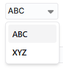
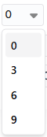
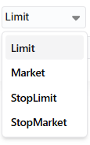
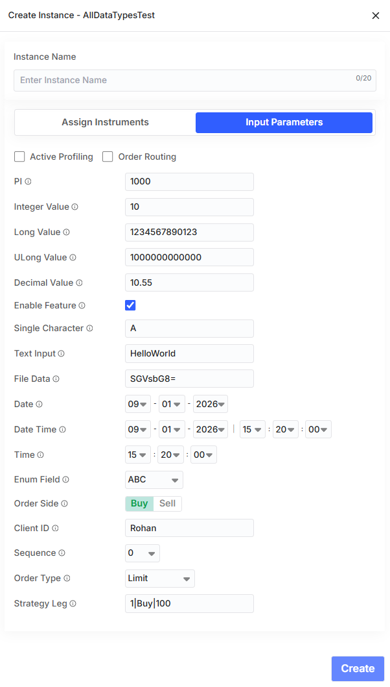

# BlitzTrader Strategy JSON Configuration Guide

---

<!-- ## Table of Contents

1. [Introduction](#1-introduction)
2. [Architecture Overview](#2-architecture-overview)
3. [Strategy JSON Schema](#3-strategy-json-schema)
4. [Strategy Metadata Fields](#4-strategy-metadata-fields)
5. [Input Parameters](#5-input-parameters)
   - 5.1 [Parameter Schema](#51-parameter-schema)
   - 5.2 [Field Definitions](#52-field-definitions)
   - 5.3 [Base (System) Parameters](#53-base-system-parameters)
6. [Supported Data Types](#6-supported-data-types)
   - 6.1 [Numeric Types](#61-numeric-types)
   - 6.2 [Text & Binary Types](#62-text--binary-types)
   - 6.3 [Date & Time Types](#63-date--time-types)
   - 6.4 [Selection & Enumeration Types](#64-selection--enumeration-types)
   - 6.5 [Trading-Specific Types](#65-trading-specific-types)
7. [Market Variable Binding (iVObjects)](#7-market-variable-binding-ivobjects)
8. [Output Variables](#8-output-variables)
9. [Commands](#9-commands)
   - 9.1 [Instance-Level Commands](#91-instance-level-commands)
   - 9.2 [Global Commands](#92-global-commands)
10. [Exchange Details](#10-exchange-details)
11. [Controls](#11-controls)
12. [Complete Strategy JSON Example](#12-complete-strategy-json-example)
13. [Validation Rules & Best Practices](#13-validation-rules--best-practices) -->

---

## 1. Introduction

BlitzTrader strategies are programmable trading logic modules written in C# using the BlitzTrader Strategy Framework and SDK. Each strategy is compiled, deployed, and executed on the server side. The web-based **Trading Dashboard** provides traders and operations teams with a real-time interface to configure, monitor, and control these server-side strategy instances.

The **Strategy JSON Configuration** is the metadata contract that bridges backend strategy logic with the frontend dashboard. It serves three core functions:

| Function | Description |
|---|---|
| **UI Rendering** | Defines how each input parameter is presented in the dashboard — the control type, label, category grouping, visibility, and editability. |
| **Data Binding** | Maps market variables (instruments) to real-world securities (e.g., Reliance Industries Futures, NIFTY 50 Index), enabling the strategy engine to subscribe to live market data and route orders for the correct instruments. |
| **Runtime Interaction** | Exposes output variables (e.g., P&L, position status) and commands (e.g., SquareOff, Exit) that the trader can observe or invoke directly from the UI during live execution. |

Every strategy **must** have a valid JSON configuration. The dashboard reads this JSON to dynamically generate the entire parameter entry form, command buttons, and output display — no frontend code changes are required when a new strategy is deployed.

---

## 2. Architecture Overview

The strategy lifecycle follows a well-defined pipeline from source code to live execution:

```text
┌──────────────────────────────────────────────────────────────────────────┐
│                     STRATEGY DEPLOYMENT PIPELINE                         │
└──────────────────────────────────────────────────────────────────────────┘

┌──────────────────┐      ┌──────────────────┐      ┌──────────────────┐
│  C# Strategy     │      │  Compiled        │      │  Strategy JSON   │
│  Source Code     │─────▶│  Strategy DLL    │─────▶│  Configuration   │
│  (.cs)           │      │  (.dll)          │      │  (.json)         │
└──────────────────┘      └──────────────────┘      └────────┬─────────┘
                                                             │
                                                             ▼
                                                    ┌──────────────────┐
                                                    │  Python Sync     │
                                                    │  Script          │
                                                    └────────┬─────────┘
                                                             │
                                                             ▼
┌──────────────────┐      ┌──────────────────┐      ┌──────────────────┐
│  Trading         │◀─────│  BlitzTrader     │◀─────│  MySQL           │
│  Dashboard (UI)  │      │  Engine          │      │  Strategies DB   │
└──────────────────┘      └──────────────────┘      └──────────────────┘
```

**Flow Summary:**

1. The strategy developer writes trading logic in **C#** and compiles it into a **.dll** assembly.
2. A **Strategy JSON** file is authored alongside, defining all input parameters, market variable bindings, output variables, commands, and exchange details.
3. A **Python sync script** reads the JSON and inserts/updates the strategy record in the **MySQL `strategies` table**.
4. The **BlitzTrader Engine** loads the strategy definition from the database, instantiates the DLL, and begins execution.
5. The **Trading Dashboard** queries the strategy metadata and dynamically renders the configuration UI for the trader.

---

## 3. Strategy JSON Schema

The root-level structure of a Strategy JSON document:

```json
{
  "strategyId": "98e28ed8-89dd-52b6-b456-5e4e1c095e54",
  "strategyName": "StrategyName",
  "assemblyName": "QX.Blitz.Strategy.StrategyName.dll",
  "version": "1.0.0",
  "owner": "OwnerName",
  "category": "Signal",
  "displayName": "Strategy Display Name",
  "description": "Brief description of the strategy's purpose and behavior.",
  "strategyType": "1",
  "inputParameters": [ ... ],
  "iVObjects": [ ... ],
  "outputVariables": [ ... ],
  "commands": [ ... ],
  "globalCommands": [ ... ],
  "exchangeDetails": [ ... ],
  "controls": [ ... ],
  "checksum": "6d55c4274f1f9a98fc0c...",
  "createdAt": "2026-03-25T11:18:09",
  "updatedAt": "2026-03-31T06:19:29",
  "updatedBy": "System",
  "isDeleted": 0
}
```

---

## 4. Strategy Metadata Fields

| Field | Type | Required | Description |
|---|---|---|---|
| `strategyId` | `string` (UUID) | Yes | Globally unique identifier for the strategy. Must be a valid UUID v4/v5. |
| `strategyName` | `string` | Yes | Internal name used by the engine to identify the strategy. Must match the class name in the DLL. |
| `assemblyName` | `string` | Yes | Filename of the compiled .NET assembly (e.g., `QX.Blitz.Strategy.PairTrader.dll`). |
| `version` | `string` | Yes | Semantic version string (e.g., `1.0.0`, `2.3.1`). |
| `owner` | `string` | Yes | Name of the strategy developer or owning team. |
| `category` | `string` | Yes | Logical category for grouping in the UI (e.g., `Signal`, `Execution`, `Hedging`, `Test`). |
| `displayName` | `string` | Yes | Human-readable name shown in the dashboard header and strategy list. |
| `description` | `string` | Yes | Brief description of the strategy's purpose. Shown as a tooltip or subtitle in the UI. |
| `strategyType` | `string` | Yes | Numeric type identifier. Determines engine-level behavior classification. |
| `checksum` | `string` | No | SHA-256 hash of the JSON payload for integrity verification during sync. |
| `createdAt` | `string` (ISO 8601) | No | Timestamp of initial creation. |
| `updatedAt` | `string` (ISO 8601) | No | Timestamp of the most recent update. |
| `updatedBy` | `string` | No | Identity of the user or system that performed the last update. |
| `isDeleted` | `integer` | No | Soft-delete flag. `0` = active, `1` = deleted. |

---

## 5. Input Parameters

Input parameters are the primary mechanism through which the Trading Dashboard collects configuration values from the trader and passes them to the server-side strategy instance. The dashboard reads the `inputParameters` array and **dynamically generates** the appropriate UI controls — text fields, dropdowns, toggles, date pickers, etc. — based on each parameter's `dataType`.

### 5.1 Parameter Schema

Each entry in the `inputParameters` array follows this structure:

```json
{
  "name": "ParamName",
  "value": "currentValue",
  "dataType": "Type",
  "isVisible": true,
  "isEditable": true,
  "isReadOnly": false,
  "description": "Tooltip or help text for this parameter.",
  "displayName": "UI Label",
  "categoryName": "CategoryGroup",
  "defaultValue": "initialDefault"
}
```

### 5.2 Field Definitions

| Field | Type | Description |
|---|---|---|
| `name` | `string` | **Internal identifier.** Must exactly match the corresponding property name in the C# strategy code. Case-sensitive. |
| `value` | `string` | **Current value** of the parameter. All values are serialized as strings regardless of data type. |
| `dataType` | `string` | Determines the UI control rendered and the validation rules applied. See [Section 6](#6-supported-data-types). |
| `isVisible` | `boolean` | Controls whether the parameter appears in the dashboard UI. Set to `false` for internal/system parameters that should not be exposed to the trader. |
| `isEditable` | `boolean` | When `true`, the trader can modify this parameter's value in the UI. When `false`, the field is displayed but grayed out. |
| `isReadOnly` | `boolean` | When `true`, the parameter is strictly read-only and cannot be modified at any point — not even during strategy instance creation. Typically used for system-assigned values like exchange client IDs. |
| `description` | `string` | Human-readable description. Rendered as tooltip text or helper text beneath the input control. |
| `displayName` | `string` | **UI label.** The text shown next to the input control in the dashboard form. Should be concise but descriptive. |
| `categoryName` | `string` | Groups parameters into collapsible sections in the UI (e.g., `Base`, `Trading`, `Risk`, `Misc`). Parameters with the same `categoryName` appear together. |
| `defaultValue` | `string` | The value pre-populated when a new strategy instance is created. For `Enum` types, this defines the list of allowed values using pipe-delimited syntax: `{Option1\|Option2\|Option3}`. |

### 5.3 Base (System) Parameters

Every strategy inherits the following base parameters. These are typically hidden from the trader (`isVisible: false`) and control system-level behavior:

| Parameter | Data Type | Default | Purpose |
|---|---|---|---|
| `ActivateProfiling` | `Boolean` | `false` | Enables performance profiling and diagnostic logging for the strategy instance. |
| `OrderRoutingEnabled` | `Boolean` | `false` | Master switch for live order routing. When `false`, the strategy runs in simulation/paper-trade mode. |
| `PublishInterval` | `Int` | `1000` | Interval (in milliseconds) at which the strategy publishes output variable updates to the dashboard. |

```json
[
  {
    "name": "ActivateProfiling",
    "value": "false",
    "dataType": "Boolean",
    "isVisible": false,
    "isEditable": true,
    "isReadOnly": false,
    "description": "Enable performance profiling and diagnostic logging.",
    "displayName": "AP",
    "categoryName": "Base",
    "defaultValue": "false"
  },
  {
    "name": "OrderRoutingEnabled",
    "value": "false",
    "dataType": "Boolean",
    "isVisible": false,
    "isEditable": true,
    "isReadOnly": false,
    "description": "Enable live order routing to exchange.",
    "displayName": "OR",
    "categoryName": "Base",
    "defaultValue": "false"
  },
  {
    "name": "PublishInterval",
    "value": "1000",
    "dataType": "Int",
    "isVisible": false,
    "isEditable": true,
    "isReadOnly": false,
    "description": "Output variable publish interval in milliseconds.",
    "displayName": "PI",
    "categoryName": "Base",
    "defaultValue": "1000"
  }
]
```


---

## 6. Supported Data Types

The `dataType` field determines how the dashboard renders the input control and how the value is validated. The following data types are supported:

### 6.1 Numeric Types

#### `Int` — 32-bit Signed Integer

Renders as a numeric input field. Accepts whole numbers within the range of a 32-bit signed integer.

```json
{
  "name": "Quantity",
  "value": "10",
  "dataType": "Int",
  "isVisible": true,
  "isEditable": true,
  "isReadOnly": false,
  "description": "Number of lots to trade.",
  "displayName": "Quantity",
  "categoryName": "Trading",
  "defaultValue": "10"
}
```


#### `Long` — 64-bit Signed Integer

Renders as a numeric input field. Used for large integer values such as instrument IDs, timestamps, or counters.

```json
{
  "name": "LongParam",
  "value": "1234567890123",
  "dataType": "Long",
  "isVisible": true,
  "isEditable": true,
  "isReadOnly": false,
  "description": "Large integer value.",
  "displayName": "Long Value",
  "categoryName": "Misc",
  "defaultValue": "1234567890123"
}
```


#### `ULong` — 64-bit Unsigned Integer

Same as `Long` but only accepts non-negative values. Suitable for hash values, unique tokens, or counts.

```json
{
  "name": "ULongParam",
  "value": "1000000000000",
  "dataType": "ULong",
  "isVisible": true,
  "isEditable": true,
  "isReadOnly": false,
  "description": "Unsigned large numeric value.",
  "displayName": "ULong Value",
  "categoryName": "Misc",
  "defaultValue": "1000000000000"
}
```


#### `Double` — 64-bit Floating Point

Renders as a decimal input field. Used for prices, percentages, ratios, and other fractional values.

```json
{
  "name": "SpreadThreshold",
  "value": "10.55",
  "dataType": "Double",
  "isVisible": true,
  "isEditable": true,
  "isReadOnly": false,
  "description": "Spread threshold in basis points.",
  "displayName": "Spread Threshold",
  "categoryName": "Trading",
  "defaultValue": "10.55"
}
```


---

### 6.2 Text & Binary Types

#### `Boolean` — True/False Toggle

Renders as a checkbox or toggle switch in the UI.

```json
{
  "name": "EnableFeature",
  "value": "true",
  "dataType": "Boolean",
  "isVisible": true,
  "isEditable": true,
  "isReadOnly": false,
  "description": "Enable or disable this feature.",
  "displayName": "Enable Feature",
  "categoryName": "Base",
  "defaultValue": "true"
}
```


#### `Char` — Single Character

Renders as a single-character text input field.

```json
{
  "name": "CharParam",
  "value": "A",
  "dataType": "Char",
  "isVisible": true,
  "isEditable": true,
  "isReadOnly": false,
  "description": "Single character input.",
  "displayName": "Single Character",
  "categoryName": "Misc",
  "defaultValue": "A"
}
```


#### `String` — Free-Form Text

Renders as a standard text input field. Used for labels, identifiers, notes, or any arbitrary string.

```json
{
  "name": "StrategyTag",
  "value": "ProdRun01",
  "dataType": "String",
  "isVisible": true,
  "isEditable": true,
  "isReadOnly": false,
  "description": "Custom tag for this strategy instance.",
  "displayName": "Strategy Tag",
  "categoryName": "Base",
  "defaultValue": "ProdRun01"
}
```


#### `ByteArray` — Base64-Encoded Binary Data

Renders as a file-upload or Base64 text input. Used for embedding binary payloads such as serialized configuration blobs or small data files.

```json
{
  "name": "ByteArrayParam",
  "value": "SGVsbG8=",
  "dataType": "ByteArray",
  "isVisible": true,
  "isEditable": true,
  "isReadOnly": false,
  "description": "Base64-encoded binary data.",
  "displayName": "File Data",
  "categoryName": "Misc",
  "defaultValue": "SGVsbG8="
}
```


---

### 6.3 Date & Time Types

#### `Date` — Calendar Date

Renders as a date picker.

| Aspect | Format |
|---|---|
| **Storage format** | `YYYYMMDD` (e.g., `20260109`) |
| **UI display format** | `DD-MM-YYYY` (e.g., `09-01-2026`) |

```json
{
  "name": "ExpiryDate",
  "value": "20260109",
  "dataType": "Date",
  "isVisible": true,
  "isEditable": true,
  "isReadOnly": false,
  "description": "Contract expiry date.",
  "displayName": "Expiry Date",
  "categoryName": "Trading",
  "defaultValue": "20260109"
}
```


#### `DateTime` — Date and Time Combined

Renders as a combined date-time picker.

| Aspect | Format |
|---|---|
| **Storage format** | `YYYYMMDD HHMMSS` (e.g., `20260109 152000`) |
| **UI display format** | `DD-MM-YYYY HH:MM:SS` |

```json
{
  "name": "ScheduledStart",
  "value": "20260109 152000",
  "dataType": "DateTime",
  "isVisible": true,
  "isEditable": true,
  "isReadOnly": false,
  "description": "Scheduled strategy start time.",
  "displayName": "Start DateTime",
  "categoryName": "Misc",
  "defaultValue": "20260109 152000"
}
```


#### `Time` — Time of Day

Renders as a time picker.

| Aspect | Format |
|---|---|
| **Storage format** | `HHMMSS` (e.g., `152000` for 3:20:00 PM) |
| **UI display format** | `HH:MM:SS` |

```json
{
  "name": "CutoffTime",
  "value": "152000",
  "dataType": "Time",
  "isVisible": true,
  "isEditable": true,
  "isReadOnly": false,
  "description": "End-of-day cutoff time for order placement.",
  "displayName": "Cutoff Time",
  "categoryName": "Trading",
  "defaultValue": "152000"
}
```


---

### 6.4 Selection & Enumeration Types

#### `Enum` — Dropdown Selection

Renders as a dropdown (select) control. The `defaultValue` field defines the allowed options using **pipe-delimited syntax** enclosed in curly braces.

**Syntax:** `{Option1|Option2|Option3}`

The `value` field holds the currently selected option.

```json
{
  "name": "ExecutionMode",
  "value": "Aggressive",
  "dataType": "Enum",
  "isVisible": true,
  "isEditable": true,
  "isReadOnly": false,
  "description": "Order execution aggression level.",
  "displayName": "Execution Mode",
  "categoryName": "Trading",
  "defaultValue": "{Passive|Aggressive|Neutral}"
}
```




#### `Sequence` — Numeric Range Generator

Renders as a dropdown populated with a generated numeric sequence. Useful for parameters where the trader selects from a predefined range of values (e.g., lot multipliers, tick offsets).

**Syntax:** `start-end|step`

| Example Value | Generates |
|---|---|
| `0-10\|3` | `0, 3, 6, 9` |
| `1-5\|1` | `1, 2, 3, 4, 5` |
| `100-500\|100` | `100, 200, 300, 400, 500` |

```json
{
  "name": "LotMultiplier",
  "value": "0-10|3",
  "dataType": "Sequence",
  "isVisible": true,
  "isEditable": true,
  "isReadOnly": false,
  "description": "Select a lot multiplier from the generated range.",
  "displayName": "Lot Multiplier",
  "categoryName": "Trading",
  "defaultValue": "0-10|3"
}
```




---

### 6.5 Trading-Specific Types

#### `OrderSide` — Buy/Sell Toggle

Renders as a toggle or two-button selector for trade direction.

**Allowed values:** `Buy`, `Sell`

```json
{
  "name": "Direction",
  "value": "Buy",
  "dataType": "OrderSide",
  "isVisible": true,
  "isEditable": true,
  "isReadOnly": false,
  "description": "Trade direction for the strategy leg.",
  "displayName": "Order Side",
  "categoryName": "Trading",
  "defaultValue": "Buy"
}
```


#### `OrderType` — Order Execution Type

Renders as a dropdown for selecting the order type.

**Allowed values:**

| Value | Description |
|---|---|
| `Limit` | Limit order — executed at a specified price or better. |
| `Market` | Market order — executed immediately at the best available price. |
| `StopLimit` | Stop-limit order — becomes a limit order once the stop price is reached. |
| `StopMarket` | Stop-market order — becomes a market order once the stop price is reached. |

```json
{
  "name": "OrderType",
  "value": "Limit",
  "dataType": "OrderType",
  "isVisible": true,
  "isEditable": true,
  "isReadOnly": false,
  "description": "Order execution type.",
  "displayName": "Order Type",
  "categoryName": "Trading",
  "defaultValue": "Limit"
}
```




#### `ILeg` — Strategy Leg Definition

Renders as a composite input for defining a single leg of a multi-leg strategy.

**Format:** `ratio|side|price`

| Component | Description | Example |
|---|---|---|
| `ratio` | Lot ratio or quantity multiplier | `1` |
| `side` | Trade direction | `Buy` or `Sell` |
| `price` | Limit price for the leg | `100` |

```json
{
  "name": "Leg1",
  "value": "1|Buy|2500",
  "dataType": "ILeg",
  "isVisible": true,
  "isEditable": true,
  "isReadOnly": false,
  "description": "First leg of the pair strategy.",
  "displayName": "Leg 1",
  "categoryName": "Trading",
  "defaultValue": "1|Buy|2500"
}
```


#### `ExchangeClientId` — Exchange Client Identifier

Renders as a read-only text field displaying the exchange-assigned client ID. This value is typically set by the system and should not be modified by the trader.

```json
{
  "name": "ClientId",
  "value": "ABC123",
  "dataType": "ExchangeClientId",
  "isVisible": true,
  "isEditable": false,
  "isReadOnly": true,
  "description": "Exchange-assigned client identifier.",
  "displayName": "Client ID",
  "categoryName": "Misc",
  "defaultValue": "ABC123"
}
```


---

## 7. Market Variable Binding (iVObjects)

The `iVObjects` array is the mechanism through which a strategy **binds abstract market variable slots to actual tradable instruments**. Each entry defines a named instrument slot that the trader populates with a real-world security when creating a strategy instance.

### How It Works

1. **Strategy Definition:** The developer defines one or more `iVObjects` in the JSON, each representing a logical instrument slot (e.g., `FuturesIV`, `OptionLegIV`, `HedgeIV`).
2. **Instance Creation:** When a trader creates a new instance of the strategy in the dashboard, the UI presents each `iVObject` as an instrument selector. The trader searches for and selects an actual instrument — for example, **Reliance Industries Futures (NSE)** or **NIFTY 50 Index Options (NFO)**.
3. **Runtime Binding:** The engine binds the selected instrument to the slot. The strategy code references the instrument by its `iVObjectsName` (e.g., `FuturesIV`), and the engine routes market data subscriptions and order execution to the actual instrument the trader selected.

### iVObject Schema

```json
{
  "isTradable": true,
  "description": "Futures Instrument",
  "instrumentId": 0,
  "iVObjectsName": "FuturesIV",
  "instrumentType": "All",
  "requiredMarketDataType": "All",
  "requiredOrderEventType": "All"
}
```

### Field Definitions

| Field | Type | Description |
|---|---|---|
| `iVObjectsName` | `string` | Logical name of the instrument slot. Referenced in the C# strategy code to access market data and place orders. |
| `description` | `string` | Human-readable label shown in the dashboard instrument selector. |
| `instrumentId` | `integer` | Default instrument ID. Set to `0` when no default is assigned — the trader selects the instrument at instance creation time. |
| `isTradable` | `boolean` | If `true`, the strategy can place orders on this instrument. If `false`, the slot is used for market data subscription only (e.g., an index used as a reference signal). |
| `instrumentType` | `string` | Filters the instrument selector in the UI. Values: `All`, `Futures`, `Options`, `Equity`, `Index`, etc. |
| `requiredMarketDataType` | `string` | Specifies which market data feeds the strategy needs for this instrument (e.g., `All`, `L1`, `L2`, `Trades`). |
| `requiredOrderEventType` | `string` | Specifies which order event callbacks the strategy needs for this instrument (e.g., `All`, `Fill`, `Cancel`). |

### Example: Pair Trading Strategy with Two Instruments

```json
"iVObjects": [
  {
    "isTradable": true,
    "description": "Primary Leg — e.g., Reliance Futures",
    "instrumentId": 0,
    "iVObjectsName": "PrimaryIV",
    "instrumentType": "Futures",
    "requiredMarketDataType": "All",
    "requiredOrderEventType": "All"
  },
  {
    "isTradable": true,
    "description": "Hedge Leg — e.g., NIFTY 50 Futures",
    "instrumentId": 0,
    "iVObjectsName": "HedgeIV",
    "instrumentType": "Futures",
    "requiredMarketDataType": "All",
    "requiredOrderEventType": "All"
  },
  {
    "isTradable": false,
    "description": "Reference Index — e.g., NIFTY BANK Index",
    "instrumentId": 0,
    "iVObjectsName": "ReferenceIV",
    "instrumentType": "Index",
    "requiredMarketDataType": "L1",
    "requiredOrderEventType": "All"
  }
]
```

In this example:
- `PrimaryIV` and `HedgeIV` are tradable slots — the trader might bind them to **Reliance Industries Futures** and **NIFTY 50 Futures** respectively.
- `ReferenceIV` is a non-tradable, data-only slot — the trader might bind it to the **NIFTY Bank Index** to use as a signal reference.

---

## 8. Output Variables

The `outputVariables` array defines runtime values that the strategy publishes to the dashboard during execution. These are **read-only** on the UI side — the strategy code updates them, and the dashboard displays the latest values.

### Schema

```json
{
  "name": "VariableName",
  "value": "initialValue",
  "dataType": "DataType"
}
```

### Common Output Variables

| Variable | Data Type | Description |
|---|---|---|
| `MTM` | `Double` | Mark-to-Market profit/loss for the strategy instance. |
| `Status` | `String` | Current execution status (e.g., `RUNNING`, `PAUSED`, `STOPPED`, `ERROR`). |
| `NetPosition` | `Int` | Current net position across all legs. |
| `SignalValue` | `Double` | Latest computed signal value. |

### Example

```json
"outputVariables": [
  {
    "name": "MTM",
    "value": "0.0",
    "dataType": "Double"
  },
  {
    "name": "Status",
    "value": "RUNNING",
    "dataType": "String"
  }
]
```

The dashboard renders these as a live-updating panel, refreshed at the interval specified by the `PublishInterval` base parameter.

---

## 9. Commands

Commands are **user-triggered actions** that the trader can invoke from the dashboard during live strategy execution. Each command sends a request to the server-side strategy instance, which processes it and executes the corresponding logic.

### 9.1 Instance-Level Commands

Instance-level commands are scoped to a single strategy instance and may accept input parameters.

#### Schema

```json
{
  "id": "UUID",
  "name": "CommandName",
  "commandInputParameters": [
    {
      "name": "ParamName",
      "value": "defaultValue",
      "dataType": "Type"
    }
  ]
}
```

#### Common Commands

| Command | Description | Typical Parameters |
|---|---|---|
| `ExecuteBasket` | Execute a basket of orders across multiple instruments. | `InstrumentId`, `OrderQty`, `OrderPrice`, `OrderSide` per leg |
| `ExecuteHedgeBasket` | Execute a hedging basket order. | Same as above, with additional legs |
| `MoveAway` | Move open orders away from the current price by a percentage. | `InstrumentId`, `Percentage`, `OrderSide` |
| `MoveCloser` | Move open orders closer to the current price by a percentage. | `InstrumentId`, `Percentage`, `OrderSide` |
| `Add` | Add to an existing position. | `InstrumentId`, `Percentage`, `OrderSide` |
| `Exit` | Exit a position partially or fully. | `InstrumentId`, `Percentage`, `OrderSide` |
| `SetStopLoss` | Set a stop-loss level. | `InstrumentId`, `StopLossPercentage`, `OrderSide` |
| `SetTrailingStopLoss` | Set a trailing stop-loss. | `InstrumentId`, `TrailingStopLoss`, `OrderSide` |
| `CancelOpenOrder` | Cancel all open orders for an instrument. | `InstrumentId` |

#### Example: MoveCloser Command

```json
{
  "id": "2327BCA6-279A-47D4-AC19-AC7A5F23F68E",
  "name": "MoveCloser",
  "commandInputParameters": [
    {
      "name": "InstrumentId",
      "value": "0",
      "dataType": "Double"
    },
    {
      "name": "Percentage",
      "value": "1",
      "dataType": "Int"
    },
    {
      "name": "OrderSide",
      "value": "Buy",
      "dataType": "OrderSide"
    }
  ]
}
```

### 9.2 Global Commands

Global commands operate across **all instances** of a strategy simultaneously. They are rendered as top-level action buttons in the dashboard.

```json
"globalCommands": [
  {
    "name": "SquareOff All",
    "referenceCommand": "ExecuteTrade"
  }
]
```

| Field | Description |
|---|---|
| `name` | Display label for the button in the UI. |
| `referenceCommand` | The underlying engine command to invoke across all instances. |

---

## 10. Exchange Details

The `exchangeDetails` array registers the strategy with specific exchange segments for regulatory and algorithmic trading compliance.

### Schema

```json
{
  "algoId": "123456789",
  "algoCategoryId": "123654789123",
  "exchangeSegment": "NSECM"
}
```

### Field Definitions

| Field | Description |
|---|---|
| `algoId` | Algorithmic trading registration ID assigned by the exchange. |
| `algoCategoryId` | Category-level registration ID for the algorithm class. |
| `exchangeSegment` | Exchange segment code (e.g., `NSECM` for NSE Cash Market, `BSECM` for BSE Cash Market, `NSEFO` for NSE Futures & Options). |

### Example: Multi-Exchange Registration

```json
"exchangeDetails": [
  {
    "algoId": "123456789",
    "algoCategoryId": "123654789123",
    "exchangeSegment": "NSECM"
  },
  {
    "algoId": "123456789000",
    "algoCategoryId": "12365478912300",
    "exchangeSegment": "BSECM"
  }
]
```

---

## 11. Controls

The `controls` array defines additional UI-level configuration elements that are not input parameters but influence the dashboard's behavior or provide reference data.

```json
"controls": [
  {
    "name": "IndexList",
    "value": "NIFTY 50|NIFTY BANK"
  }
]
```

| Field | Description |
|---|---|
| `name` | Control identifier. |
| `value` | Pipe-delimited list of values that the UI can reference for display or filtering. |

---

## 12. Complete Strategy JSON Example

Below is a fully populated strategy configuration demonstrating all supported features. This example uses the strategy name `AllDataTypesTest` and includes every supported data type, market variable bindings, output variables, commands, and exchange details.

<details>
<summary><strong>Click to expand full JSON</strong></summary>

```json
{
  "strategyId": "98e28ed8-89dd-52b6-b456-5e4e1c095e54",
  "strategyName": "AllDataTypesTest",
  "assemblyName": "QX.Blitz.Strategy.AllTypes.dll",
  "version": "1.0.0",
  "owner": "Rohan",
  "category": "Test",
  "displayName": "All Data Types Strategy",
  "description": "Testing all supported data types.",
  "strategyType": "1",
  "inputParameters": [
    {
      "name": "ActivateProfiling",
      "value": "false",
      "dataType": "Boolean",
      "isVisible": false,
      "isEditable": true,
      "isReadOnly": false,
      "description": "Enable performance profiling.",
      "displayName": "AP",
      "categoryName": "Base",
      "defaultValue": "false"
    },
    {
      "name": "OrderRoutingEnabled",
      "value": "false",
      "dataType": "Boolean",
      "isVisible": false,
      "isEditable": true,
      "isReadOnly": false,
      "description": "Enable live order routing.",
      "displayName": "OR",
      "categoryName": "Base",
      "defaultValue": "false"
    },
    {
      "name": "PublishInterval",
      "value": "1000",
      "dataType": "Int",
      "isVisible": false,
      "isEditable": true,
      "isReadOnly": false,
      "description": "Publish interval in milliseconds.",
      "displayName": "PI",
      "categoryName": "Base",
      "defaultValue": "1000"
    },
    {
      "name": "IntParam",
      "value": "10",
      "dataType": "Int",
      "isVisible": true,
      "isEditable": true,
      "isReadOnly": false,
      "description": "Integer input value.",
      "displayName": "Integer Value",
      "categoryName": "Misc",
      "defaultValue": "10"
    },
    {
      "name": "LongParam",
      "value": "1234567890123",
      "dataType": "Long",
      "isVisible": true,
      "isEditable": true,
      "isReadOnly": false,
      "description": "Large integer value.",
      "displayName": "Long Value",
      "categoryName": "Misc",
      "defaultValue": "1234567890123"
    },
    {
      "name": "DoubleParam",
      "value": "10.55",
      "dataType": "Double",
      "isVisible": true,
      "isEditable": true,
      "isReadOnly": false,
      "description": "Decimal numeric value.",
      "displayName": "Decimal Value",
      "categoryName": "Misc",
      "defaultValue": "10.55"
    },
    {
      "name": "BooleanParam",
      "value": "true",
      "dataType": "Boolean",
      "isVisible": true,
      "isEditable": true,
      "isReadOnly": false,
      "description": "True or false flag.",
      "displayName": "Enable Feature",
      "categoryName": "Base",
      "defaultValue": "true"
    },
    {
      "name": "StringParam",
      "value": "HelloWorld",
      "dataType": "String",
      "isVisible": true,
      "isEditable": true,
      "isReadOnly": false,
      "description": "Text input value.",
      "displayName": "Text Input",
      "categoryName": "Base",
      "defaultValue": "HelloWorld"
    },
    {
      "name": "DateParam",
      "value": "20260109",
      "dataType": "Date",
      "isVisible": true,
      "isEditable": true,
      "isReadOnly": false,
      "description": "Date value.",
      "displayName": "Date",
      "categoryName": "Misc",
      "defaultValue": "20260109"
    },
    {
      "name": "EnumParam",
      "value": "ABC",
      "dataType": "Enum",
      "isVisible": true,
      "isEditable": true,
      "isReadOnly": false,
      "description": "Dropdown selection.",
      "displayName": "Enum Field",
      "categoryName": "Misc",
      "defaultValue": "{ABC|XYZ}"
    },
    {
      "name": "OrderSide",
      "value": "Buy",
      "dataType": "OrderSide",
      "isVisible": true,
      "isEditable": true,
      "isReadOnly": false,
      "description": "Trade direction.",
      "displayName": "Order Side",
      "categoryName": "Trading",
      "defaultValue": "Buy"
    },
    {
      "name": "OrderType",
      "value": "Limit",
      "dataType": "OrderType",
      "isVisible": true,
      "isEditable": true,
      "isReadOnly": false,
      "description": "Order execution type.",
      "displayName": "Order Type",
      "categoryName": "Trading",
      "defaultValue": "Limit"
    },
    {
      "name": "LegParam",
      "value": "1|Buy|100",
      "dataType": "ILeg",
      "isVisible": true,
      "isEditable": true,
      "isReadOnly": false,
      "description": "Strategy leg definition.",
      "displayName": "Strategy Leg",
      "categoryName": "Trading",
      "defaultValue": "1|Buy|100"
    },
    {
      "name": "ClientId",
      "value": "ABC123",
      "dataType": "ExchangeClientId",
      "isVisible": true,
      "isEditable": false,
      "isReadOnly": true,
      "description": "Exchange-assigned client ID.",
      "displayName": "Client ID",
      "categoryName": "Misc",
      "defaultValue": "ABC123"
    }
  ],
  "iVObjects": [
    {
      "isTradable": true,
      "description": "Futures Instrument",
      "instrumentId": 0,
      "iVObjectsName": "FuturesIV",
      "instrumentType": "All",
      "requiredMarketDataType": "All",
      "requiredOrderEventType": "All"
    }
  ],
  "outputVariables": [
    { "name": "MTM", "value": "0.0", "dataType": "Double" },
    { "name": "Status", "value": "RUNNING", "dataType": "String" }
  ],
  "commands": [
    {
      "id": "2327BCA6-279A-47D4-AC19-AC7A5F23F68E",
      "name": "MoveCloser",
      "commandInputParameters": [
        { "name": "InstrumentId", "value": "0", "dataType": "Double" },
        { "name": "Percentage", "value": "1", "dataType": "Int" },
        { "name": "OrderSide", "value": "Buy", "dataType": "OrderSide" }
      ]
    },
    {
      "id": "2327BCA6-279A-47D4-AC19-AC7A5F23F70E",
      "name": "Exit",
      "commandInputParameters": [
        { "name": "InstrumentId", "value": "0", "dataType": "Double" },
        { "name": "Percentage", "value": "1", "dataType": "Int" },
        { "name": "OrderSide", "value": "Buy", "dataType": "OrderSide" }
      ]
    }
  ],
  "globalCommands": [
    { "name": "SquareOff All", "referenceCommand": "ExecuteTrade" }
  ],
  "exchangeDetails": [
    { "algoId": "123456789", "algoCategoryId": "123654789123", "exchangeSegment": "NSECM" },
    { "algoId": "123456789000", "algoCategoryId": "12365478912300", "exchangeSegment": "BSECM" }
  ],
  "controls": [
    { "name": "IndexList", "value": "NIFTY 50|NIFTY BANK" }
  ],
  "checksum": "6d55c4274f1f9a98fc0c66ad8a19a2c8f128b511e4038bac98777001fa5e5dea",
  "createdAt": "2026-03-25T11:18:09",
  "updatedAt": "2026-03-31T06:19:29",
  "updatedBy": "System",
  "isDeleted": 0
}
```



</details>

---

## 13. Validation Rules & Best Practices

### Mandatory Rules

1. **All values must be strings.** Regardless of the data type, the `value` and `defaultValue` fields must always be serialized as JSON strings (e.g., `"10"` not `10`, `"true"` not `true`).

2. **Data type names are case-sensitive.** The `dataType` value must exactly match one of the supported types listed in [Section 6](#6-supported-data-types). A mismatch will cause strategy instance creation to fail.

3. **Parameter names must match C# code.** The `name` field of each input parameter must be identical to the corresponding property name in the strategy's C# source code. Any discrepancy will result in a runtime binding failure.

4. **UUIDs must be unique.** Each `strategyId` and command `id` must be a globally unique UUID. Duplicate IDs across strategies will cause conflicts in the database.

5. **Enum default values must use pipe syntax.** For `Enum` data types, the `defaultValue` must list all allowed options in the format `{Option1|Option2|...}`. Omitting the braces or pipes will result in a broken dropdown.

### Best Practices

- **Use meaningful `categoryName` values** to logically group related parameters in the UI (e.g., `Trading`, `Risk`, `Signal`, `Base`).
- **Set `isVisible: false`** for system-level parameters that traders should not modify directly.
- **Provide descriptive `description` values** — they serve as inline documentation for traders using the dashboard.
- **Always include the three base parameters** (`ActivateProfiling`, `OrderRoutingEnabled`, `PublishInterval`) in every strategy's `inputParameters` array.
- **Use `isReadOnly: true`** for values assigned by the system (e.g., exchange client IDs) to prevent accidental modification.
- **Keep `displayName` concise** — it appears as the form label and should be immediately understandable (2–4 words).
- **Version your JSON** — increment the `version` field with every change to the parameter structure to maintain traceability.

---

<!-- > **QuantXpress Technologies** — BlitzTrader Platform Documentation -->
