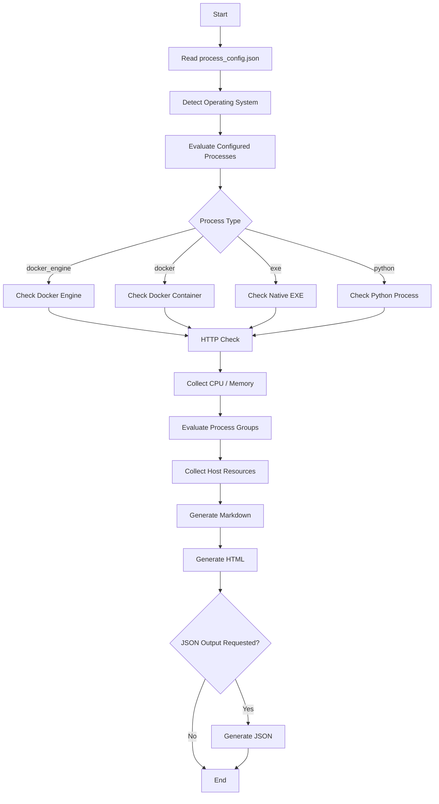

# Architecture and Execution Flow

## High-Level Workflow

The Process Health Report Generator follows the workflow below:



## Execution Stages

### 1. Load Configuration

The script reads:

```text
process_config.json
```

The configuration contains the processes, groups, HTTP checks, and FAQ definitions.

### 2. Detect Operating System

The script detects whether it is running on:

- Windows
- Linux

This is required because native process names can differ between platforms.

### 3. Evaluate Processes

Each configured process is evaluated according to its configured type.

```text
docker_engine → Docker Engine check
docker         → Docker container check
exe            → Native process check
python         → Python process check
```

### 4. HTTP Health Check

If an `http_check` is configured, the script attempts to determine the service port and performs an HTTP request.

### 5. Resource Collection

The script collects:

- CPU
- Memory
- Docker resource usage
- Host resource usage

### 6. Group Evaluation

Processes are grouped into logical application components.

The health of each group is calculated from the status of its members.

### 7. Report Generation

The tool generates:

```text
Markdown report
HTML report
Optional JSON status
```

## Complete Data Flow

```text
process_config.json
        |
        v
Read Configuration
        |
        v
Detect Operating System
        |
        v
Evaluate Processes
        |
        +--> Docker Engine
        |
        +--> Docker Container
        |
        +--> EXE Process
        |
        +--> Python Process
        |
        v
HTTP Health Check
        |
        v
CPU / Memory Collection
        |
        v
Evaluate Groups
        |
        v
Collect Host Resources
        |
        v
Generate Markdown
        |
        v
Generate HTML
        |
        v
Optional JSON
```