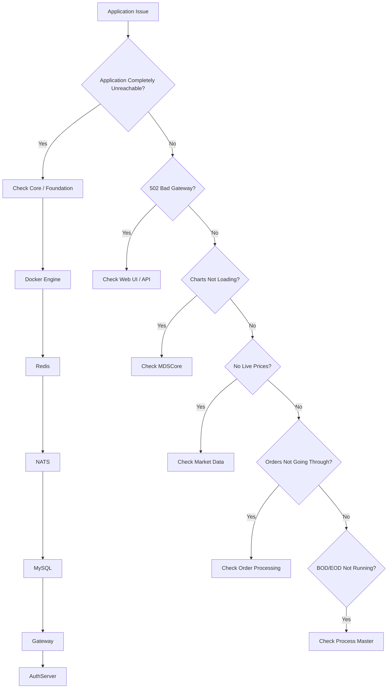

# Troubleshooting

## Overview

The troubleshooting FAQ is configuration-driven.

FAQ entries are defined under:

```text
faq
```

in:

```text
process_config.json
```

An FAQ entry can reference:

```text
check_ids
```

or:

```text
check_group
```

## Whole Application Unreachable

Check the Core / Foundation group:

```text
Docker Engine
Redis
NATS
MySQL
Gateway
AuthServer
```

## 502 Bad Gateway

Check the Web UI / API group:

```text
Trader Web
Admin Web
ApiApplication
ApiAdminApplication
```

## Charts Not Loading

Check:

```text
MDSCore
```

## No Live Prices

Check the Market Data group:

```text
Market Feed Service
MDAPI
MD Streaming
```

For NNF-specific market data issues, check:

```text
Blitz NNF
Blitz NNFCM
```

## Orders Not Going Through

Check:

```text
BlitzServer
RMS Validator
```

## BOD / EOD Not Running

Check:

```text
Process Master
```

## Troubleshooting Flow

